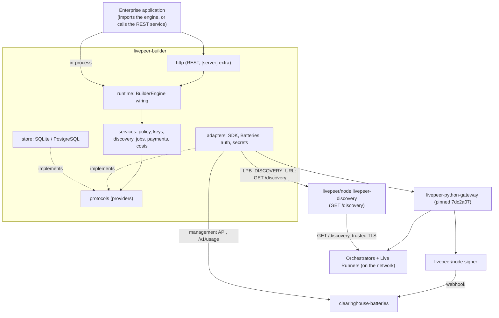

# Architecture

The engine sits between enterprise applications and existing Livepeer network and payment
components. It answers **what the network did and what it cost**; applications keep **who the
customer is and what they are charged**.

Diagrams for the components and the key flows (authentication, allotment, a paid job with
failover, cost sync, reconciliation, recovery) are in
[docs/design-docs/architecture-diagrams.md](docs/design-docs/architecture-diagrams.md). The database ER
diagram is generated into [docs/generated/db-schema.md](docs/generated/db-schema.md#entity-relationship-diagram). Class and
sequence diagrams of the interfaces and of the REST service are in
[docs/design-docs/interfaces-and-http-servers.md](docs/design-docs/interfaces-and-http-servers.md).

## Layers

Code depends only "forward" through these layers. `tests/structure/test_layers.py` enforces every
edge and prints how to fix a violation.

| Layer | Package | May import |
| --- | --- | --- |
| Utils | `utils.py` | nothing internal |
| Types | `contracts/` | nothing internal |
| Errors | `errors.py` | contracts |
| Providers | `protocols/` | contracts, errors |
| Facade | `api.py` (`ActorApi`, `WorkApi`, `ClearinghouseApi`, `EngineApi`) | contracts, errors, protocols |
| Config | `config.py` | contracts, errors |
| Service | `services/` | contracts, errors, protocols, config, utils |
| Repo | `store/` | contracts, errors, protocols, config, utils |
| Adapters | `adapters/` | contracts, errors, protocols, config, utils |
| App wiring | `runtime/` (`assembly.py` builds the parts, `engine.py` runs them) | everything above |
| Test doubles | `testing/` (`make_engine` builds a real engine) | everything `runtime/` may, plus runtime |
| UI | `http/` (`server.py` is the stock server's composition root and the only module that imports uvicorn; the routes are [two sets](#the-two-halves)) | runtime, api, contracts, errors, config |
| Entry points | `cli.py`, `docs_gen.py`, `docs_diagrams.py`, `__init__.py` | anything |

Services never touch a database, SDK or HTTP client directly: they receive protocol implementations
from the runtime. That is what lets an enterprise replace authentication, policy, secret storage,
discovery or transport **without patching core**.

`BuilderEngine` (and `FakeEngine`, for `ActorApi`) satisfies the facade Protocols structurally; mypy checks it through
`create_app(engine: EngineApi)` and `tests/structure/test_conformance.py`. The CLI, the stock
server import only the public API
(`tests/structure/test_public_api.py`). Importing the root or `api` loads no heavy dependency
(`test_import_weight.py`), and no module may import a DI container (`test_layers.py`).

## The two halves

The engine is one program with two halves, which meet at five payment ports (D84,
[guide](docs/design-docs/m4-guides/iss-31-payment-configurations.md#the-engines-two-halves)). The halves
live in `http/` and `services/`. Every module of the two is one half's or shared.

| | Work half | Clearinghouse half | Shared |
| --- | --- | --- | --- |
| Does | Network capabilities, runner choice, the runner call, streaming, job records, the cost of each job | Tenants, grants, allocations, payment keys, a tenant's access keys | Access, the operation ledger, health |
| Routes | `http/work.py` (`mount_work_routes`): `/v1/offerings`, `/v1/runners`, `/v1/jobs`, `/v1/costs`, `/v1/allowance`, `/v1/events`, `/v1/sessions`, and the engine's own access keys under `/v1/keys` | `http/clearinghouse.py` (`mount_clearinghouse_routes`): everything under `/v1/clearinghouse/tenants`, in two groups that also mount by themselves: a tenant's own routes (`mount_tenant_routes`) and what only a clearinghouse admin does (`mount_clearinghouse_admin_routes`, #165) | `http/app.py` (`shared_app`: the lifecycle, the error answers, the request limit, `/livez` and `/readyz`), `http/auth.py` |
| Facade | `WorkApi` | `ClearinghouseApi` | `EngineApi` is both |
| Services | `discovery`, `jobs`, `streams`, `failover`, `evidence`, `operations`, `admission`, `costs`, `reconciliation`, `usage_intake`, `usage_reports`, `request_identity`, `failure_codes`, `reserved` | `payments`, `payment_keys`, `tenants`, `grants`, `actor_writes` | `policy`, `keys`, `ledger`, `ownership`, `sightings` |

`create_app` mounts both sets of routes on one app. Each set is one function that adds its routes to an
app, so a deployment can serve one half: the role setting that chooses is #169.

The work half reaches payments through five ports and nothing else: signing inside `RunnerTransport`,
`CredentialResolver`, `AllocationManager`, `AllowanceReader` and `UsageSource`. An enterprise that uses a
payment clearinghouse runs the work half alone, with each port pointed at the clearinghouse (#168).
`tests/structure/test_two_halves.py` enforces the seam and prints how to fix a violation: no module of
one half imports the other, a work module names no payment protocol but the five ports, every protocol
is classified, and each set of routes is typed against its own half of the facade.

## Providers

Cross-cutting concerns enter only through `livepeer_builder.protocols`:

| Protocol | Default implementation | Replace it to… |
| --- | --- | --- |
| `Authenticator` | `ApiKeyAuthenticator`, and `JwtBearerAuthenticator` with `LPB_AUTH=jwt` (D45), in an `AuthenticatorChain` | use SSO, mTLS, another token scheme |
| `AccessPolicy` | `DefaultPolicy` (permissions + ownership) | add teams, org admins, RBAC |
| `SecretStore` | `RoutingSecretStore` (settings + Fernet-encrypted DB) | use Vault or a cloud secret manager |
| `DiscoverySource` | `HttpDiscoverySource` (`LPB_DISCOVERY_URL`, required) | read another service that serves the same contract, by wrapping the source through `decorate` ([contract](docs/contracts/discovery.md)) |
| `SelectionPolicy` | `MostCapacityFirst` | rank by price or latency |
| `RunnerTransport` | `SdkRunnerTransport` | add another network transport |
| `AllocationManager`, `UsageSource` | `BatteriesClient`, `BatteriesUsageSource` | use another payment provider |
| `EngineStore` (+ repos) | `SqlStore` | — (one store; two databases) |
| `EventFeed`, `SessionManager` | reserved (raise 501) | — events held in M3 (D60); sessions in M4 |

How to replace each default with an enterprise implementation, with class diagrams and runnable
examples, is in [docs/design-docs/extending-the-engine.md](docs/design-docs/extending-the-engine.md).

## Third-party boundaries

Each third-party package is confined to one module so a dependency change has one blast radius
(enforced by `tests/structure/test_layers.py`):

| Package | Only in |
| --- | --- |
| `livepeer_gateway` | `adapters/sdk.py`, `adapters/runner_call.py`, `adapters/signer_failures.py` |
| `aiohttp` | `adapters/runner_call.py`, `adapters/signer_failures.py` |
| `yarl` | `adapters/discovery_inventory.py`, `adapters/runner_address.py` |
| `httpx` | `adapters/batteries.py`, `adapters/jwt.py`, `adapters/sdk.py` |
| `jwt` (PyJWT) | `adapters/jwt.py` |
| `cryptography` | `adapters/secrets.py` |
| `sqlalchemy`, `alembic`, `aiosqlite`, `asyncpg` | `store/` |
| `fastapi`, `starlette` | `http/` |
| `uvicorn` | `http/server.py` |
| DI containers (`dishka`, `dependency_injector`, `injector`, …) | nowhere (decision 1) |

## Domains

| Domain | Service | Contract doc |
| --- | --- | --- |
| Access | `services/policy.py`, `services/keys.py`, `adapters/auth.py` | [access](docs/contracts/access.md) |
| Discovery | `services/discovery.py` | [engine](docs/contracts/engine.md#discovery) |
| Jobs | `services/jobs.py`, `services/admission.py` | [engine](docs/contracts/engine.md) |
| Payments | `services/payments.py`, `services/payment_keys.py` (keeping the key a command gets back), `services/tenants.py` (the tenant desk: onboarding, a tenant's grant and status), `services/grants.py` (the provider's idempotency keys and grant tag) | [payments](docs/contracts/payments.md) |
| Costs | `services/costs.py` | [payments](docs/contracts/payments.md#cost-classification) |
| Events, sessions | `services/reserved.py` | [events](docs/contracts/events.md), [engine](docs/contracts/engine.md#persistent-sessions) |
| Persistence | `store/` | [persistence](docs/contracts/persistence.md) |

## Integration modes

- **Imported:** `engine = await BuilderEngine.create(settings, supply=..., decorate=...)`, typed as
  `ActorApi` where it only runs jobs; the application authenticates its own users and passes an
  `ActorContext`. The `AccessPolicy` still applies. Walkthrough:
  [docs/guides/embedded-mode.md](docs/guides/embedded-mode.md).
- **Service:** `lpb serve` runs the same engine behind REST. Requests are authenticated by the
  authenticator chain. Admin routes need an admin credential: every clearinghouse route, and in the
  work set the key routes, reconciliation and cost sync. A clearinghouse admin is an admin of every
  tenant and a tenant admin of its own ([access](docs/contracts/access.md#defaultpolicy)). A customized service calls
  `livepeer_builder.http.server.serve` (or `build_app`, to mount it elsewhere) with its own parts
  and routes: [extending-the-engine.md](docs/design-docs/extending-the-engine.md#service-mode).

Both modes run the same release and the same code paths.
