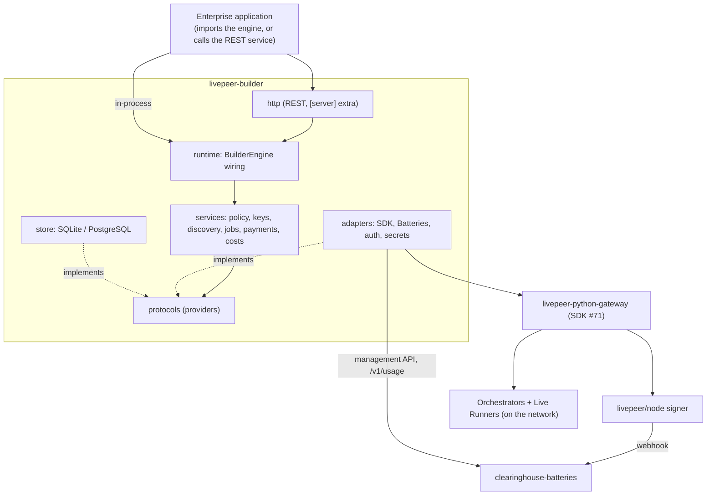

# Architecture

The engine sits between enterprise applications and existing Livepeer network and payment
components. It answers **what the network did and what it cost**; applications keep **who the
customer is and what they are charged**.

Diagrams for the components and the key flows (authentication, provisioning, a paid job with
failover, cost sync, reconciliation, recovery) are in
[docs/design-docs/architecture-diagrams.md](docs/design-docs/architecture-diagrams.md). The database ER
diagram is generated into [docs/generated/db-schema.md](docs/generated/db-schema.md#entity-relationship-diagram).

## Layers

Code depends only "forward" through these layers. `tests/structure/test_layers.py` enforces every
edge and prints how to fix a violation.

| Layer | Package | May import |
| --- | --- | --- |
| Utils | `utils.py` | nothing internal |
| Types | `contracts/` | nothing internal |
| Errors | `errors.py` | contracts |
| Providers | `protocols/` | contracts, errors |
| Config | `config.py` | contracts, errors |
| Service | `services/` | contracts, errors, protocols, config, utils |
| Repo | `store/` | contracts, errors, protocols, config, utils |
| Adapters | `adapters/` | contracts, errors, protocols, config, utils |
| Test doubles | `testing/` | contracts, errors, protocols, utils |
| App wiring | `runtime/` | everything above |
| UI | `http/` | runtime, contracts, errors, config |
| Entry points | `cli.py`, `docs_gen.py`, `__init__.py` | anything |

Services never touch a database, SDK or HTTP client directly: they receive protocol implementations
from the runtime. That is what lets an enterprise replace authentication, policy, secret storage,
discovery or transport **without patching core**.

## Providers

Cross-cutting concerns enter only through `livepeer_builder.protocols`:

| Protocol | Default implementation | Replace it to… |
| --- | --- | --- |
| `Authenticator` | `ApiKeyAuthenticator` in an `AuthenticatorChain` | use SSO, mTLS, enterprise JWTs |
| `AccessPolicy` | `DefaultPolicy` (permissions + ownership) | add teams, org admins, RBAC |
| `SecretStore` | `RoutingSecretStore` (settings + Fernet-encrypted DB) | use Vault or a cloud secret manager |
| `DiscoverySource` | `SignerDiscoverySource` / `StaticDiscoverySource` | read a registry or URL list |
| `SelectionPolicy` | `MostCapacityFirst` | rank by price or latency |
| `RunnerTransport` | `SdkRunnerTransport` | add another network transport |
| `AllocationManager`, `UsageSource` | `BatteriesClient`, `BatteriesUsageSource` | use another payment provider |
| `EngineStore` (+ repos) | `SqlStore` | — (one store; two databases) |
| `EventFeed`, `SessionManager` | reserved (raise 501) | — implemented in M3 / M4 |

## Third-party boundaries

Each third-party package is confined to one module so a dependency change has one blast radius
(enforced by `tests/structure/test_layers.py`):

| Package | Only in |
| --- | --- |
| `livepeer_gateway`, `aiohttp` | `adapters/sdk.py` |
| `httpx` | `adapters/batteries.py` |
| `cryptography` | `adapters/secrets.py` |
| `sqlalchemy`, `alembic`, `aiosqlite`, `asyncpg` | `store/` |
| `fastapi`, `starlette` | `http/` |

## Domains

| Domain | Service | Contract doc |
| --- | --- | --- |
| Access | `services/policy.py`, `services/keys.py`, `adapters/auth.py` | [access](docs/contracts/access.md) |
| Discovery | `services/discovery.py` | [engine](docs/contracts/engine.md#discovery) |
| Jobs | `services/jobs.py`, `services/admission.py` | [engine](docs/contracts/engine.md) |
| Payments | `services/payments.py` | [payments](docs/contracts/payments.md) |
| Costs | `services/costs.py` | [payments](docs/contracts/payments.md#cost-classification) |
| Events, sessions | `services/reserved.py` | [events](docs/contracts/events.md), [engine](docs/contracts/engine.md#persistent-sessions) |
| Persistence | `store/` | [persistence](docs/contracts/persistence.md) |

## Integration modes

- **Imported:** `engine = await BuilderEngine.from_settings(...)`; the application authenticates its
  own users and passes an `ActorContext`. The `AccessPolicy` still applies.
- **Service:** `lpb serve` (or `create_app(engine)`) runs the same engine behind REST. Requests are
  authenticated by the authenticator chain. Admin routes need an admin credential.

Both modes run the same release and the same code paths.
