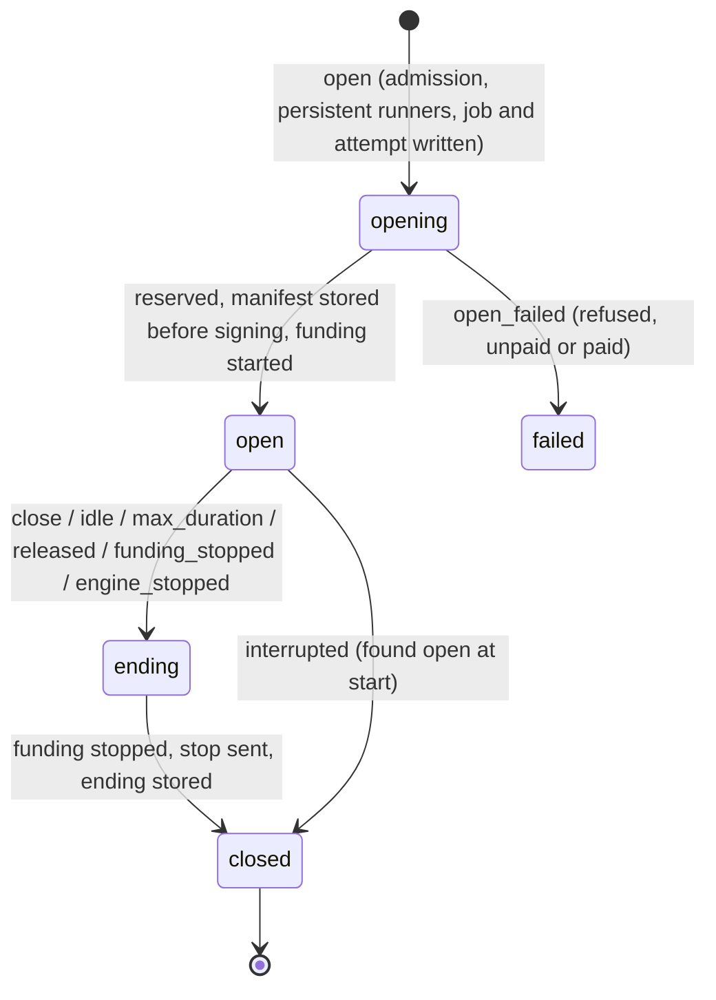

# Media work on builder-core: sessions, media and the payment plane

- **Date:** 29 October 2026; revised the same day to match the M3, M4 and M5 implementation guides and
  the no-upstream rule.
- **Status:** a cross-cutting map, not a decision record. Each item lives in a guide (or is marked
  unscheduled); the guide is where it is designed, questioned and locked with Mike and John.
- **Question:** what do the media requests need, how do they map onto the milestones, and which designs
  are still missing?
- **Inputs:**
  - builder-core [#73](https://github.com/NE-Build-Track/livepeer-builder-core/issues/73) (media outputs and
    realtime sessions) and [#68](https://github.com/NE-Build-Track/livepeer-builder-core/issues/68) (x402
    payment-provider boundary).
  - Mux replacement (`livepeer-mux-concept`): `builder-core-session-requirements.md` (R1–R17) and
    `sdk-session-issue-drafts.md` (S1–S3).
  - Media runners (`livepeer-media-runners`): `builder-core-change-request.md` (CR-1–CR-9),
    `node-change-request.md` (N1, N2), `session-lifecycle.md` (gaps G1–G13).
- **Verified against:** builder-core `releases/m3` at `d3df806`; SDK `livepeer-python-gateway` `2017a80`;
  livepeer/node `406b248` (our pin); clearinghouse-batteries `ca09e47` (our pin). Some node facts below were
  first read at `e75e5b6`, a branch on the NE-Build-Track fork; they are marked where the pin differs.

## Ground rules this plan follows

1. **No upstream changes.** We never open a PR, issue or change request against `livepeer/*`
   (node, the SDK, Batteries), and no work here waits for one. SDK gaps are closed by vendoring into
   builder-core with a fingerprint in `tests/unit/test_sdk_contract.py` (D53, #61). Node and Batteries
   behavior cannot be vendored: it is pinned, and the engine contains its gaps. The one exception is #72:
   after the private security report, John closed it as not planned (the SDK owns renewal and refresh)
   and the fix is tracked upstream as livepeer-python-gateway#87. builder-core takes it through a future
   SDK pin bump and owns no funding loop.
2. **Milestones do not move.** M3's gate comes first. Sessions are ISS-27 (M4). Nothing here rides M3
   without Mike's agreement.
3. **Guides are where design happens.** This plan points to them and lists what no guide covers yet.

## Bottom line

1. **All four inputs ask for the same two things:** a funded reservation held for minutes to hours (a
   *session*), and a request path that copes with media-sized inputs and outputs. They disagree on one
   point: **who carries the media bytes**.
2. **M4 ships one delivery: the engine proxies.** ISS-27 makes a session a job holding one paid
   reservation; clients see only `proxy_path`, which carries HTTP, SSE and WebSocket frames. That covers
   #73's realtime speech-to-text and the media-runners team's audio relay (CR-1.3). Handing out channel URLs
   (`direct`, what the Mux team needs for video, R2) is **later**: on node today, `app_url` lets its holder
   use and stop the paid reservation with no other credential, and we cannot change node.
3. **The payment plane stays as it is.** The engine owns the paid request (D53); renewals stay the SDK's
   `run_payments()` (#72 moved upstream as livepeer-python-gateway#87). ISS-27 adds an engine-owned
   reserve over the same `PaidRequest` and reads the funding loop's result instead of dropping it
   (`True` = released). That is S1 done inside the engine; S2 (richer funding outcomes) is what the SDK
   loop gives: released or not. No authorizer and reservation-client refactor is needed.
4. **Two of the draft's risks are smaller at our pins than it said.** A 480 refresh keeps the manifest
   *and* the signer state, so one engine session stays one Batteries payment session (verified by
   reading; confirm in the ISS-27 live run). Batteries' accounting-lag gate is not in our pin; it arrives
   with Batteries #40 and becomes a pin-bump review item.
5. **The rest is unscheduled.** Selection and admission (CR-2), large bodies and `MediaStore`, usage
   observers, the client wheel, and the Mux team's small job items (R12, R14, R16, R17) have no tracker
   yet. They need a ticket and Mike's placement (Section 7).
6. **Several asks are already done or stale.** The requests were written against builder-core `0d0b532`
   and `e943e370`; D53, D54 and D56 have since closed CR-8.1 and much of CR-4, CR-5 and R4. Both teams
   should re-pin to `d3df806` and SDK `2017a80` before their asks are reviewed.

## 1. What is being asked

| Source | Asks for | Its view of media |
| --- | --- | --- |
| #73 (eliteprox) | fal-style alias routes; per-message and realtime WebSockets; the engine as the Trickle client; `delivery: "direct"`; socket tokens for browsers; CORS; `MediaStore` and file objects; a `livepeer-client` wheel | The engine relays by default; direct capability URLs as an option |
| #68 (eliteprox) | Split the media plane from the payment plane behind an x402-style provider; a caller-owned `payment_intent_id`; delivered and failed fees first-class on the cost contract | Not about media; about who owns payment state |
| Mux replacement (R1–R17, S1–S3) | An in-process `SessionHandle`; hours-long lifetimes; evidence before `open` returns; funding state and `ended()`; classified endings; restart recovery; separate admission; selection hints; cost while open; spend cap; labels; session events; a longer job ceiling; the caller marking a delivered job failed (R16); find a job by `operation_ref` (R17) | **Never through the engine.** Video moves over Trickle between their media bridge and the orchestrator |
| Media runners (CR-1–CR-9, N1–N2, G1–G13) | The same handle plus `websocket()` and `close(grace_s)`; generic selection and admission; 3 KiB metadata; bodies beyond 8 MiB; faithful responses and sinks; usage observers; long jobs and cancel by ID; payment intent for sessions; typed events with spans | **Audio through the engine**, one WebSocket per session, so it can apply backpressure, measure idle and feed usage observers |

The S1–S3 and N1–N2 drafts are written as upstream requests. builder-core will not file them or depend
on them: S1 and S2 are done in the engine (Section 3.2); S3 needs the signer and stays open; N1, N2 and the
runner-side gaps (G5–G8) are for the runner teams to work around in their own runners.

### Already done, or stale, at `d3df806`

| Ask | State now |
| --- | --- |
| CR-8.1: land PRs #55 and #56 on one SDK commit | **Moot.** D54 superseded #56; D56 rebuilt #55 on upstream `2017a80`. No fork pin remains |
| R4 / CR-1.6: the manifest on record before the signer is asked | **Done for jobs** (D54). ISS-27 extends it to the reserve. A refresh keeps the manifest, so refreshes need no new evidence row |
| CR-5.1: JSON that is not an object passes through | **Done on the engine's own call** (D53) |
| CR-5.3: runner errors reach buffered callers | **Done** (D56, `return_http_errors`) |
| CR-4: bytes bodies | **Done up to 8 MiB** (D56). Files, iterators and streamed REST uploads remain |
| CR-5.2: response headers on buffered results | **Open.** `RunnerStream` has headers; `JobResult` does not |
| Pins | Mux pins `e943e370`; media runners pin builder-core `0d0b532` (pre-D56) and SDK fork `cd6ed5e`. Both should move to `d3df806` and upstream `2017a80` |

### Facts from the code that shape the design

**SDK (`2017a80`):**

- The funding loop (`remote_signer.py:175-197`) stops silently on a 4xx other than 408 and 429, retries
  5xx and network errors forever, and reads any 404 as "released". Renewals and refreshes follow
  redirects (#72, fixed upstream by livepeer-python-gateway#87, not yet in our pin). builder-core starts
  this loop and drops its outcome (T17); `True` from it means released.
- A 480 refresh calls `_refresh_payment_params`, which swaps only `payment_params` and keeps the challenge's
  manifest and `_state`, so the signer's `StateID` survives the refresh.
- `reserve_session` runs its own discovery, pays the next runner after a paid failure, has no hook before
  signing, and starts `run_payments` itself, so it cannot keep D54, D52/D55 or D43. ISS-27 vendors only its
  response parsing and `stop_runner_session`.
- No WebSocket client. The Trickle modules need PyAV, which the package already imports.
- Runner side: heartbeat outcomes are only logged (G5); the heartbeat session list is ignored (G6); status
  is fixed at `ready`, so no drain (G7).

**livepeer/node (`406b248` unless marked):**

- A paid reserve answers `{session_id, app_url, control_url}`; `session_id` is the challenge's
  `manifest_id`. Capacity 503 comes **after** signing, so it is a paid refusal (D52).
- `RefreshChallenge` (`orchestrator/payment_engine.go:143`) reissues the challenge for the **same
  manifest**. The signer keeps the `StateID` it is sent (`signer/service.go:396-412`).
- **`POST {control_url}/stop` has no authorization**, and `session_id` is inside `app_url`: whoever holds
  `app_url` can use the paid reservation and stop it.
- After a release, payment and proxied requests answer 404. A proxied 404 can also mean the runner is
  briefly unusable while node keeps charging, so only a **payment** 404 means "released". Nothing says who
  released (G2).
- The proxy keeps HTTP, SSE and WebSocket semantics. Proxy and Trickle traffic share **256 slots per
  orchestrator**.
- Trickle channel URLs are unauthenticated for read, publish **and delete**.
- Per the first read at `e75e5b6`: the first payment buys about 10 s; node charges whole seconds on a 1 s
  tick and releases about 1 s after credit runs out. That leaves roughly two missed 3 s renewals.
  Recheck at `406b248` in ISS-27's harness tests.
- `runner_id` in discovery exists only on the NE fork branch (`e75e5b6`, "Expose runner identity in
  orchestrator discovery"). Public orchestrators do not publish it, so no design may require it.

**clearinghouse-batteries (`ca09e47`):**

- Payment sessions are keyed by the signer's `state_id` (`internal/store/auth.go:83,130`). Because a refresh
  keeps the state, one engine session maps to one Batteries payment session for as long as the engine
  keeps the same `LivePaymentSession`. That holds as long as the engine does not restart funding with a fresh
  state.
- Authorization does not reserve balance: balance moves only when accounting ingests the ticket, and
  negative balances are allowed. Concurrent sessions on one allocation can overspend.
- Usage rows carry the orchestrator's `manifest_id` and a signer-random `request_id`, nothing from the
  caller. `/v1/usage` has no session or time filter.
- **Not at our pin:** Batteries #40 (`d47d1ff`, after `ca09e47`) refuses every payment with 503 while
  accounting lags more than `MaxKafkaLag` (default 60 s), with no grace for running sessions. With about
  10 s of credit, that would end every live session. It is a reason to review any Batteries pin bump
  carefully, not a risk today.

**builder-core (`d3df806`):**

- **Bug P1:** the job path ignores `Runner.mode`, so `POST /v1/jobs` to a persistent app reserves a paid
  session and hands the caller `app_url` and `control_url` (ISS-27).
- uvicorn access logs are on (`http/server.py:56`), so a `?token=` on a WebSocket URL would be logged.
- uvicorn is installed without `websockets` or `wsproto`, so the server cannot accept an upgrade yet.

## 2. Categories of change

| # | Category | Covers | Where it is designed |
| --- | --- | --- | --- |
| C1 | **Session lifecycle** | Open, limits, idle, endings, recovery, engine stop, session admission | ISS-27 (M4) |
| C2 | **Payment plane** | Funding outcomes from the SDK loop, engine-owned reserve, cost rules for sessions | ISS-12 (M3), ISS-27 and ISS-28 (M4); #72 upstream |
| C3 | **Media plane** | Proxy and WebSocket relay; later `direct` grants and a Trickle bridge | ISS-27 for the proxy; the rest unscheduled |
| C4 | **Request and response shape** | Bodies beyond 8 MiB, sinks, response headers, `MediaStore`, stored results | ISS-26 for stored results; the rest unscheduled |
| C5 | **Admission and selection** | Selection request, metadata envelope, approvals, hints, 3 KiB metadata | Unscheduled; amends D32 |
| C6 | **Usage and observability** | Usage observers, typed events, listeners, the durable feed, spans, metrics | Feed held (M3 decision, item 4); the rest unscheduled |
| C7 | **Access and client surface** | Socket tokens, CORS, `Key` scheme, alias routes, the client wheel | Unscheduled; aliases follow ISS-29, the wheel goes with #25 |
| C8 | **Job ergonomics** | Labels, find by `operation_ref`, deadline ceilings, cancel, caller verdict | ISS-26 Q3 (cancel a queued job); the rest unscheduled |
| C9 | **Upstream gaps, contained** | What node, the SDK and Batteries do that we cannot change | Every guide's "Upstream dependencies" section; Section 6 here |
| C10 | **Cross-team contracts** | Ending names, close codes, metadata envelope, `Livepeer-Usage`, pins | ISS-27 (client endings); the rest with the product teams |

## 3. Target design

### 3.1 A session is a job that holds a reservation (ISS-27)

The reserved contract already makes a session a job (`Session.job_id`); keep that, so attempts, payment
evidence, cost sync and cost reads all apply unchanged.

ISS-27's proposal, in short:

- **Open:** permission (Q3) → session admission (`LPB_MAX_SESSIONS`, per actor), refused before payment →
  persistent runners only → engine-owned reserve over `PaidRequest` (D53/D54 before signing, origin check,
  no redirects) → `{session_id, app_url, control_url}`. Paid refusals fail over under D52/D55. A paid reply
  missing a field gets a best-effort stop and `failed_after_payment`.
- **Traffic:** `ANY /v1/sessions/{id}/app/{path}` forwards HTTP and SSE, and relays a WebSocket frame for
  frame with bounded queues. The engine injects no frames of its own; the ending is a close code (Q2).
- **Endings:** `closed`, `idle`, `max_duration`, `released`, `funding_stopped`, `engine_stopped`,
  `interrupted`, `open_failed`. Only a payment 404 is `released`.
- **Secrets:** `app_url` stays in memory; `control_url` goes to the `SecretStore` for the stop after a
  restart; neither is on a record or in a log. Non-admin job reads redact `manifest_id` (Q6), because an
  auditor reads every job in its application.
- **Restart and stop:** an open session found at start makes its job `uncertain` and gets a best-effort
  stop; `engine.stop()` closes sessions after `LPB_SESSION_DRAIN_TIMEOUT_S`.

The in-process handle the Mux team (R1) and the media-runners team (`websocket()`, `close(grace_s)`) ask
for sits on the embedded `SessionManager`. Its exact surface is part of ISS-27's review; the REST shape
above is the floor.

### 3.2 The payment plane (ISS-12, ISS-27, ISS-28)

| Piece | Guide | Does |
| --- | --- | --- |
| The SDK's `run_payments()` | — (upstream) | Renewals every 3 s. Its result is read, not dropped: `True` = released, `False` = stopped on another 4xx (and on a 3xx once the pin includes #87); 5xx and network errors are retried each cycle |
| T17 | ISS-28 (M4) | A stream that ends after a release ends `uncertain`, from the loop's result |
| `Failure.reason` | ISS-12 (M3) | `not_authorized`, `allowance_exhausted`, `signer_unavailable`, `signer_unknown`; engine-written messages, no signer URL or upstream text |
| Engine-owned reserve | ISS-27 (M4) | `adapters/reservation.py` over `PaidRequest`; vendored response parsing and stop, fingerprinted |

Renewals reuse the stored manifest and are **not** evidence writes; a refresh keeps the manifest, so no new
`SignedSession` row. Reading the loop's result closes T17 for sessions.

**Open in ISS-27 (Q8):** the SDK loop retries failed renewals until node releases the session (about two
missed 3 s renewals), so the ending is `released`. Accept that, or ask for richer funding outcomes
upstream beside #87. An engine-owned loop is ruled out by #72's closing note.

**Accepted risk until the pin includes #87:** metered renewals and refreshes follow redirects. The paid
orchestrators come from the deployment's own list or on-chain directory.

**Not pursued (need upstream changes):**

- A caller-owned correlation id on Batteries usage rows (#68's stage 1), which needs node's signer to carry
  it and Batteries to store it. Instead, matching stays manifest-based; T16 (match within the attempt's time
  window) is the engine-side improvement.
- Two-phase settlement, a node protocol change.
- Balance holds in Batteries. A spend cap (R11), if adopted, is an engine estimate from the advertised
  rate, labelled as one.

ISS-31 records #68's x402-style provider as longer-term research, not M4.

### 3.3 How media moves

| Delivery | Who carries the bytes | For | When |
| --- | --- | --- | --- |
| **Proxy** (`proxy_path`: HTTP, SSE, WebSocket) | The engine | `/start`, `/stop`, configuration; realtime audio and text (#73's STT, media runners' CR-1.3); browsers through a relay | **ISS-27, M4** |
| **`direct`** (the owner gets channel URLs) | The client, over Trickle or the runner's socket | Video (Mux live transcode) | **Later.** Needs a D9 amendment Mike accepts. On node, a grant of `app_url` is a grant of the paid reservation, and Trickle URLs allow delete. Embedded callers first, if at all |
| **Engine Trickle bridge** | The engine, MPEG-TS-sized | Clients that cannot speak Trickle | Only when a real client needs it |

Rules that hold across all three:

- Delivery is an attachment, not a session type: funding, limits, endings and cost are identical.
- Any URL a runner returns is accepted only on the runner's orchestrator origin (or a configured media
  store), as `payment_url` is today.
- The relay shares one host's bandwidth (one engine process per database). Cap it before payment; video
  belongs in `direct`.

**What this means for the Mux team:** their live video alpha needs `direct` (R2), which ISS-27 does not
deliver in M4. Mike should decide whether `direct` for embedded callers joins ISS-27, gets its own ticket,
or waits. Section 7, item 1.

### 3.4 Endings and cost

- **Endings** are ISS-27's list (Section 3.1). The draft's `released_by: runner | orchestrator | unknown`
  is worth raising in ISS-27's review. Node never says who released, so today it would always read
  `unknown`.
- **Job state after a session:** `succeeded` for an orderly ending of an opened session, `uncertain` for
  `interrupted` and an upstream drop after payment, `failed` before payment (ISS-27).
- **Cost:** one session = one job. `pending` while open, then projected like any job. Spend while open is
  `delivered`; a paid reserve that never opened is `failed_after_payment` (D52).
- **Matching (ISS-27 Q7):** `store/matching.py` treats more than one Batteries session per
  `(allocation_id, manifest_id)` as `ambiguous`. At our pins a refresh keeps the signer state, so a session
  should stay one Batteries session; the live run confirms it. If it does not, the rule must accept several.
- **Volume:** one payment every 3 s is about 1,200 usage rows an hour per session. Cost sync, retention
  (ISS-35's R1 and R2) and cost reads of open sessions all scale with it.
- **Caller verdict (R16):** unscheduled. If adopted, a `failed` verdict moves delivered fees out of
  `billable` and leaves `fees` unchanged (D38: "done" comes from the caller or the runner).

### 3.5 Admission and selection (CR-2, R9): unscheduled

Proposal to carry into a ticket:

- **One `SelectionRequest`** built from a job or session request, through a new method beside
  `SelectionPolicy.order` with a default that calls the old one, so integrators' policies keep working (the
  D33 precedent).
- **A generic metadata envelope parsed at the boundary.** Unparseable or oversize metadata (over 3 KiB)
  makes a runner ineligible and never fails a refresh. This **amends D32**: the engine reads the envelope
  but never interprets attribute values.
- **Admission by envelope and approvals is opt-in per app**, because runners publish several metadata
  shapes and ChatLPT works today without one.
- **`ApprovalSource`** keys approvals on what public orchestrators publish: orchestrator address, runner
  URL, app, `deployment_revision`, endpoint, expiry. Runner IDs are accepted when present, never required.

### 3.6 Bodies, outputs, events and client surface: unscheduled

- **Bodies and outputs:** `BodySource` (bytes, seekable file, async iterator) checked against the engine
  cap and the runner's limit before payment; response sinks and `response_too_large`; a `MediaStore` port
  (`none`, `s3`) that ISS-26's stored results can later use through `ResultRef.storage="stored"`.
  Capability URLs are minted on read, never stored or logged.
- **Events:** the durable feed is held by the M3 decision (item 4). When the hold lifts, build one
  internal stream of typed events that both the durable feed (an outbox) and in-process listeners read,
  so they cannot drift. No event carries a body, URL, IP address or token.
- **Client surface:** alias routes map onto the same requests and add no behavior (ISS-29). Socket
  tokens (at most 300 s, scoped, socket routes only), `LPB_CORS_ORIGINS` and the `Key` scheme come with
  browser use. The `livepeer-client` wheel is decided with #25.

## 4. How it fits builder-core's architecture

Nothing needs a new layer; the rules in `tests/structure/` stay. For M4 (ISS-27):

| Layer | Adds or changes |
| --- | --- |
| `contracts/` | `sessions.py` (moved from `reserved.py`, re-exported): `SessionEnding`, `Session.ending`; `ExecutionMode` gains `session` |
| `protocols/` | `SessionManager.get/list_sessions/close`; optional `ReservationTransport` beside `RunnerTransport` (like `StreamingRunnerTransport`, D33) |
| `adapters/` | `runner_call.py` (keep the funding loop's result); `reservation.py` (reserve, proxy HTTP and WebSocket, stop) |
| `services/` | `sessions.py` (state machine, watchers, endings, recovery, drain); jobs skip persistent runners (P1) |
| `store/` | Migration `0009`, `lpb_sessions`; a matching change only if Q7 needs it |
| `http/` | `sessions.py`: open, get, list, close, `ANY` + WebSocket on `/v1/sessions/{id}/app/{path}` |
| `runtime/` | Supervises per-session tasks; drains on stop |
| `testing/` | `ScriptedReservations`; `FakeEngine` sessions with a parity test; loopback harness with node's persistent routes |

Third-party boundaries: `aiohttp` and `livepeer_gateway` also allowed in `adapters/reservation.py`;
`websockets` (or `wsproto`) joins the `[server]` extra. Unscheduled work would add S3 and OpenTelemetry
adapters, each confined to one module.

## 5. Architecture impacts

1. **The engine holds state for hours.** Every deploy or crash of the one engine process ends every
   session, and funding lives in that process. Products must drain to replacement sessions before a planned
   restart. Funding that survives a restart (R15, S3) needs the signer and stays an open question.
2. **One process per database becomes a product limit:** relay bandwidth and session count are one host's.
3. **D9 changes in wording only for M4** (proxy only; owner-redacted manifests). Handing out capability
   URLs is a separate, later security decision.
4. **Evidence and cost volume grow** (Section 3.4); renewals must not be evidence writes.
5. **Funding becomes an availability dependency:** a session lives only while the signer and Batteries
   answer within the credit window, and while the orchestrator (which holds sessions in memory) stays up.
6. **Orchestrator capacity is shared:** a relayed session holds one of 256 proxy slots for hours.
7. **Extension protocols are integrator-implemented:** add beside `SelectionPolicy` and `SessionManager`;
   never change their signatures in place.
8. **The vendored SDK copy grows** (T18): the reserve parsing and the stop each get a
   fingerprint.

## 6. Repositories affected

| Repository | Changes |
| --- | --- |
| **livepeer-builder-core** | Everything in Sections 3–4 |
| **livepeer-python-gateway** | **None from us.** Vendored pieces: the reserve parsing, `stop_runner_session`. #72's fix arrives upstream (#87) with a pin bump |
| **livepeer/node** | **None.** Contained engine-side: unauthenticated stop and `app_url` as a bearer key (proxy only, secrets off records, redaction); no release reason (only a payment 404 is `released`); oversized `/discovery` answers drop a whole orchestrator (the 3 KiB envelope limit, when built). Pin stays `406b248`; a bump is its own review |
| **clearinghouse-batteries** | **None.** No holds (spend cap is an engine estimate); no caller id on usage rows (T16 window matching); the #40 lag gate is a pin-bump review item |
| **livepeer-mux-concept** | Re-pin to `d3df806`; use the embedded `SessionManager`; drain before deploy; S1–S3 are answered by the engine, not upstream |
| **livepeer-media-runners** | Re-pin (builder-core `d3df806`, SDK `2017a80`); drop CR-8.1; runner-side gaps (G5–G8, N1) are theirs to work around |
| **inference-gateway** | Moves `NativeSelection` onto the CR-2 policy, once that is built |
| **runner-app-examples** | `realtime-transcription` as ISS-27's representative runner; `echo` (Trickle) for later work |

## 7. Order of work and what needs placing

| When | Work | Guide |
| --- | --- | --- |
| **M3** | Idempotency (incl. 409 on a repeated `operation_ref`); ISS-12 failure reasons; discovery forward-compatibility | [m3-guides](m3-guides/index.md) 1, 4, 8 |
| M3, if Mike agrees | ISS-27's P1 fix (jobs skip persistent runners), with its regression test | ISS-27 slice 1 |
| **M4** | ISS-27 slices 2–5: reserve adapter, `SessionService`, REST and HTTP/SSE proxy with redaction, WebSocket relay and live evidence on `realtime-transcription` | [ISS-27](m4-guides/iss-27-persistent-endpoints.md) |
| M4 | ISS-26 (async, stored results), ISS-28 (session endings in the recovery table), ISS-29 (error `code`, aliases if adopted), ISS-35 (retention under session volume) | [m4-guides](m4-guides/index.md) |
| **Needs a ticket and Mike's placement** | (1) `direct` delivery for embedded callers (the Mux alpha); (2) R12 labels, R14 job ceiling, R16 caller verdict, R17 `jobs.find`; (3) CR-2 selection and admission, CR-3; (4) bodies, sinks, `MediaStore`, CR-5.2 headers; (5) usage observers and events, after the feed hold lifts; (6) socket tokens, CORS, `Key`, the client wheel with #25 | — |
| Not planned | Engine Trickle bridge until a client needs it; resumable funding (R15, S3); caller-owned correlation and two-phase settlement (upstream changes) | — |

## 8. Answers the teams are waiting on

Recommendations until the guides are locked.

| Question | Recommended answer | Where it locks |
| --- | --- | --- |
| Mux Q1: a session that lost its runner after an hour | Spend is `delivered`; ending `released` | ISS-27 |
| Mux Q2: `engine.stop()` and open sessions | Closed after a drain window | ISS-27 |
| Mux Q3: repeated `operation_ref` on `open` | 409 `OperationExists`, like jobs (`OperationInProgress` while the first is running) | ISS-11/14, ISS-27 Q5 |
| Mux Q4: `funding_failed` threshold | Open: two failed renewals vs retry until node releases | ISS-27 Q8 |
| Mux Q5 / media runners Q4: milestone | Sessions with proxy delivery in M4 (ISS-27). `direct` for video is not yet placed | ISS-27; Section 7 |
| Mux S1–S3 | S1 done in the engine; S2 is the SDK loop's released-or-not result; S3 open; nothing filed by us | ISS-27 |
| Media runners Q1: 2 s cancel bound | Fine for closing the upstream connection; the runner's stop bound is theirs | — |
| Media runners Q2: `header.v1` in builder-core | Yes in principle (it reads a header, not a body); unscheduled | Section 7 |
| Media runners Q3: approval wildcards | No; the dev stack writes a file approval source | Section 7 |
| G1–G4 | Settled by ISS-27's endings and stop rules | ISS-27 |
| G5–G8 | Runner-side; the runner teams work around them | — |
| G9, G10, G12, G13 | The media-runners team's own decisions | — |
| G11 | Advertise the idle timeout in the envelope's `endpoints` | Section 7 (CR-2) |
| #73 Q1: alias path split | An explicit separator (`/v1/run/{app}/-/{path}`) if aliases are adopted | ISS-29 |
| #73 Q2: Trickle setup | Declared in the envelope's `endpoints`, not inferred | Later |
| #73 Q3: `direct` billable | Yes, the same rule as every session | Later |
| #73 Q4: realtime apps on the network | Not answered by code: query live discovery | ISS-27 Q4 |

## 9. Other things to consider

- **Security.** Capability URLs are bearer secrets: never logged, never stored, minted on read; a
  structural test scans for them. Socket tokens in query strings reach access logs, so redact them or turn
  the access log off on socket routes. Runner-returned URLs are an SSRF path: allow the orchestrator origin
  and the media store only. Browsers cannot verify self-signed orchestrators (D27) and orchestrators send no
  CORS headers, so browsers go through the proxy.
- **Money.** Batteries holds no balance, so concurrent sessions can overdraw. A failed transcode is
  billable until something like R16 lands.
- **Privacy.** In proxy delivery, customer audio passes through engine memory. Say so in `SECURITY.md`.
- **Version drift.** Several pins of builder-core and the SDK are in play across the product teams.
  Re-pin before review, and run one funded acceptance on the combination you ship.
- **Shared names.** Client ending names belong in builder-core's contract (ISS-27). Runner endings,
  close codes and `Livepeer-Usage` belong in a contract both product teams cite.
- **Operations.** Deploys end sessions: runbooks, drain tooling, `/metrics` (T4) and alerts on funding
  stops.
- **Testing.** Virtual-clock soaks for hours-long sessions; chaos cases (kill the engine, restart the
  orchestrator, stall the signer); a funded live run that reconciles a long session's cost.
- **Hourly pricing reaches jobs too.** The Mux team prices VOD by the hour, so streamed jobs are metered
  and funded today. Its redirect fix (#87) matters before sessions exist.

## 10. Traceability

| Item | Category | Guide or placement | State at `d3df806` |
| --- | --- | --- | --- |
| #72 renewals and refreshes follow redirects | C2 | Upstream (livepeer-python-gateway#87); SDK pin bump | #72 closed as not planned |
| T17 funding outcome dropped | C2 | ISS-28 (streams), ISS-27 (sessions) | Open |
| P1 jobs reserve persistent runners | C1 | ISS-27 slice 1 | Open bug |
| #73 P1 alias routes | C7 | ISS-29, if ISS-27 adopts them | Open |
| #73 P2 engine relays frames | C3 | ISS-27 | Open |
| #73 P3 `direct` and D9 | C3 | Needs placement | Open |
| #73 P4 engine-owned reserve | C2 | ISS-27 | Open |
| #73 P5 Trickle client | C3 | Not planned | Open |
| #73 P6–P7 socket tokens, `Key`, CORS | C7 | Needs placement | Open |
| #73 P8 client wheel | C7 | With #25 | Open |
| #73 `MediaStore`, file objects | C4 | Needs placement | Open |
| #68 intent before signing | C2 | — | Done for jobs (D54) |
| #68 caller-owned correlation id | C2 | Not pursued (upstream); T16 instead | T13 open |
| #68 two-phase settlement | C2 | Not pursued (upstream) | — |
| #68 delivered and failed fees first-class | C2 | — | `billable` exists (D52) |
| #68 x402-style provider | C2 | ISS-31, research | — |
| R1 handle | C1 | ISS-27 | Open |
| R2 media outside the engine | C3 | Needs placement (`direct`) | Open |
| R3 long lifetimes | C1 | ISS-27 | Open |
| R4 evidence before `open` returns | C2 | ISS-27 | Rule exists (D54) |
| R5 funding state, `ended()` | C1, C2 | ISS-27 | Open |
| R6 endings | C1, C10 | ISS-27 | Open |
| R7 restart recovery | C1 | ISS-27 | Jobs only |
| R8 session admission | C1 | ISS-27 | Open |
| R9 selection with hints | C5 | Needs placement | Open |
| R10 cost while open | C2 | ISS-27 | Mechanism exists for running jobs |
| R11 spend cap | C2 | Needs placement | Open; Batteries holds nothing |
| R12 labels | C8 | Needs placement | Open |
| R13 session events | C6 | After the feed hold lifts | Feed 501 |
| R14 job ceiling | C8 | Needs placement | Open |
| R15 funding across restarts | C2 | Not planned (needs the signer) | — |
| R16 caller marks failure | C2, C8 | Needs placement | Open |
| R17 find by `operation_ref` | C8 | Needs placement | Store method exists |
| S1 reserve a chosen runner | C2 | ISS-27, in the engine | — |
| S2 funding outcomes | C2 | SDK loop result (released or not); ISS-27 Q8 | — |
| S3 resumable funding | C2 | Not planned | Open question |
| CR-1 sessions | C1, C3 | ISS-27 | Open |
| CR-2 selection and admission | C5 | Needs placement | Open; amends D32 |
| CR-3 3 KiB metadata | C5 | Needs placement | Open |
| CR-4 large bodies | C4 | Needs placement | 8 MiB done (D56) |
| CR-5 faithful responses | C4 | Needs placement (CR-5.2) | Partly done (D53, D56) |
| CR-6 usage observers | C6 | Needs placement | Open |
| CR-7 long jobs, cancel | C8 | ISS-26 Q3 (queued cancel); rest needs placement | Open |
| CR-8 payment intent | C2 | ISS-27 | CR-8.1 moot; rest extends D54 |
| CR-9 events and spans | C6 | After the feed hold lifts | Open |
| N1, N2, G5–G8 | C9 | Runner teams | Not ours to change |
