# Architecture diagrams

Mermaid diagrams of the components and the key flows. Every box and message uses a real class,
route or table name, so each diagram leads straight to the code. The database ER diagram is
**generated** from `store/schema.py` into [generated/db-schema.md](../generated/db-schema.md#entity-relationship-diagram),
so it can't drift. Layer rules are in [ARCHITECTURE.md](../../ARCHITECTURE.md#layers).

**Keep these current:** when a change alters a flow drawn here, update the diagram in the same change.
CI renders nothing, but reviewers and agents read these as text.

## 1. System context

Who talks to whom. The engine sits between enterprise applications and Livepeer's network and
payment components. Orchestrators are assumed to exist on the network.

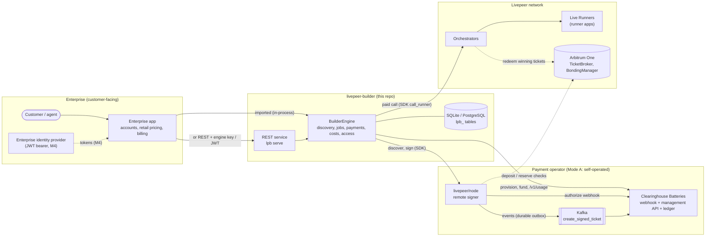

## 2. Engine components

The layers, and the protocol seams through which enterprises extend the engine. Services call
**only** protocols. Adapters and the store implement them, and the runtime wires one to the other.
Every layer uses the frozen models in `contracts/`.

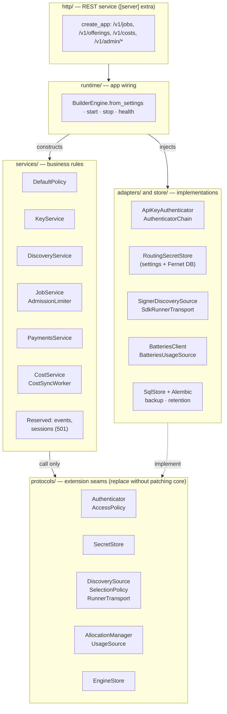

## 3. Integration modes

The same release runs in both modes. In imported mode the application builds the `ActorContext`
itself; in service mode the authenticator chain builds it.

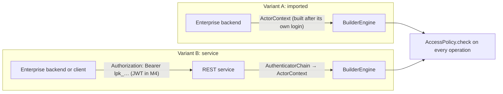

## 4. Request authentication and authorization

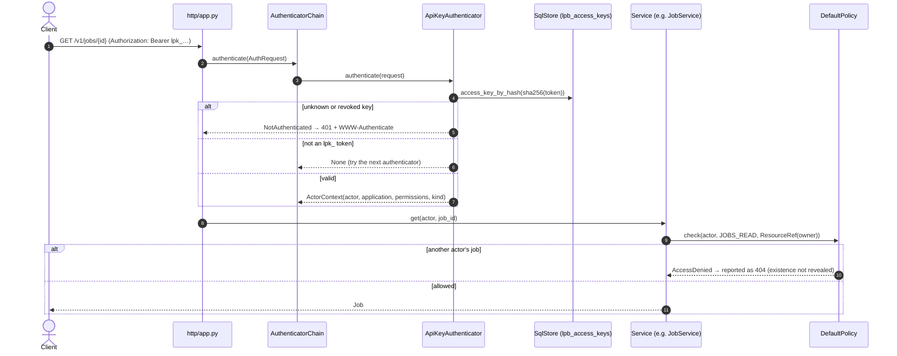

## 5. Explicit provisioning (per_actor)

Money moves only on an admin command, with an idempotency key. The key goes straight into the
`SecretStore`; the database stores only a `SecretRef`.

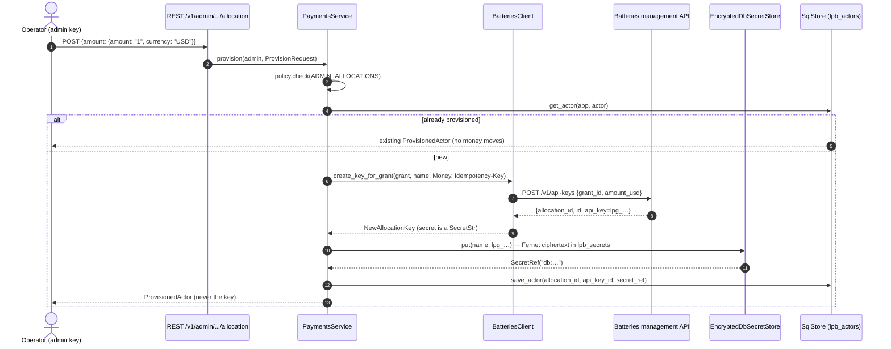

## 6. A paid immediate job, with failover

The core execution path. The attempt row is written **before** the call. Failover happens only
while nothing has been paid.

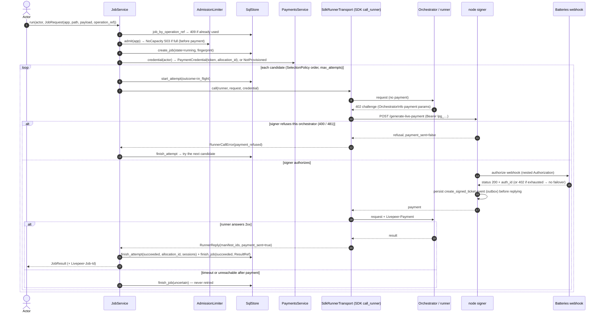

## 7. Cost sync, classification and correction

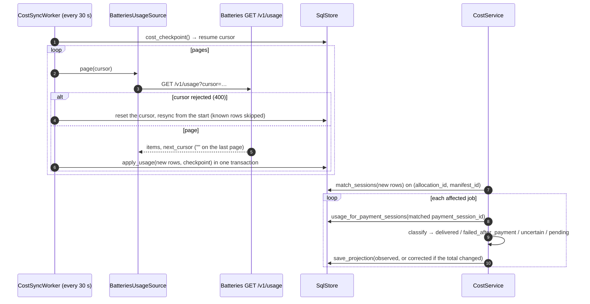

## 8. Reconciliation

Batteries is the authority. The engine shows how the provider's figure splits across cost classes.

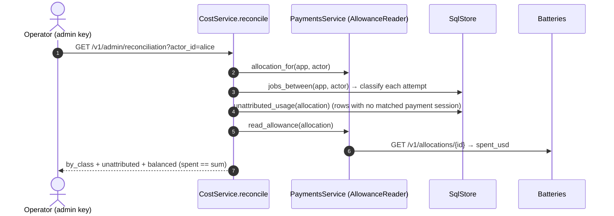

## 9. Restart recovery

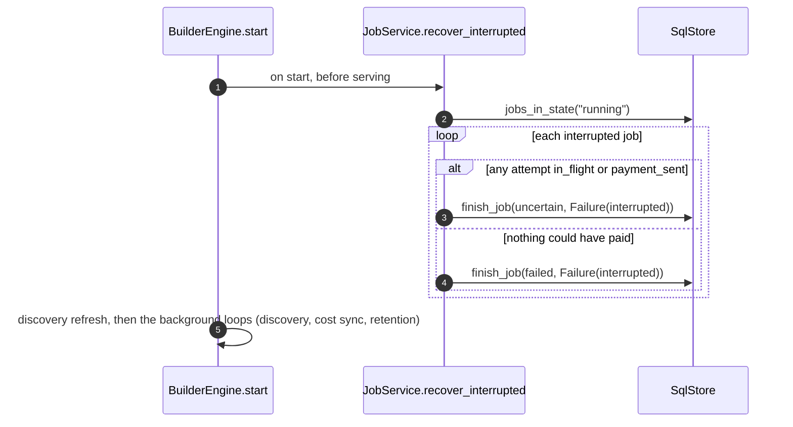

## 10. Persistent session (planned, M4 · ISS-27)

Defined in the contract and not implemented yet; `POST /v1/sessions` answers 501 today. **The engine
proxies all session traffic** (D9).

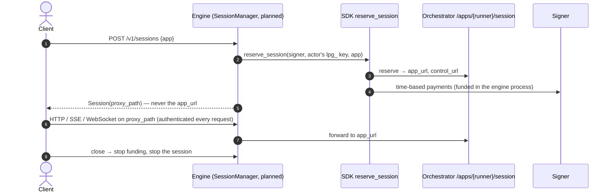

## 11. State machines

### Job

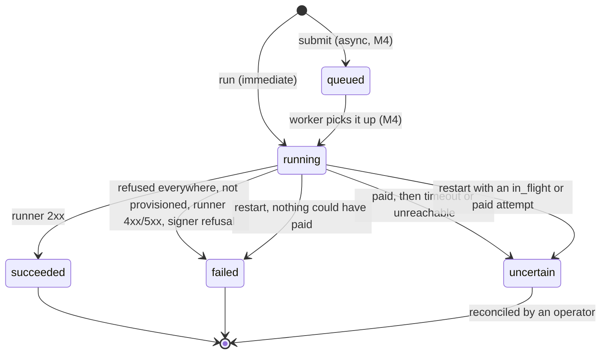

### Job cost

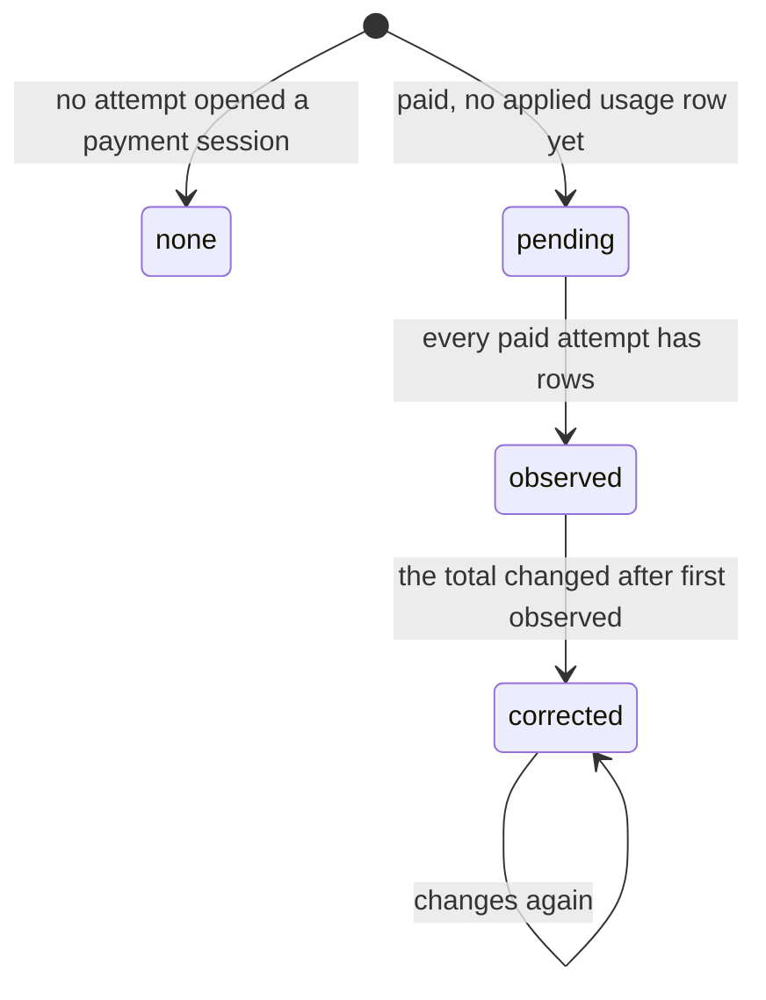
