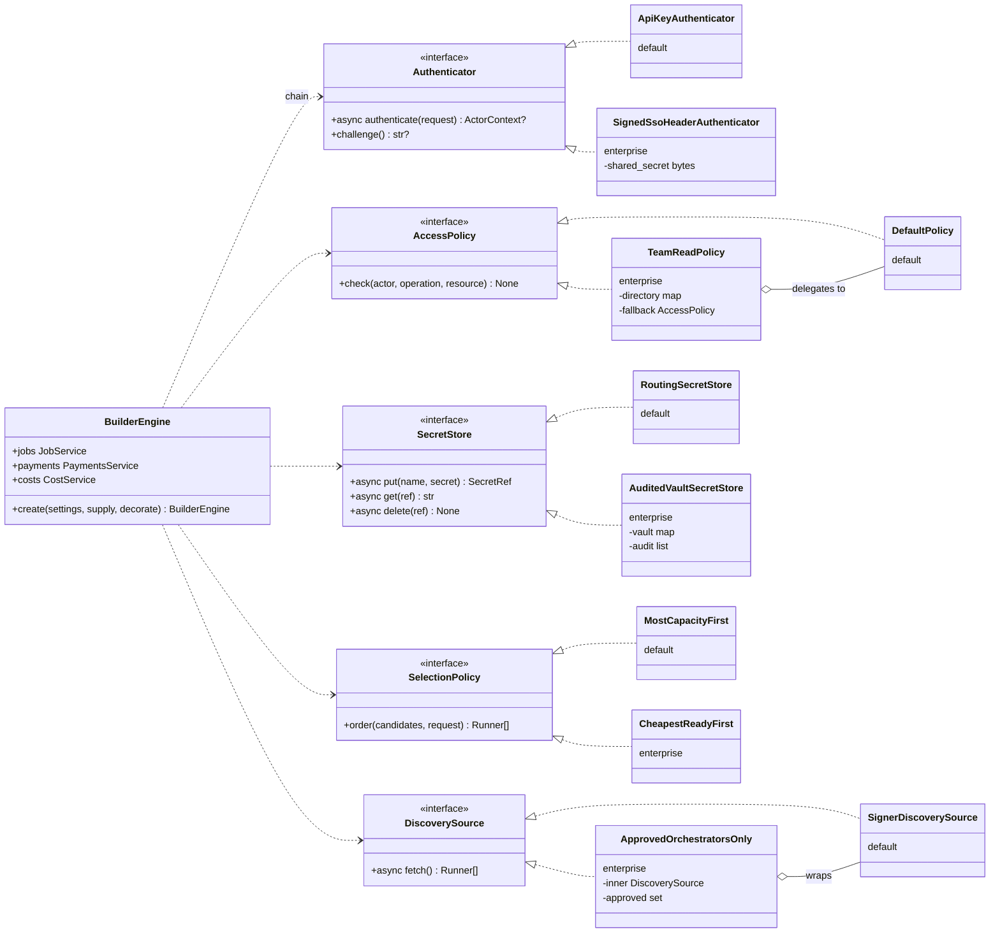

# Extending the engine: from simple defaults to enterprise implementations

The engine ships **simple defaults** behind every extension interface. An enterprise keeps the same
core release and swaps in its own, richer implementations through
`BuilderEngine.create(settings, supply=..., decorate=...)`. It never patches or subclasses core.

**Generated references** (always current, drift-checked in CI):

- [generated/interfaces.md](../generated/interfaces.md): every interface, its methods and its default implementations;
- [generated/contracts.md](../generated/contracts.md): the core data contracts that cross every interface.

**Runnable examples:** `tests/unit/test_extension_examples.py` implements every enterprise variant
shown below, wires it into a real engine, and proves the behavior in CI.

## What you can replace

| Interface | Default (simple) | Enterprise version (example) | Wire it with |
| --- | --- | --- | --- |
| `Authenticator` | none of your own; engine API keys (`ApiKeys`) after them | `SignedSsoHeaderAuthenticator`: trust a signed SSO-proxy header. Or OIDC/JWT, mTLS, session cookies | supply `authenticators=(...)` (tried **before** API keys); `api_keys=None` turns keys off |
| `AccessPolicy` | `DefaultPolicy` (permissions + own records + admin kind) | `TeamReadPolicy`: teammates read each other's jobs. Or org admins, RBAC/ABAC, entitlements | decorate (wrap `parts.policy`) or supply `policy=` |
| `SecretStore` | `RoutingSecretStore` (settings + Fernet-encrypted DB) | `AuditedVaultSecretStore`: HashiCorp Vault, AWS/GCP secret manager, HSM | supply `secret_store=` |
| `SelectionPolicy` | `MostCapacityFirst` | `CheapestReadyFirst`: price-aware. Or latency-ranked, region-pinned, SLA-weighted | supply `selection=` |
| `DiscoverySource` | `SignerDiscoverySource` / `StaticDiscoverySource` | `ApprovedOrchestratorsOnly`: an allow-list wrapper. Or a registry, URL list, cached catalog | decorate (wrap `parts.discovery_source`) or supply `discovery_source=` |
| `RunnerTransport` | `SdkRunnerTransport` (Live Runner via the SDK) | Another network transport, or a recording proxy for audit | supply or decorate `transport=` |
| `StreamingRunnerTransport` (optional `open` beside `call`) | `SdkRunnerTransport` | The same transport, streaming. Without `open`, `jobs.streaming` is `None` and the REST streaming route answers 400 (D33) | supply `transport=` |
| `AllocationManager` / `UsageSource` | `BatteriesClient` / `BatteriesUsageSource` | Another payment provider, or a hosted operator's API (Mode B) | supply `allocation_manager=` / `usage_source=` |
| `AllocationManager` for the grant desk | `BatteriesClient` with `LPB_BATTERIES_OPERATOR_TOKEN`, else off | Another grant administration API | supply `grants_manager=` (`None` turns the desk off) |
| `EngineStore` | `SqlStore` (SQLite or PostgreSQL) | The enterprise's managed PostgreSQL (same `SqlStore`, different URL), or a custom store passing `tests/store/` | supply `store=` or set `LPB_DATABASE_URL` |
| `Clock` | `SystemClock` | A controlled clock for tests | supply `clock=` |

**Not replaceable, by design:** the services (`JobService`, `PaymentsService`, `CostService`, …).
They hold the rules that protect money and correctness: failover only before payment, idempotency,
cost classification. Change behavior through the interfaces they call, not by subclassing them.

## An enterprise build



## Supply or decorate

`BuilderEngine.create(settings, supply=..., decorate=...)` builds an engine in three stages
(`livepeer_builder.runtime.assembly`):

1. **Supply (Replace).** `EngineSupply(...)` names parts you already have. Every field defaults to
   `UNSET`; the engine builds only what you did not supply, so a supplied part is never built, and the
   defaults that depend on it use yours: API keys and the encrypted secret store are built from a
   supplied store. `None` is a value, not a missing one: `api_keys=None` turns engine keys off,
   `grants_manager=None` turns the grant desk off. Supplied parts are borrowed; the engine never closes
   them.
2. **Decorate.** A plain function `(EngineParts) -> EngineParts` wraps the configured parts where
   they are used, typically with `dataclasses.replace`. `TeamReadPolicy` wraps `parts.policy`;
   `ApprovedOrchestratorsOnly` wraps the configured discovery source, signer bearer header included,
   so you never re-create a default by hand. A decoration that needs I/O is really a new resource:
   open it yourself and supply it.
3. **Assemble.** The services are built last, from the final parts, so a decorated policy reaches
   every service.

**The rule for choosing:** if other parts depend on it (the store), supply it; if you only add
behavior around a default, decorate it. A decorated part is not seen by parts built before
decoration.

**Engine API keys off.** Supplying `api_keys=None` removes the key routes from the app and its
OpenAPI, makes `lpb bootstrap-admin` refuse, and accepts no `lpk_` key. Your authenticator then
carries every caller, so it must grant admin permissions to operators.

## Wiring it

<!-- example: tests/unit/test_extension_examples.py#wiring -->
```python
def enterprise_supply() -> EngineSupply:
    """Replace: parts that substitute a default outright, or that other parts depend on."""
    return EngineSupply(
        authenticators=(SignedSsoHeaderAuthenticator(SECRET),),  # tried before the engine's API keys
        secret_store=AuditedVaultSecretStore(),  # payment keys never touch the engine database
        selection=CheapestReadyFirst(),
    )


def enterprise_decorations(parts: EngineParts) -> EngineParts:
    """Decorate: wrap the configured defaults where they are used."""
    return dataclasses.replace(
        parts,
        policy=TeamReadPolicy(DIRECTORY, fallback=parts.policy),
        discovery_source=ApprovedOrchestratorsOnly(parts.discovery_source, approved={"https://orch.example"}),
    )
```

This block is the tested example: `scripts/check_docs.py` fails if it drifts from the region in
`tests/unit/test_extension_examples.py`. Then:

```python
engine = await BuilderEngine.create(
    EngineSettings.from_env(), supply=enterprise_supply(), decorate=enterprise_decorations
)
await engine.start()
```

The same engine serves both integration modes: call it in-process with your own `ActorContext`
(imported; [embedded-mode.md](../guides/embedded-mode.md)), or run it behind HTTP
([Service mode](#service-mode)).

## Service mode

`livepeer_builder.http.server` (the `[server]` extra) has two entry points. Both take the same
`supply` and `decorate` as `create`, plus `extend`, a hook that adds routes:

- **`serve(settings, *, supply, decorate, extend)`** runs the whole service, as `lpb serve` does.
  It configures logging, creates the engine and runs uvicorn on `LPB_HTTP_HOST`/`LPB_HTTP_PORT`. It
  stops the engine whatever happens, including when an `extend` hook raises or uvicorn fails
  before its lifespan runs.
- **`build_app(settings, *, supply, decorate, extend)`** returns the FastAPI app without running it,
  for mounting in another ASGI stack. The engine lives as long as the app's lifespan, which starts and
  stops it (a failed start stops it too), so the host must run that lifespan, as any ASGI server does.
  To hold the engine yourself, build it with `BuilderEngine.create` and pass it to
  `livepeer_builder.http.create_app`. Logging is left to the host.

`extend(app, engine)` receives the app and the engine, so a router gets the engine as an argument
rather than from `app.state`. `actor_dependency(engine)` is the dependency the built-in routes use:
an extra endpoint that depends on it gets the same authenticators, and the same 401 for a missing
or bad credential.
With API keys on, it also declares the `lpk_` bearer scheme, so Swagger offers Authorize. With keys
off it declares none, because the engine cannot know what your authenticator expects; declare your
scheme in `extend` if Swagger should send it.

<!-- example: tests/unit/test_service_mode_example.py#service-mode -->
```python
def corp_supply() -> EngineSupply:
    return EngineSupply(authenticators=(SignedSsoHeaderAuthenticator(SECRET),))


def corp_decorations(parts: EngineParts) -> EngineParts:
    approved = ApprovedOrchestratorsOnly(parts.discovery_source, approved={"https://orch.example"})
    return dataclasses.replace(parts, discovery_source=approved)


def corp_routes(app: FastAPI, engine: EngineApi) -> None:
    """An extra endpoint: it gets the engine and the same authentication as the built-in routes."""
    router = APIRouter()
    Actor = Annotated[ActorContext, Depends(actor_dependency(engine))]

    @router.get("/v1/corp/whoami")
    async def whoami(actor: Actor) -> dict[str, str]:
        return {"actor_id": actor.actor_id, "application_id": actor.application_id}

    app.include_router(router)
```

A customized service is a small entrypoint of its own; there is no `lpb serve` flag for it:

```python
asyncio.run(
    serve(
        EngineSettings.from_env(),
        supply=corp_supply(),
        decorate=corp_decorations,
        extend=corp_routes,
    )
)
```

## Rules every implementation must keep

These rules are what make a replacement safe. The default implementations follow them; the tests
named here show each one.

| Interface | Rule |
| --- | --- |
| `Authenticator` | Return `None` for a credential that isn't yours. Raise `NotAuthenticated` for one that is yours but invalid; the chain stops with 401 and never falls through. **Never trust an unchecked request field** (sign or verify it). Put no secrets in `ActorContext.attributes` (`test_unrecognized_credentials_fall_through_but_invalid_ones_stop`) |
| `AccessPolicy` | Raise `AccessDenied`; never return a value. Keep admin operations restricted to admin credentials, typically by delegating to `DefaultPolicy`. Reads of other owners' records surface as 404 automatically |
| `SecretStore` | Return an opaque `SecretRef`, never the secret. Never log secret values. `get` raises `NotFound` for unknown refs. Rotation is `put` new, then `delete` old |
| `SelectionPolicy` | Pure and fast: order candidates, don't call the network. The engine applies `max_attempts` and the failover-before-payment rule |
| `DiscoverySource` | Return contract `Runner`s. Raising keeps the last good snapshot (`discovery_error` in health) |
| `CredentialResolver` | Return a `PaymentCredential` with the signer bearer and the allocation that bearer spends. `token` is `None` for an unpaid call |
| `RunnerTransport` | Raise `RunnerCallError` with an accurate **`payment_sent`** and **`manifest_ids`** (one per signed session, in order). Failover, `uncertain` and cost attribution all depend on them. Use `payment_refused` only for orchestrator-specific refusals before payment |
| `StreamingRunnerTransport` | `open` returns once the runner answered (status, content type), with `payment_sent` and `manifest_ids` already known. It must give up after `request.first_byte_timeout_s` and raise `RunnerCallError("timeout")` with the payment evidence so far; the engine stops an `open` that runs `LPB_STREAM_OPEN_GRACE_S` (default 5 s) longer and treats it as paid (D35). Iteration raises `RunnerCallError` mid-stream; `aclose` closes the connection and stops any ongoing funding, and may be called more than once (`tests/unit/test_stream_deadlines.py`) |
| `AllocationManager` | Every money-moving call honors its `idempotency_key`. A replay returns the original result |
| `UsageSource` | Opaque cursor. Raise `CursorMismatch` on a rejected cursor so the worker resyncs. Rows are immutable per `id` |
| `EngineStore` | Pass the store suite (`tests/store/`). Never weaken `operation_ref` uniqueness or the before-call attempt write. `finish_attempt` may run twice for one attempt and must only add signed sessions, never rewrite them (D39). `maintenance` may be `None`: the engine then purges nothing and reports no schema revision |

## Testing your implementation

- **Unit test** it against the protocol with the shipped fakes: `livepeer_builder.testing` provides
  `FixedClock`, `ScriptedTransport`, `ScriptedStreamTransport` (with `StreamScript` for chunks,
  pauses, mid-stream errors and slow opens), `FakeAllocationManager`, `FakeUsageSource` and
  `MemorySecretStore`.
- **Wire it** into `BuilderEngine.create(settings, supply=EngineSupply(...))` with an in-memory SQLite
  store, as `tests/unit/test_extension_examples.py` does.
- **A replacement store** must pass `tests/store/test_contract.py` and `test_durability.py`.

## What's coming

| Interface | Status |
| --- | --- |
| `JwtBearerAuthenticator` (OIDC, MCP OAuth tokens) | Defined in [access.md](../contracts/access.md#modes); built in M4 |
| `ServiceCredentialAuthenticator` (trusted backend with `actors.assert`) | Defined in [access.md](../contracts/access.md#service-mode); built in M4 |
| `EventFeed` | Defined in [events.md](../contracts/events.md); built in M3 |
| `SessionManager` | Defined in [engine.md](../contracts/engine.md#persistent-sessions); built in M4 |
| `UsageMeter` (engine-side usage measurement) | A later extension; today usage is app-reported |
