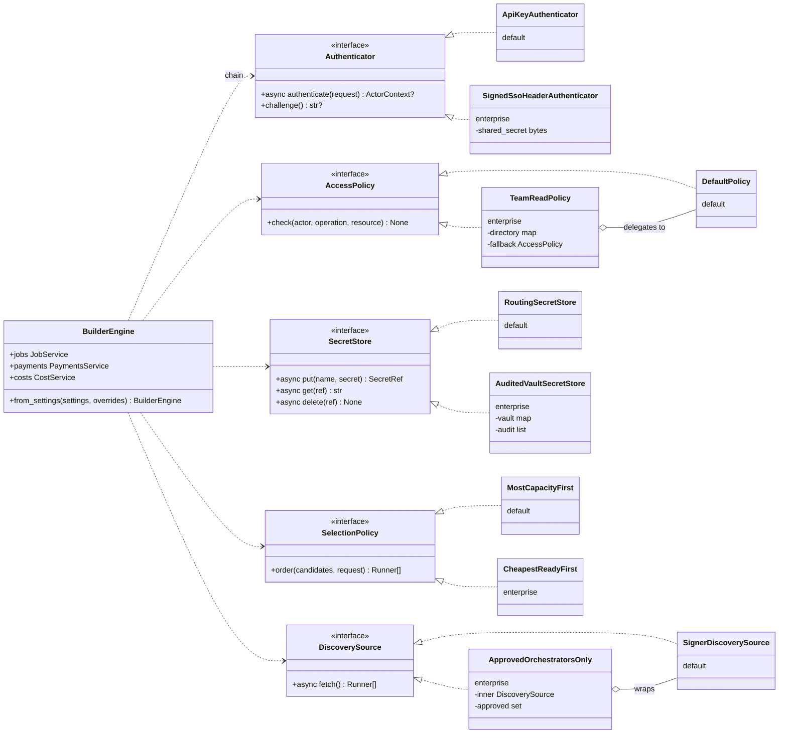

# Extending the engine: from simple defaults to enterprise implementations

The engine ships **simple defaults** behind every extension interface. An enterprise keeps the same
core release and swaps in its own, richer implementations through `BuilderEngine.from_settings(...)`.
It never patches or subclasses core.

**Generated references** (always current, drift-checked in CI):

- [generated/interfaces.md](../generated/interfaces.md): every interface, its methods and its default implementations;
- [generated/contracts.md](../generated/contracts.md): the core data contracts that cross every interface.

**Runnable examples:** `tests/unit/test_extension_examples.py` implements every enterprise variant
shown below, wires it into a real engine, and proves the behavior in CI.

## What you can replace

| Interface | Default (simple) | Enterprise version (example) | Wire it with |
| --- | --- | --- | --- |
| `Authenticator` | `ApiKeyAuthenticator` (engine `lpk_` keys) | `SignedSsoHeaderAuthenticator`: trust a signed SSO-proxy header. Or OIDC/JWT, mTLS, session cookies | `authenticators=[...]` (tried **before** the API-key default) |
| `AccessPolicy` | `DefaultPolicy` (permissions + own records + admin kind) | `TeamReadPolicy`: teammates read each other's jobs. Or org admins, RBAC/ABAC, entitlements | `policy=` |
| `SecretStore` | `RoutingSecretStore` (settings + Fernet-encrypted DB) | `AuditedVaultSecretStore`: HashiCorp Vault, AWS/GCP secret manager, HSM | `secret_store=` |
| `SelectionPolicy` | `MostCapacityFirst` | `CheapestReadyFirst`: price-aware. Or latency-ranked, region-pinned, SLA-weighted | `selection=` |
| `DiscoverySource` | `SignerDiscoverySource` / `StaticDiscoverySource` | `ApprovedOrchestratorsOnly`: an allow-list wrapper. Or a registry, URL list, cached catalog | `discovery_source=` |
| `RunnerTransport` | `SdkRunnerTransport` (Live Runner via the SDK) | Another network transport, or a recording proxy for audit | `transport=` |
| `StreamingRunnerTransport` (optional `open` beside `call`) | `SdkRunnerTransport` | The same transport, streaming. Without `open`, `jobs.stream` answers 400 (D33) | `transport=` |
| `AllocationManager` / `UsageSource` | `BatteriesClient` / `BatteriesUsageSource` | Another payment provider, or a hosted operator's API (Mode B) | `allocation_manager=` / `usage_source=` |
| `EngineStore` | `SqlStore` (SQLite or PostgreSQL) | The enterprise's managed PostgreSQL (same `SqlStore`, different URL), or a custom store passing `tests/store/` | `store=` or `LPB_DATABASE_URL` |
| `Clock` | `SystemClock` | A controlled clock for tests | `clock=` |

**Not replaceable, by design:** the services (`JobService`, `PaymentsService`, `CostService`, …).
They hold the rules that protect money and correctness: failover only before payment, idempotency,
cost classification. Change behavior through the interfaces they call, not by subclassing them.

## An enterprise build



Two patterns recur:

- **Decorate:** wrap a default and add behavior. `TeamReadPolicy` delegates to `DefaultPolicy`, and
  `ApprovedOrchestratorsOnly` wraps the signer's discovery.
- **Replace:** swap the default entirely, as `AuditedVaultSecretStore` does.

## Wiring it

```python
engine = await BuilderEngine.from_settings(
    EngineSettings.from_env(),
    authenticators=[SignedSsoHeaderAuthenticator(shared_secret)],  # before the engine's API keys
    policy=TeamReadPolicy(directory),  # falls back to DefaultPolicy
    secret_store=AuditedVaultSecretStore(),  # payment keys never touch the engine DB
    selection=CheapestReadyFirst(),
    discovery_source=ApprovedOrchestratorsOnly(
        SignerDiscoverySource(signer_url=settings.signer_url), approved={"https://orch.example"}
    ),
)
await engine.start()
```

The same engine serves both integration modes: call it in-process with your own `ActorContext`
(imported), or pass it to `livepeer_builder.http.create_app(engine)` (service).

## Rules every implementation must keep

These rules are what make a replacement safe. The default implementations follow them; the tests
named here show each one.

| Interface | Rule |
| --- | --- |
| `Authenticator` | Return `None` for a credential that isn't yours. Raise `NotAuthenticated` for one that is yours but invalid; the chain stops with 401 and never falls through. **Never trust an unchecked request field** (sign or verify it). Put no secrets in `ActorContext.attributes` (`test_unrecognized_credentials_fall_through_but_invalid_ones_stop`) |
| `AccessPolicy` | Raise `AccessDenied`; never return a value. Keep admin operations restricted to admin credentials, typically by delegating to `DefaultPolicy`. Reads of other owners' records surface as 404 automatically |
| `SecretStore` | Return an opaque `SecretRef`, never the secret. Never log secret values. `get` raises `NotFound` for unknown refs. Rotation is `put` new, then `delete` old |
| `SelectionPolicy` | Pure and fast: order candidates, don't call the network. The engine applies `max_attempts` and the failover-before-payment rule |
| `DiscoverySource` | Return contract `Runner`s. Raising keeps the last good snapshot (`discovery_error` in health) |
| `CredentialResolver` | Return a `PaymentCredential` with the signer bearer and the allocation that bearer spends. `token` is `None` for an unpaid call |
| `RunnerTransport` | Raise `RunnerCallError` with an accurate **`payment_sent`** and **`manifest_ids`** (one per signed session, in order). Failover, `uncertain` and cost attribution all depend on them. Use `payment_refused` only for orchestrator-specific refusals before payment |
| `StreamingRunnerTransport` | `open` returns once the runner answered (status, content type), with `payment_sent` and `manifest_ids` already known. It must give up after `request.first_byte_timeout_s` and raise `RunnerCallError("timeout")` with the payment evidence so far; the engine stops an `open` that runs 5 s longer and treats it as paid (D35). Iteration raises `RunnerCallError` mid-stream; `aclose` closes the connection and stops any ongoing funding, and may be called more than once (`tests/unit/test_stream_deadlines.py`) |
| `AllocationManager` | Every money-moving call honors its `idempotency_key`. A replay returns the original result |
| `UsageSource` | Opaque cursor. Raise `CursorMismatch` on a rejected cursor so the worker resyncs. Rows are immutable per `id` |
| `EngineStore` | Pass the store suite (`tests/store/`). Never weaken `operation_ref` uniqueness or the before-call attempt write. `finish_attempt` may run twice for one attempt and must only add signed sessions, never rewrite them (D39) |

## Testing your implementation

- **Unit test** it against the protocol with the shipped fakes: `livepeer_builder.testing` provides
  `FixedClock`, `ScriptedTransport`, `ScriptedStreamTransport` (with `StreamScript` for chunks,
  pauses, mid-stream errors and slow opens), `FakeAllocationManager`, `FakeUsageSource` and
  `MemorySecretStore`.
- **Wire it** into `BuilderEngine.from_settings(...)` with an in-memory SQLite store, as
  `tests/unit/test_extension_examples.py` does.
- **A replacement store** must pass `tests/store/test_contract.py` and `test_durability.py`.

## What's coming

| Interface | Status |
| --- | --- |
| `JwtBearerAuthenticator` (OIDC, MCP OAuth tokens) | Defined in [access.md](../contracts/access.md#modes); built in M4 |
| `ServiceCredentialAuthenticator` (trusted backend with `actors.assert`) | Defined in [access.md](../contracts/access.md#service-mode); built in M4 |
| `EventFeed` | Defined in [events.md](../contracts/events.md); built in M3 |
| `SessionManager` | Defined in [engine.md](../contracts/engine.md#persistent-sessions); built in M4 |
| `UsageMeter` (engine-side usage measurement) | A later extension; today usage is app-reported |
