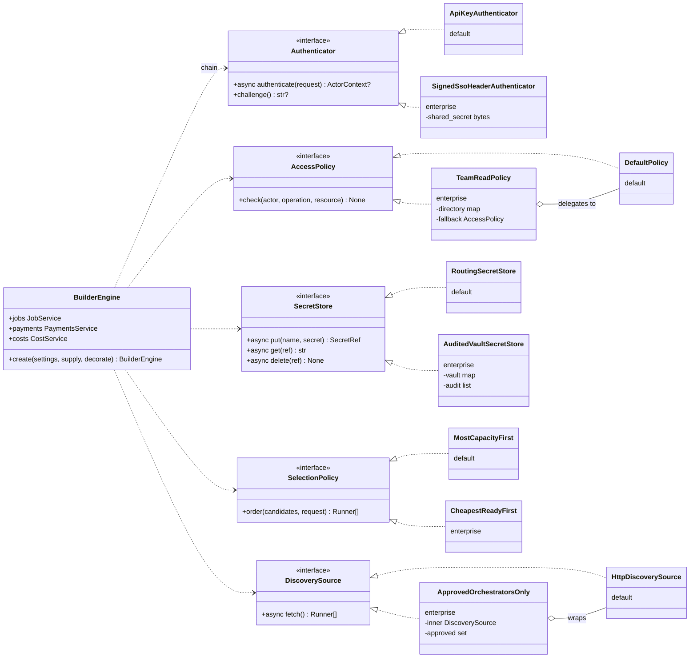

# Extending the engine: from simple defaults to enterprise implementations

The engine ships **simple defaults** behind every extension interface. An enterprise keeps the same
core release and swaps in its own, richer implementations through
`BuilderEngine.create(settings, supply=..., decorate=...)`. It never patches or subclasses core.

**Generated references** (always current, drift-checked in CI):

- [generated/interfaces.md](../generated/interfaces.md): every interface, its methods and its default implementations;
- [generated/contracts.md](../generated/contracts.md): the core data contracts that cross every interface.

**Runnable examples:** `tests/unit/test_extension_examples.py` implements every enterprise variant
shown below, wires it into a real engine, and proves the behavior in CI.

## What you can replace

| Interface | Default (simple) | Enterprise version (example) | Wire it with |
| --- | --- | --- | --- |
| `Authenticator` | engine API keys (`ApiKeys`); with `LPB_AUTH=jwt`, the built-in `JwtBearerAuthenticator` for OAuth access tokens ([access.md](../contracts/access.md#jwt-bearer)) | `SignedSsoHeaderAuthenticator`: trust a signed SSO-proxy header. Or mTLS, session cookies | supply `authenticators=(...)` (tried **before** API keys, and replacing the configured JWT one); `api_keys=None` turns keys off |
| `AccessPolicy` | `DefaultPolicy` (permissions + own records + admin kind) | `TeamReadPolicy`: teammates read each other's jobs. Or org admins, RBAC/ABAC, entitlements | decorate (wrap `parts.policy`) or supply `policy=` |
| `SecretStore` | `RoutingSecretStore` (settings + Fernet-encrypted DB) | `AuditedVaultSecretStore`: HashiCorp Vault, AWS/GCP secret manager, HSM | supply `secret_store=` |
| `WritableSecretStore` (optional `writable()` beside `put`) | `RoutingSecretStore` (`False` without `LPB_SECRET_KEY`) | A vault that is sealed, or a token without write access. Provisioning and key rotation ask it before the provider is called, and `False` refuses them with nothing sent (#112, C2). Without it, the store is not asked | supply `secret_store=` |
| `SelectionPolicy` | `MostCapacityFirst` | `CheapestReadyFirst`: price-aware. Or latency-ranked, region-pinned, SLA-weighted | supply `selection=` |
| `DiscoverySource` | `HttpDiscoverySource` (reads `LPB_DISCOVERY_URL`, required) | `ApprovedOrchestratorsOnly`: an allow-list wrapper around the HTTP source | decorate (wrap `parts.discovery_source`) |
| `RunnerTransport` | `SdkRunnerTransport` (Live Runner via the SDK) | Another network transport, or a recording proxy for audit | supply or decorate `transport=` |
| `StreamingRunnerTransport` (optional `open` beside `call`) | `SdkRunnerTransport` | The same transport, streaming. Without `open`, `jobs.streaming` is `None` and the REST streaming route answers 400 (D33) | supply `transport=` |
| `AllocationManager` / `UsageSource` | `BatteriesClient` / `BatteriesUsageSource` | Another payment provider, or a hosted operator's API (Mode B) | supply `allocation_manager=` / `usage_source=` |
| `AllocationManager` for the grant desk | `BatteriesClient` with `LPB_BATTERIES_OPERATOR_TOKEN`, else off | Another grant administration API | supply `grants_manager=` (`None` turns the desk off) |
| `EngineStore` | `SqlStore` (SQLite or PostgreSQL) | The enterprise's managed PostgreSQL (same `SqlStore`, different URL), or a custom store passing `tests/store/` | supply `store=` or set `LPB_DATABASE_URL` |
| `AllocationCostSnapshot` (optional `attempt_allocations` on the store's cost snapshot) | `SqlCostSnapshot` | A custom store that can say which allocation paid each attempt, so reconciliation counts one allocation at a time and balances after a revoke and a re-provision (#115, C9). Without it, every attempt of the actor is counted against the current allocation | supply `store=` |
| `UsageOnceRepo` (optional `set_usage_once` on the store) | `SqlStore` | A custom store that writes a job's usage once, so two reports at the same moment store one (#115, C20). Without it, the engine checks the job it read and calls `set_usage`, and that race remains | supply `store=` |
| `ActorCommandRepo` (optional `set_actor_status` and `set_actor_key` on the store) | `SqlStore` | A custom store whose admin commands write only their own actor columns, each with its condition in the write (#115, C4). Without it, the engine checks the condition itself and saves the whole row with `save_actor` | supply `store=` |
| `Clock` | `SystemClock` | A controlled clock for tests | supply `clock=` |

**Not replaceable, by design:** the services (`JobService`, `PaymentsService`, `CostService`, …).
They hold the rules that protect money and correctness: failover only before payment, idempotency,
cost classification. Change behavior through the interfaces they call, not by subclassing them.

## An enterprise build



## Supply or decorate

`BuilderEngine.create(settings, supply=..., decorate=...)` builds an engine in three stages
(`livepeer_builder.runtime.assembly`):

1. **Supply (Replace).** `EngineSupply(...)` names parts you already have. Every field defaults to
   `UNSET`; the engine builds only what you did not supply, so a supplied part is never built, and the
   defaults that depend on it use yours: API keys and the encrypted secret store are built from a
   supplied store. `None` is a value, not a missing one: `api_keys=None` turns engine keys off,
   `grants_manager=None` turns the grant desk off. Supplied parts are borrowed; the engine never closes
   them.
2. **Decorate.** A plain function `(EngineParts) -> EngineParts` wraps the configured parts where
   they are used, typically with `dataclasses.replace`. `TeamReadPolicy` wraps `parts.policy`;
   `ApprovedOrchestratorsOnly` wraps the configured discovery source, so you never re-create a default
   by hand. A decoration that needs I/O is really a new resource:
   open it yourself and supply it.
3. **Assemble.** The services are built last, from the final parts, so a decorated policy reaches
   every service.

**The rule for choosing:** if other parts depend on it (the store), supply it; if you only add
behavior around a default, decorate it. A decorated part is not seen by parts built before
decoration.

**Engine API keys off.** Supplying `api_keys=None` removes the key routes from the app and its
OpenAPI, sets `engine.keys` to `None`, and accepts no `lpk_` key. The stock `lpb bootstrap-admin`
uses the default wiring, so a keys-off deployment has no bootstrap command. Your authenticator then
carries every caller, so it must grant admin permissions to operators.

## Wiring it

<!-- example: tests/unit/test_extension_examples.py#wiring -->
```python
def enterprise_supply() -> EngineSupply:
    """Replace: parts that substitute a default outright, or that other parts depend on."""
    return EngineSupply(
        authenticators=(SignedSsoHeaderAuthenticator(SECRET),),  # tried before the engine's API keys
        secret_store=AuditedVaultSecretStore(),  # payment keys never touch the engine database
        selection=CheapestReadyFirst(),
    )


def enterprise_decorations(parts: EngineParts) -> EngineParts:
    """Decorate: wrap the configured defaults where they are used."""
    return dataclasses.replace(
        parts,
        policy=TeamReadPolicy(DIRECTORY, fallback=parts.policy),
        discovery_source=ApprovedOrchestratorsOnly(parts.discovery_source, approved={"https://orch.example"}),
    )
```

This block is the tested example: `scripts/check_docs.py` fails if it drifts from the region in
`tests/unit/test_extension_examples.py`. Then:

```python
engine = await BuilderEngine.create(
    EngineSettings.from_env(), supply=enterprise_supply(), decorate=enterprise_decorations
)
await engine.start()
```

The same engine serves both integration modes: call it in-process with your own `ActorContext`
(imported; [embedded-mode.md](../guides/embedded-mode.md)), or run it behind HTTP
([Service mode](#service-mode)).

## Service mode

`livepeer_builder.http.server` (the `[server]` extra) has two entry points. Both take the same
`supply` and `decorate` as `create`, plus `extend`, a hook that adds routes:

- **`serve(settings, *, supply, decorate, extend)`** runs the whole service, as `lpb serve` does.
  It configures logging, creates the engine and runs uvicorn on `LPB_HTTP_HOST`/`LPB_HTTP_PORT`. It
  stops the engine whatever happens, including when an `extend` hook raises or uvicorn fails
  before its lifespan runs.
- **`build_app(settings, *, supply, decorate, extend)`** returns the FastAPI app without running it,
  for mounting in another ASGI stack. The engine lives as long as the app's lifespan, which starts and
  stops it (a failed start stops it too), so the host must run that lifespan, as any ASGI server does.
  To hold the engine yourself, build it with `BuilderEngine.create` and pass it to
  `livepeer_builder.http.create_app`. Logging is left to the host.

`extend(app, engine)` receives the app and the engine, so a router gets the engine as an argument
rather than from `app.state`. `actor_dependency(engine)` is the dependency the built-in routes use:
an extra endpoint that depends on it gets the same authenticators, and the same 401 for a missing
or bad credential.
With API keys on, it also declares the `lpk_` bearer scheme, so Swagger offers Authorize. With
`LPB_AUTH=jwt` it declares the JWT bearer scheme. With neither it declares none, because the engine
cannot know what your authenticator expects; declare your scheme in `extend` if Swagger should send it.

<!-- example: tests/unit/test_service_mode_example.py#service-mode -->
```python
def corp_supply() -> EngineSupply:
    return EngineSupply(authenticators=(SignedSsoHeaderAuthenticator(SECRET),))


def corp_decorations(parts: EngineParts) -> EngineParts:
    approved = ApprovedOrchestratorsOnly(parts.discovery_source, approved={"https://orch.example"})
    return dataclasses.replace(parts, discovery_source=approved)


def corp_routes(app: FastAPI, engine: EngineApi) -> None:
    """An extra endpoint: it gets the engine and the same authentication as the built-in routes."""
    router = APIRouter()
    Actor = Annotated[ActorContext, Depends(actor_dependency(engine))]

    @router.get("/v1/corp/whoami")
    async def whoami(actor: Actor) -> dict[str, str]:
        return {"actor_id": actor.actor_id, "application_id": actor.application_id}

    app.include_router(router)
```

A customized service is a small entrypoint of its own; there is no `lpb serve` flag for it:

```python
asyncio.run(
    serve(
        EngineSettings.from_env(),
        supply=corp_supply(),
        decorate=corp_decorations,
        extend=corp_routes,
    )
)
```

## Discovery

Which runners exist is decided outside the engine. `LPB_DISCOVERY_URL` is required and points at a
`GET /discovery` document that follows livepeer/node's contract
([contract](../contracts/discovery.md)). The reference implementation is livepeer/node's
`livepeer-discovery`. This package does not ship a discovery process.

To change who the engine calls without replacing that process, wrap `HttpDiscoverySource` through
`decorate`. Raising from the wrapper keeps the last good snapshot. To replace the inventory entirely,
serve the same document from another process and point `LPB_DISCOVERY_URL` at it.

## Rules every implementation must keep

These rules are what make a replacement safe. The default implementations follow them; the tests
named here show each one.

| Interface | Rule |
| --- | --- |
| `Authenticator` | Return `None` for a credential that isn't yours. Raise `NotAuthenticated` for one that is yours but invalid; the chain stops with 401 and never falls through. **Never trust an unchecked request field** (sign or verify it). Put no secrets in `ActorContext.attributes` (`test_unrecognized_credentials_fall_through_but_invalid_ones_stop`) |
| `AccessPolicy` | Raise `AccessDenied`; never return a value. Keep admin operations restricted to admin credentials, typically by delegating to `DefaultPolicy`. Reads of other owners' records surface as 404 automatically |
| `SecretStore` | Return an opaque `SecretRef`, never the secret. Never log secret values. `get` raises `NotFound` for unknown refs. Rotation is `put` new, then `delete` old. A reference is opaque text of any length: the actor row holds it in an unbounded `text` column (migration 0013, #115), so a vault path of any size is stored on SQLite and PostgreSQL alike. Before, the column was `varchar(200)`, and on PostgreSQL a longer reference was refused when the actor was saved, after the provider key was funded. PostgreSQL still cannot store a NUL character in it |
| `SelectionPolicy` | Pure and fast: order candidates, don't call the network. The engine applies `max_attempts` and the failover-before-payment rule. On a paid job it then moves the runners the signer takes no ceiling for (no rate, `0`, an unpaid unit or currency) after the rest, keeping your order within each part. The engine hands you every runner for the app, those advertising zero capacity included, and tries what you return in your order (#114, C17): order them last, as `MostCapacityFirst` does, or leave them out to drop them. Returning no runner fails the job `no_offering` |
| `DiscoverySource` | Return contract `Runner`s. Raising keeps the last good snapshot (`discovery_error` in health, as a code; the text is logged) |
| `CredentialResolver` (implemented by `PaymentsService`; not replaceable today) | Return a `PaymentCredential` with the signer bearer and the allocation that bearer spends. `token` is `None` for an unpaid call |
| `RunnerTransport` | Await **`on_signed(manifest_id)`** for each session the signer signs, before the paid request goes out (`""` when the challenge has none): the engine stores the evidence there, so a cancel or crash mid-request keeps the charge attributed (D42). Raise `RunnerCallError` with an accurate **`payment_sent`** and **`manifest_ids`** (one per signed session, in order). Failover, `uncertain` and cost attribution all depend on them; a session reported through `on_signed` keeps the attempt paid even if the error says otherwise. When the callback has `remember` and `refused` (the engine's recorder does), await `remember(manifest_id)` before asking the signer and sign nothing if it raises, and await `refused(manifest_id)` when the signer refuses (D54). Use `payment_refused` only for orchestrator-specific refusals before payment. Set `reason` on a `payment` refusal (`not_authorized`, `allowance_exhausted`, `signer_unavailable`, D58) and write `message` in your own words: it reaches builders, so it must not quote the signer's URL or body |
| `StreamingRunnerTransport` | `open` returns once the runner answered (status, content type), with `payment_sent` and `manifest_ids` already known. It must give up after `request.first_byte_timeout_s` and raise `RunnerCallError("timeout")` (or `payment` / `signer_unavailable` when the deadline lands on signer identity, before the runner is asked) with the payment evidence so far; the engine stops an `open` that runs `LPB_STREAM_OPEN_GRACE_S` (default 5 s) longer and treats it as paid (D35). Iteration raises `RunnerCallError` mid-stream; `aclose` closes the connection and stops any ongoing funding, and may be called more than once (`tests/unit/test_stream_deadlines.py`) |
| `AllocationManager` | Every money-moving call honors its `idempotency_key`. A replay returns the original result. `create_grant` stores `metadata` with the grant and `list_grants` returns it, every page; `grant_page(cursor)` returns one page, oldest first, and a cursor that goes on from it: the engine finds a grant it created by its `lpb_operation` tag, resuming the search from a recorded cursor (D57, Q5). An answer you cannot read is an error (`ProviderError` with a status that is not a 4xx, or `ProviderUnavailable`), never an empty list or page: a resumed grant create that reads "no grants" creates a second one (#114, C21) |
| `UsageSource` | Opaque cursor. Raise `CursorMismatch` on a rejected cursor so the worker resyncs. Rows are immutable per `id`. An item you cannot read as a `UsageRow` goes in `UsagePage.set_aside` (build it with `contracts.costs.set_aside_record`), not in an exception: raising fails the page on every pass, so the cursor never moves. The worker itself sets aside a `UsageRow` whose text the store cannot keep (#114, C13) |
| `EngineStore` | Pass the store suite (`tests/store/`). Never weaken `operation_ref` uniqueness or the before-call attempt write. `create_job` compares fingerprints on a duplicate (`OperationConflict`), and with `retry_of` supersedes that failed job by a compare-and-set in the same transaction as the insert; `job_by_operation_ref` returns only the job not superseded (D57). The operation ledger (`OperationRepo`, D57) stores one record per caller scope and `operation_ref` under a unique constraint: `begin_operation` writes nothing and returns the holder when the reference is held, and every later write (`resume_operation`, `remember_operation`, `complete_operation`, `abandon_operation`) is a compare-and-set on the record's `fencing_token` that returns `False` once another run took it over. Keep ledger records: no retention purge. `insert_access_key` and `rotate_access_key` take the `done` ledger record of the command and write it in the same transaction as the key, writing nothing and returning `False` when that reference is held; a `KeyRepo` supplied apart from the store (`ApiKeys(store=...)`) therefore keeps the ledger records of key commands too, and answers `get_operation` for them. `finish_attempt` and `record_payment_evidence` may run more than once for one attempt: add sessions not stored yet, move a stored session's `payment_state` on unless it is `paid` (final), never clear `payment_sent`, and never write the match columns, which belong to cost sync (D39, D54). `maintenance` may be `None`: the engine then purges nothing and reports no schema revision |
| `AllocationCostSnapshot` (optional, on the store's cost snapshot) | `attempt_allocations(application_id, actor_id)` returns the allocation each attempt recorded, keyed by job id and attempt number, for the actor's jobs (the application's when `actor_id` is `None`), read in the same snapshot as the other cost reads. Leave out attempts that record no allocation. Without it, reconciliation counts every attempt of the actor against the current allocation and knows no earlier one (#115, C9; `tests/store/test_attempt_allocations.py`) |
| `UsageOnceRepo` (optional, on the store) | `set_usage_once(job_id, usage)` is one statement that stores the usage only where the job has none and is `succeeded`, and returns whether it stored it; `False` writes nothing. "None" is however your store holds a job without usage (the SQL store holds a JSON `null`). Keep `set_usage` as it is: the engine calls it only for a store without this protocol (#115, C20; `tests/store/test_usage_once.py`) |
| `ActorCommandRepo` (optional, on the store) | One statement per call. `set_actor_status` writes `status` and `updated_at`; `set_actor_key` writes `api_key_id`, `secret_ref` and `updated_at`; neither writes any other column. Write only where the actor still holds the given `allocation_id` and is not `revoked` (and, with `only_from`, has that status), and return the actor as stored after the write, or `None` with nothing written. The condition belongs in the write itself: a read followed by a write is what the engine already does for a store without this protocol, and it leaves two commands on one actor able to overwrite each other (#115, C4; `tests/store/test_actor_commands.py`) |

## Testing your implementation

- **Unit test** it against the protocol with the shipped fakes: `livepeer_builder.testing` provides
  `FixedClock`, `ScriptedTransport`, `ScriptedStreamTransport` (with `StreamScript` for chunks,
  pauses, mid-stream errors and slow opens), `FakeAllocationManager`, `FakeUsageSource` and
  `MemorySecretStore`.
- **Wire it** into `BuilderEngine.create(settings, supply=EngineSupply(...))` with an in-memory SQLite
  store, as `tests/unit/test_extension_examples.py` does.
- **A replacement store** must pass `tests/store/test_contract.py` and `test_durability.py`.

## What's coming

| Interface | Status |
| --- | --- |
| `ServiceCredentialAuthenticator` (trusted backend with `actors.assert`) | Defined in [access.md](../contracts/access.md#service-mode); built in M4 |
| `EventFeed` | Defined in [events.md](../contracts/events.md); held in M3 ([D60](m3-decisions.md)) |
| `SessionManager` | Defined in [engine.md](../contracts/engine.md#persistent-sessions); built in M4 |
| `UsageMeter` (engine-side usage measurement) | A later extension; today usage is app-reported |
