# Interfaces and the HTTP servers

Class and sequence diagrams of the engine's interfaces and of the two HTTP servers built on them:
the REST service (`lpb serve`, `http/`) and the discovery service (`lpb discovery`, `discovery/`).
Every box and message is a real class, method, route or setting, so each diagram leads to the code.
The diagrams describe the code with the discovery service (#45, D43) in place.

This document is for reviewing the shapes. Other documents cover the rest:
- the flows between components (authentication, provisioning, a paid job with failover, cost sync,
  reconciliation, recovery): [architecture-diagrams.md](architecture-diagrams.md);
- every interface's full method list, generated from the code: [generated/interfaces.md](../generated/interfaces.md);
- how to replace a default, with runnable examples: [extending-the-engine.md](extending-the-engine.md).

**Notation.** `<<interface>>` is a `typing.Protocol`. Implementations match it structurally and never
inherit from it, so `..|>` means "satisfies", checked by mypy and `tests/structure/test_conformance.py`.
`-->` means "holds", `..>` means "calls", `X?` is optional and `X[]` a sequence.

## The two kinds of interface

The engine has two sets of interfaces, and they point in opposite directions:

| Set | Module | Who implements it | Who calls it |
| --- | --- | --- | --- |
| What the engine **offers** | `api.py` (`ActorApi`, `AdminApi`, `EngineApi`) | `BuilderEngine` (and `FakeEngine` for `ActorApi`) | applications in-process, and `http/` |
| What the engine **needs** | `protocols/` (ports) | adapters, the store, or the enterprise | services only |

The discovery service has a third, one-method interface: `OrchestratorDirectory`. It lives in its own
process and shares no code with the engine ([discovery contract](../contracts/discovery.md)).

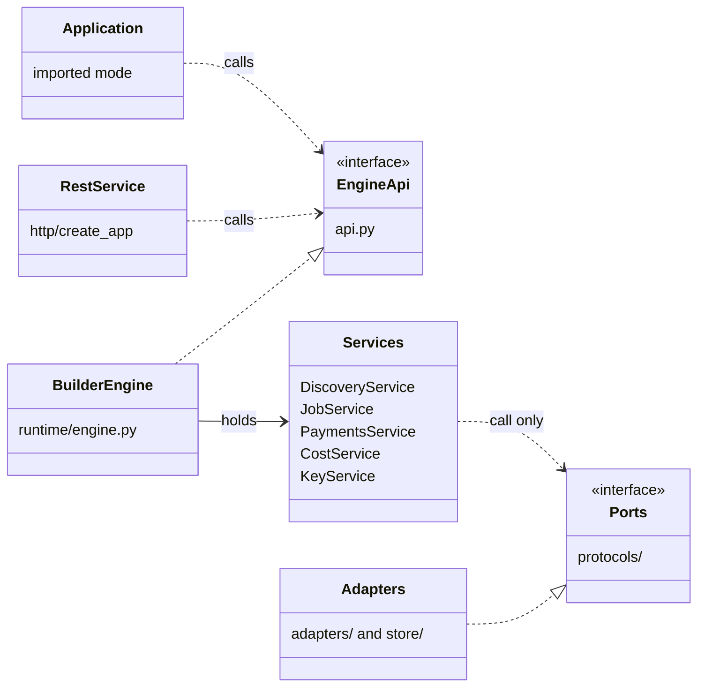

## What the engine offers: the facade

`api.py` splits the engine by role. An application that only runs jobs types against `ActorApi`;
`http/` types against `EngineApi`. Optional capabilities are `X?` members decided once at construction:
`jobs.streaming` (the transport can stream), `keys` (engine API keys are on) and `payments.grants`
(the grant desk is on). Callers check for `None`; nothing probes with `hasattr`.

```mermaid
classDiagram
    direction TB
    class ActorApi {
        <<interface>>
        +jobs JobsApi
        +costs CostsApi
        +discovery DiscoveryApi
        +payments AllowanceApi
        +health() EngineHealth
        +async start() None
        +async stop() None
    }
    class AdminApi {
        <<interface>>
        +payments PaymentsAdminApi
        +keys KeysApi?
        +costs CostsAdminApi
    }
    class EngineApi {
        <<interface>>
        +payments PaymentsApi
        +costs EngineCostsApi
        +authenticator Authenticator
        +events EventFeed
        +sessions SessionManager
    }
    class JobsApi {
        <<interface>>
        +async run(actor, request) JobResult
        +async get(actor, job_id) Job
        +async list_jobs(actor, limit, before) Job[]
        +async result(actor, job_id) JobResult
        +async report_usage(actor, job_id, quantities) Job
        +streaming StreamingApi?
    }
    class StreamingApi {
        <<interface>>
        +async stream(actor, request) JobStreamApi
    }
    class JobStreamApi {
        <<interface>>
        +job Job
        +status_code int
        +content_type str
        +finished bool
        +async for chunk in it
        +async complete() None
        +async aclose() None
        +async disconnected() None
    }
    class DiscoveryApi {
        <<interface>>
        +offerings(actor, app) Offering[]
        +runners(actor, app) Runner[]
        +candidates(app) Runner[]
    }
    class CostsApi {
        <<interface>>
        +async for_job(actor, job_id) JobCost
        +async summary(actor, start, end, actor_id) CostSummary
    }
    class CostsAdminApi {
        <<interface>>
        +async recent(actor, limit) JobCost[]
        +async reconcile(admin, application_id, actor_id) Reconciliation
        +async sync_now(admin) SyncReport
    }
    class AllowanceApi {
        <<interface>>
        +async allowance(actor, actor_id) Allowance
    }
    class PaymentsAdminApi {
        <<interface>>
        +async provision(admin, request) ProvisionedActor
        +async fund(admin, application_id, actor_id, request) ProvisionedActor
        +async set_status(admin, application_id, actor_id, status) ProvisionedActor
        +async rotate_key(admin, application_id, actor_id, operation_ref) ProvisionedActor
        +async revoke(admin, application_id, actor_id) ProvisionedActor
        +async fund_grant(admin, request) None
        +grants GrantsApi?
    }
    class GrantsApi {
        <<interface>>
        +async list_grants(admin) GrantRecord[]
        +async create_grant(admin, name, amount) GrantRecord
    }
    class KeysApi {
        <<interface>>
        +async issue(admin, kind, actor_id, application_id, permissions, label) IssuedKey
        +async list_keys(admin, application_id) AccessKey[]
        +async revoke(admin, key_id) None
        +async bootstrap_admin(label) IssuedKey
    }
    class BuilderEngine
    class FakeEngine
    ActorApi <|-- EngineApi
    AdminApi <|-- EngineApi
    ActorApi --> JobsApi
    ActorApi --> CostsApi
    ActorApi --> DiscoveryApi
    ActorApi --> AllowanceApi
    JobsApi --> StreamingApi
    StreamingApi ..> JobStreamApi : returns
    AdminApi --> PaymentsAdminApi
    AdminApi --> KeysApi
    AdminApi --> CostsAdminApi
    PaymentsAdminApi --> GrantsApi
    BuilderEngine ..|> EngineApi
    FakeEngine ..|> ActorApi
```

Behind the facade, each member is one concrete service: `jobs` is `JobService` (with `Streaming` and
`JobStream`), `discovery` is `DiscoveryService`, `payments` is `PaymentsService` (with `GrantDesk`),
`costs` is `CostService`, `keys` is `KeyService`, and `authenticator` is `AuthenticatorChain`.

## What the engine needs: the ports

Services receive ports and call nothing else: no database, HTTP client or SDK. Each diagram below shows
the services of one concern, the ports they hold, and the default implementations. A service depends
on the narrowest port it needs; `JobService` holds a `JobRepo`, not the whole `EngineStore`.

### Access

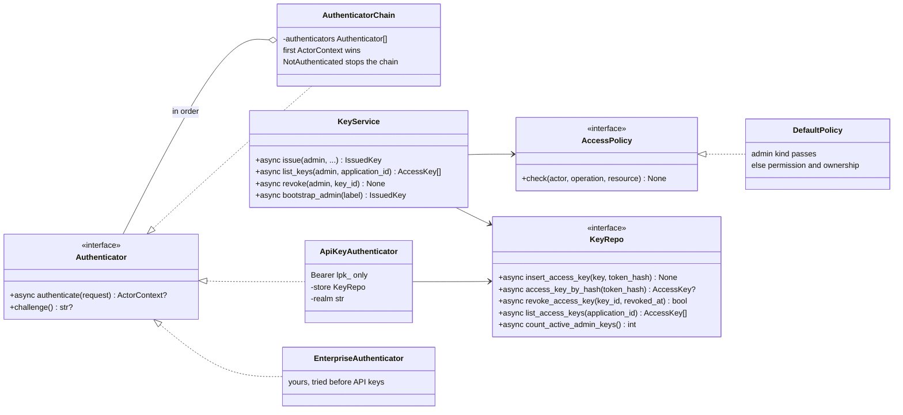

Every service holds the same `AccessPolicy` and calls `check` before it reads or writes. A policy
refusal on another actor's record is reported as `NotFound`, so existence is not revealed.

### Discovery and runner transport

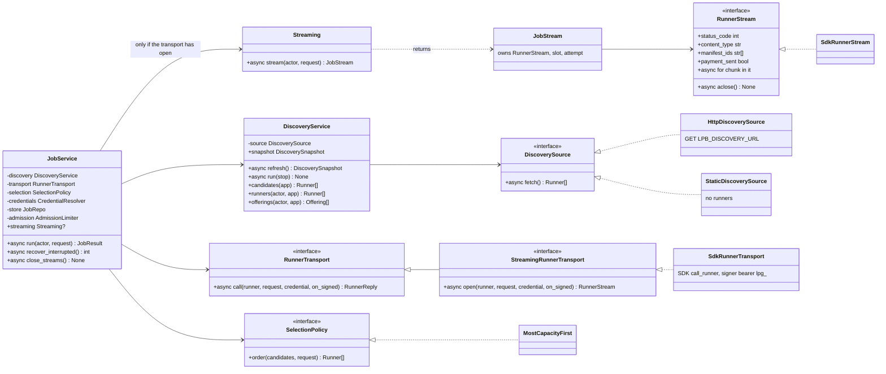

`JobService.streaming` exists only when the transport is a `StreamingRunnerTransport`; that is decided
once, in the constructor (D33). `on_signed` is the callback a transport calls each time the signer signs
a session, before the paid request goes out, so the evidence is stored first (D42).

### Payments and costs

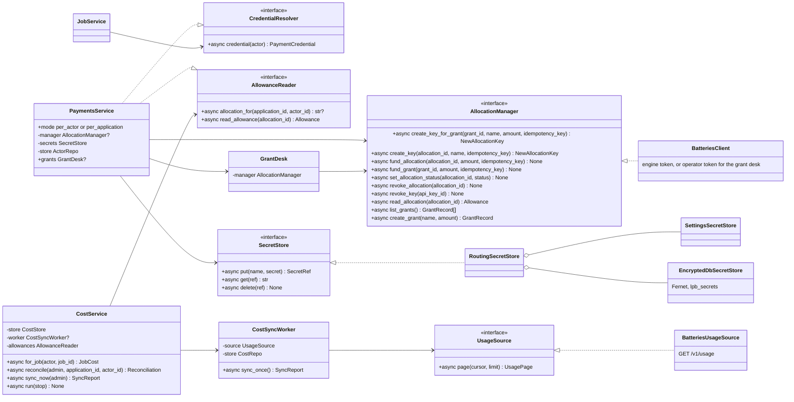

`CredentialResolver` and `AllowanceReader` are seams between services: `PaymentsService` implements
them, and `JobService` and `CostService` hold only the port. A test, or an enterprise, can then give
the job service credentials without the payments service.

### Persistence

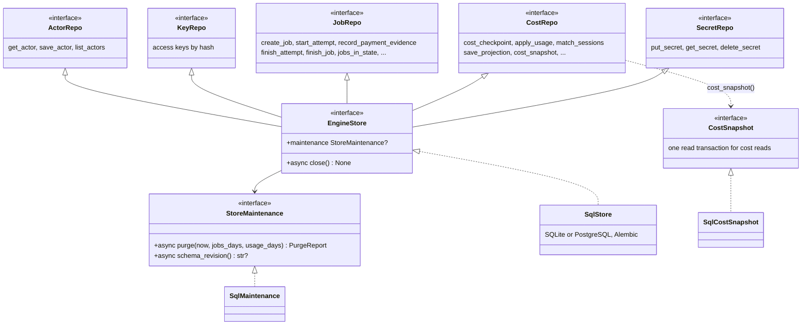

Who holds which repository: `JobService` a `JobRepo`; `PaymentsService` an `ActorRepo`; `KeyService`
and `ApiKeyAuthenticator` a `KeyRepo`; `CostService` a `CostStore` (`JobRepo` and `CostRepo`);
`EncryptedDbSecretStore` a `SecretRepo`. The full method lists are in
[generated/interfaces.md](../generated/interfaces.md#persistence-sub-interfaces).

## Composition: supply, decorate, assemble

`BuilderEngine.create` builds the engine in three stages (`runtime/assembly.py`). There is no DI
container: construction is data (`EngineSupply`, `EngineParts`) and two functions.

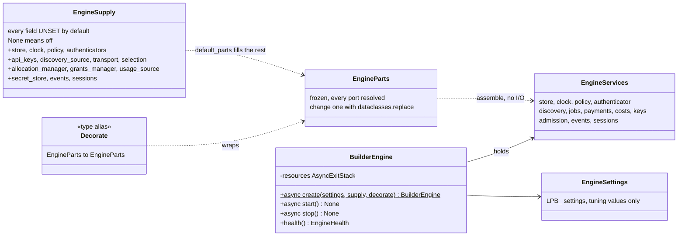

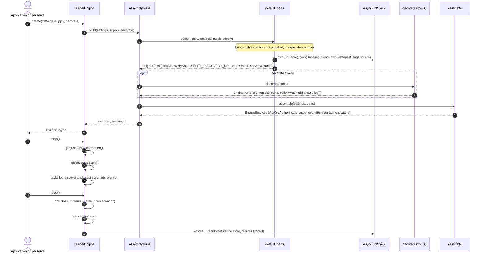

A part you supply is borrowed: the engine never closes it. A failure part-way through `build` closes
whatever was already opened; a failure in `start` stops the engine.

## A paid job through the ports

The same path as [architecture-diagrams.md](architecture-diagrams.md#6-a-paid-immediate-job-with-failover),
drawn at the level of the ports, with the evidence write at signing (D42).

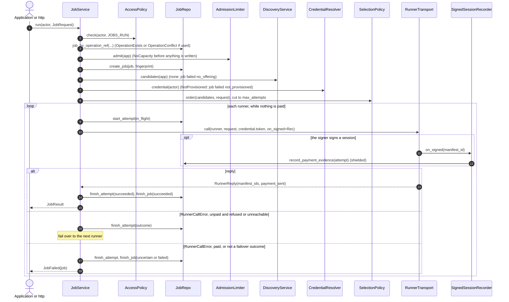

A streamed job follows the same steps up to the runner's answer, through `StreamingRunnerTransport.open`,
and then hands the open `RunnerStream` to a `JobStream` ([the streamed request](#a-streamed-request)).

## Discovery: the engine and the discovery service

The engine reads runners through one port, `DiscoverySource`. By default that is
`HttpDiscoverySource`, which reads livepeer-node's `/discovery` format from `LPB_DISCOVERY_URL`. The
discovery service is what usually answers there, and its own port, `OrchestratorDirectory`, decides
which orchestrators it asks.

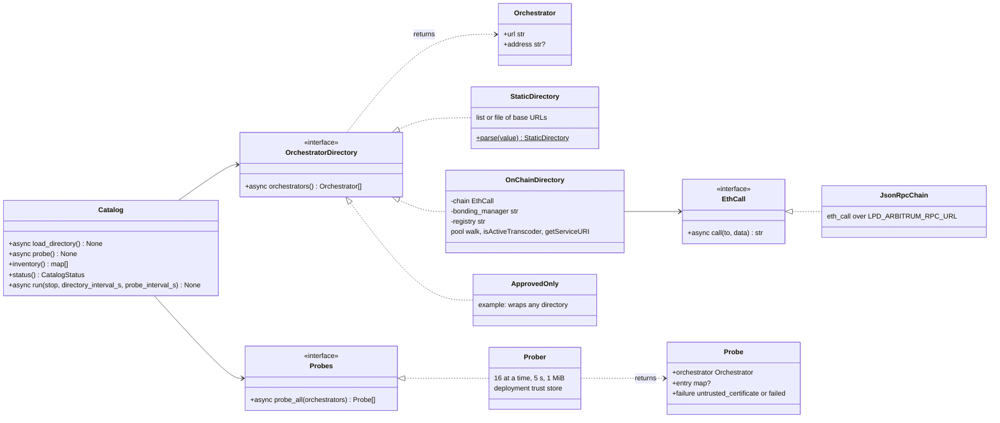

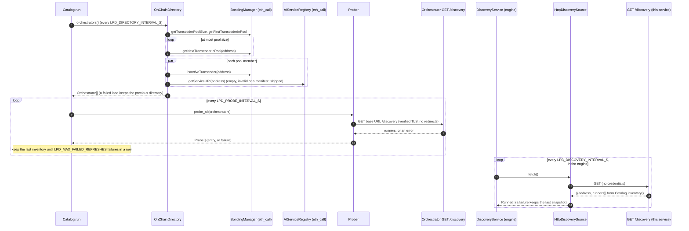

## The REST service (`http/`)

`http/` is the only package that imports FastAPI, and `http/server.py` the only one that imports
uvicorn. It depends on `EngineApi`, never on `BuilderEngine`, so any object that satisfies the facade can
be served.

### Classes

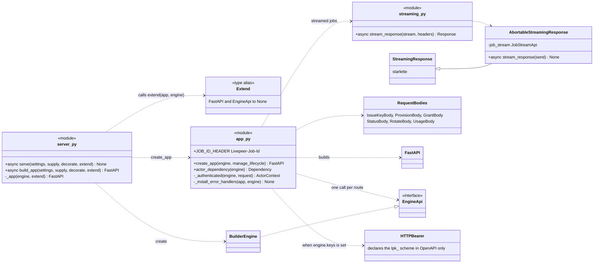

`create_app` registers every route as a closure over `engine`: nothing is looked up from a global or
from `app.state`. `actor_dependency(engine)` is the authentication dependency, and routes you add with
`extend` use the same one.

### Routes

Each route authenticates, then makes one engine call. Authorization happens in the services.

| Route | Engine call | Answer |
| --- | --- | --- |
| `GET /livez` | none | `{"status": "ok"}` |
| `GET /readyz` | `health()` | `EngineHealth`, `503` until the first discovery attempt |
| `GET /v1/offerings?app=` | `discovery.offerings` | `Offering[]` |
| `GET /v1/runners?app=` | `discovery.runners` | `Runner[]` |
| `POST /v1/jobs` | `jobs.run` | the runner's status, type and body, with `Livepeer-Job-Id` |
| `POST /v1/jobs?stream=true`, or `Accept: text/event-stream` | `jobs.streaming.stream` | the body streamed as it arrives; `400` if the transport cannot stream |
| `GET /v1/jobs`, `GET /v1/jobs/{id}` | `jobs.list_jobs`, `jobs.get` | `Job[]`, `Job` |
| `GET /v1/jobs/{id}/result` | `jobs.result` | `501` until M4 |
| `POST /v1/jobs/{id}/usage` | `jobs.report_usage` | `Job` |
| `GET /v1/jobs/{id}/cost` | `costs.for_job` | `JobCost` |
| `GET /v1/costs/projections`, `GET /v1/costs/summary` | `costs.recent`, `costs.summary` | `JobCost[]`, `CostSummary` |
| `GET /v1/allowance` | `payments.allowance` | `Allowance` |
| `GET /v1/events`, `POST /v1/sessions` | `events.after`, `sessions.open` | `501` until M4 |
| `POST, GET /v1/admin/keys`, `POST /v1/admin/keys/{id}/revoke` | `keys.*` | only when `engine.keys` is set |
| `POST /v1/admin/applications/{app}/actors/{actor}/allocation` (and `/fund`, `/status`, `/revoke`, `/rotate-key`) | `payments.provision`, `fund`, `set_status`, `revoke`, `rotate_key` | `ProvisionedActor` |
| `GET, POST /v1/admin/grants` | `payments.grants.*` | only when `payments.grants` is set |
| `POST /v1/admin/grant/fund` | `payments.fund_grant` | `204` |
| `GET /v1/admin/reconciliation` | `costs.reconcile` | `Reconciliation` |
| `POST /v1/admin/costs/sync` | `costs.sync_now` | `SyncReport` |

The generated schema is [generated/openapi.json](../generated/openapi.json); CI fails when it drifts.

### Errors and their statuses

Services raise `EngineError`s. `_install_error_handlers` maps each one to a status, so no route catches
anything.

```mermaid
classDiagram
    direction TB
    class EngineError
    class NotAuthenticated {
        401 + WWW-Authenticate from the chain
    }
    class AccessDenied {
        403
    }
    class NotFound {
        404
    }
    class InvalidRequest {
        400
    }
    class NotProvisioned {
        402
    }
    class OperationExists {
        409 + Livepeer-Job-Id + job
    }
    class OperationConflict {
        409 + Livepeer-Job-Id
    }
    class NoCapacity {
        503 + Retry-After
    }
    class ProviderUnavailable {
        503
    }
    class ProviderError {
        provider 400, 404, 409, 422 pass through
        else 502
    }
    class NotImplementedInMilestone {
        501 + milestone + ticket
    }
    class JobFailed {
        status by failure.kind
        + Livepeer-Job-Id + job
        + Retry-After when worth retrying
    }
    EngineError <|-- NotAuthenticated
    EngineError <|-- AccessDenied
    EngineError <|-- NotFound
    EngineError <|-- InvalidRequest
    EngineError <|-- NotProvisioned
    EngineError <|-- OperationExists
    EngineError <|-- OperationConflict
    EngineError <|-- NoCapacity
    EngineError <|-- ProviderUnavailable
    EngineError <|-- ProviderError
    EngineError <|-- NotImplementedInMilestone
    EngineError <|-- JobFailed
```

| `JobFailed` kind | Status | `Retry-After` |
| --- | --- | --- |
| `no_offering` | 404 | |
| `not_provisioned` | 402 | |
| `no_capacity`, `refused`, `unreachable` | 503 | 5 |
| `payment` | 503 | 10 |
| `timeout` | 504 | |
| `runner_rejected` | the runner's own status, else 422 | |
| `runner_error`, `interrupted`, anything else | 502 | |

A request body that fails validation never reaches the engine: FastAPI answers `422`.

### Startup and shutdown

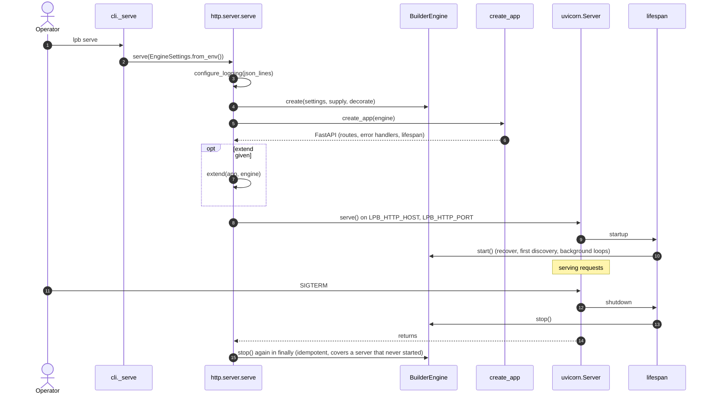

`build_app` does the same without uvicorn and without logging, for your own ASGI stack; the app's
lifespan still starts and stops the engine. To hold the engine yourself, call `create_app(engine,
manage_lifecycle=False)`.

### A buffered request

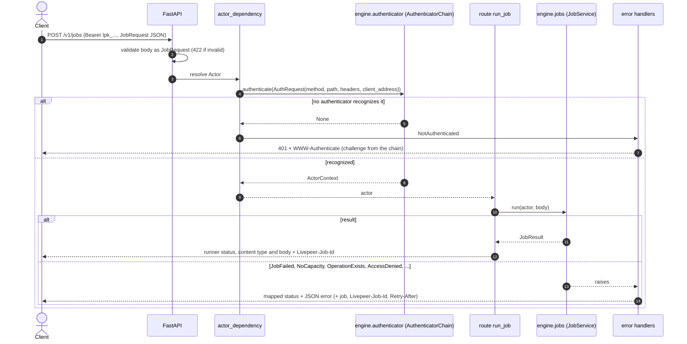

### A streamed request

The response headers wait for the runner's first chunk. Until then, a failure is an ordinary error
response, exactly like a buffered job. After it, a failure cuts the connection, because the engine never
writes into a stream whose format it does not know (D29, D37).

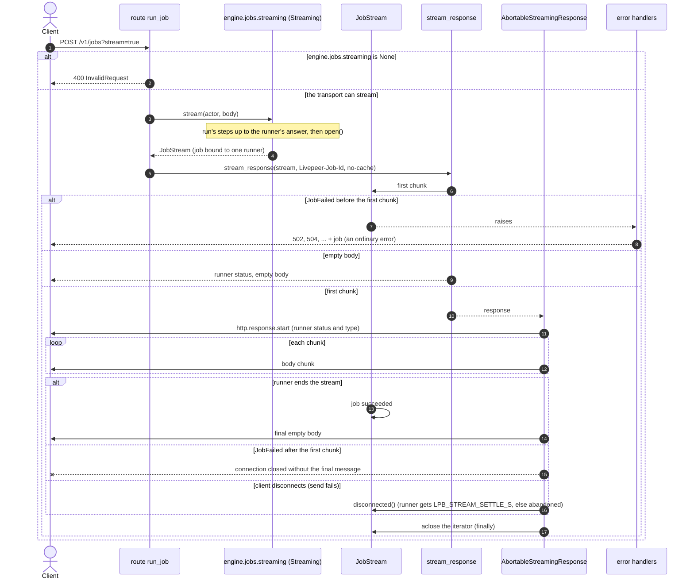

### Customizing the server

The REST service is customized like the embedded engine, plus `extend` for routes. `extend` receives
the engine, so a new route needs no lookup:

```python
def extend(app: FastAPI, engine: EngineApi) -> None:
    Actor = Annotated[ActorContext, Depends(actor_dependency(engine))]

    @app.get("/v1/me")
    async def me(actor: Actor) -> dict[str, str]:
        return {"actor_id": actor.actor_id}


asyncio.run(serve(EngineSettings.from_env(), supply=..., decorate=..., extend=extend))
```

A runnable version is in [extending-the-engine.md](extending-the-engine.md#service-mode).

## The discovery service's HTTP server (`discovery/server.py`)

A separate process with its own settings (`LPD_*`). It shares nothing with the engine, imports only
`utils` from the package, and uses Starlette directly.

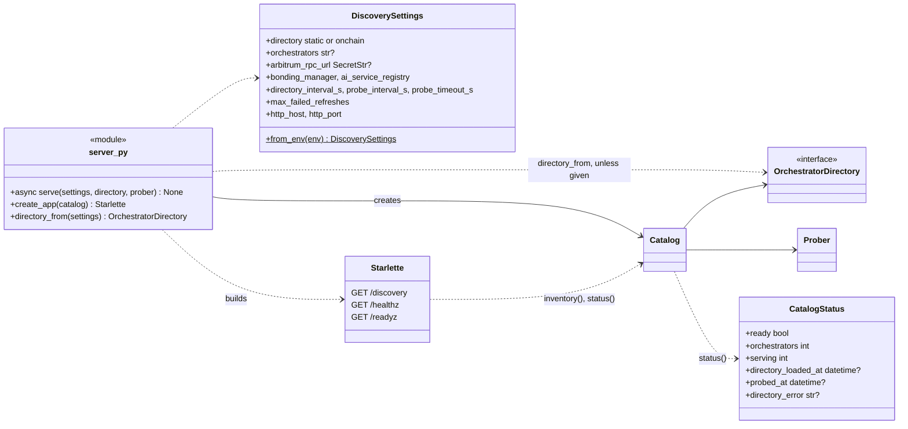

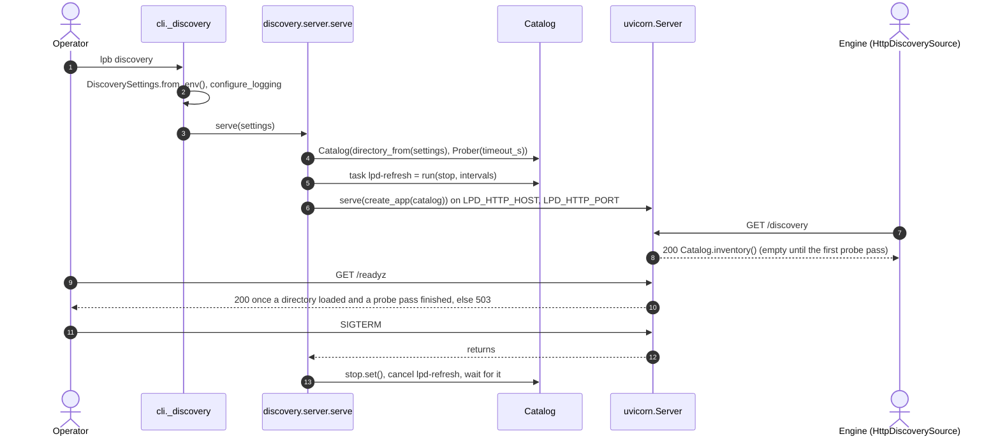

To change who is discovered, call `serve(settings, directory=YourDirectory())`. To replace the service
entirely, serve the same `GET /discovery` format from anything and point `LPB_DISCOVERY_URL` at it.

## Questions for the review

Points worth deciding, noticed while drawing these:

1. **`DiscoveryApi.candidates` checks no permission.** `runners` and `offerings` check `DISCOVER`;
   `candidates` does not, because the job service calls it after its own check. It is still on the
   public `ActorApi`, and ChatLPT and inference-gateway call it for readiness. Keep it public and
   document that, or move readiness to a policy-checked call?
2. **`ProviderError` passes some provider statuses through.** A Batteries `400`, `404`, `409` or `422`
   becomes the engine's own status, so a client cannot tell a provider rejection from an engine one.
3. **Route naming.** Grants are `/v1/admin/grants` but funding one is `/v1/admin/grant/fund`, with no
   grant id in the path.
4. **Reserved members.** `EngineApi.events`, `sessions` and `jobs.result` are on the facade and answer
   `501` until M4. Keep them visible so the contract is fixed early, or add them when they work?
5. **Ports that services implement.** `CredentialResolver` and `AllowanceReader` are implemented by
   `PaymentsService`, not by an adapter. That keeps `JobService` and `CostService` testable alone, but
   an enterprise cannot supply them through `EngineSupply`.
