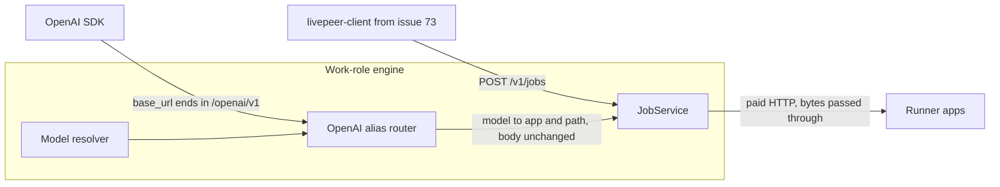

# OpenAI-compatible client surface

**Status:** proposal, 18 November 2026. Not accepted. It changes no decision, contract or code until it is.
Its [proposed decisions](#proposed-decisions) would become D87 onward.
**Depends on:** D29 (a stream is opaque bytes), D56 (`raw_body` and `return_http_errors`), and the existing
authenticator chain. The enterprise-login story assumes the work-role engine of ISS-31
([#162](https://github.com/NE-Build-Track/livepeer-builder-core/issues/162) to
[#169](https://github.com/NE-Build-Track/livepeer-builder-core/issues/169), D82 to D86).
**Sits beside:** [#73](https://github.com/NE-Build-Track/livepeer-builder-core/issues/73) and its stretch
issues [#118](https://github.com/NE-Build-Track/livepeer-builder-core/issues/118) (app-addressed aliases)
and [#123](https://github.com/NE-Build-Track/livepeer-builder-core/issues/123) (the `livepeer-client` wheel).
D64 keeps both of those outside the M4 gate. This proposal is the same class of work: it does not gate M4.
**Verified against:** builder-core `releases/m4` at `4ff6da8`; the gateway SDK pin `7dc2a07`; the runner
registry at `3669351` (the commit `livepeer-ai-nodes` pins); Venice's migration guide as published on
18 November 2026.

An enterprise application that runs the engine, embedded or as `lpb serve` in the `work` or `both` role,
can offer its logged-in users an OpenAI base URL. Any OpenAI SDK then runs chat, images, audio and the
other profiles the network already publishes, by changing `base_url` and `api_key`. Payment, discovery
and failover stay inside the engine. The caller sends the credential it already has: an `lpk_` key or
the enterprise's JWT.

The native client from #73 stays the canonical SDK. These routes are a second alias onto `JobRequest`,
addressed by model instead of by app.

## Contents

- [What exists today](#what-exists-today)
- [What OpenAI compatibility is](#what-openai-compatibility-is)
- [The engine's commitment](#the-engines-commitment)
- [Routes](#routes)
- [Model resolution](#model-resolution)
- [Errors](#errors)
- [Streaming](#streaming)
- [Client, CLI and embedded use](#client-cli-and-embedded-use)
- [Compatibility matrix](#compatibility-matrix)
- [Appendix: livepeer-ai-nodes](#appendix-livepeer-ai-nodes)
- [How it ships](#how-it-ships)
- [Proposed decisions](#proposed-decisions)
- [Open questions](#open-questions)
- [Out of scope](#out-of-scope)

## What exists today

| Area | `releases/m4` at `4ff6da8` | Where |
| --- | --- | --- |
| Sync job | `POST /v1/jobs` with `JobRequest`: `app`, `path`, `method`, `payload` or `raw_body` (8 MiB, URL-safe base64 on the wire), `content_type`, `headers`, `operation_ref`, labels `capability` and `model` | [engine.md](../contracts/engine.md#jobs-and-attempts), `contracts/jobs.py` |
| Streaming | `?stream=true` or `Accept: text/event-stream`. Headers wait for the first chunk. The engine copies bytes and writes nothing of its own into the body (D29) | [engine.md](../contracts/engine.md#streaming), `http/streaming.py` |
| Runner errors as the runner sent them | `return_http_errors` on a stream returns the status and bytes the engine stopped at. Failover for 503, 404 and 409 still happens first (D56) | [engine.md](../contracts/engine.md#opaque-request-bodies-and-stream-headers) |
| Auth | `Authorization: Bearer`, an `lpk_` key or a JWT ([RFC 6750](https://www.rfc-editor.org/rfc/rfc6750)). No query credential | `adapters/auth.py` |
| Catalog | `GET /v1/offerings` is public and names apps, modes and rates. `Runner.metadata` holds the runner's JSON and the engine does not read it | `contracts/discovery.py` |
| Engine errors | `{"error": "<message>", ...}` plus, for a job, `Livepeer-Job-Id` and a `job` object | `http/app.py` |
| Async, sessions, events | 501 | ISS-26, ISS-27, ISS-46 |
| OpenAI routes | None. A caller who wants `/v1/chat/completions` names the app and the path on `POST /v1/jobs` | `http/app.py` |

`capability` and `model` on `JobRequest` are labels. This proposal does not promote them to a resolver.
The facade keeps its own table and writes the label `model` from the resolved id.

## What OpenAI compatibility is

Venice's migration guide is the clearest public statement of the pattern, and it is the pattern this
proposal keeps. Venice serves the OpenAI wire protocol at `https://api.venice.ai/api/v1`. The official
`openai` SDK works after two assignments, `api_key` and `base_url`. The same assignment is what
LangChain, the Vercel AI SDK, LlamaIndex, CrewAI, PydanticAI and the coding agents read from
`OPENAI_BASE_URL`.

The parts of that pattern worth copying, because they are what those SDKs actually depend on:

| Venice behavior | Why an SDK depends on it |
| --- | --- |
| One base URL under which `/chat/completions`, `/models`, `/images/generations`, `/audio/speech`, `/audio/transcriptions` and `/embeddings` sit | `OpenAI(base_url=...)` appends those paths and no others |
| `model` is the only field the server must understand in order to route | The SDK treats every other field as the model's |
| `GET /models` returns objects with `id`, `object`, `created` and `owned_by` | `client.models.list()` validates that shape |
| Bearer authentication | The SDK sends `Authorization: Bearer` ([RFC 6750](https://www.rfc-editor.org/rfc/rfc6750)) |
| A JSON error object `{"error": {"message", "type", "param", "code"}}` | The SDK raises `APIStatusError` from that object |
| Chat streams are `text/event-stream` chunks and end with `data: [DONE]` | The SDK's stream parser stops on that sentinel |

Venice can promise the *body* schema because Venice runs the inference. Two of its rules follow from
that ownership, and this engine should not copy them:

- **Unknown top-level fields are HTTP 400.** Venice rejects `logit_bias` and `service_tier`. Rejecting
  a field means the server has a closed schema. Here the runner owns the schema. A field the engine
  does not know is forwarded with the body.
- **A final usage chunk, and a mid-stream `data:` error, are added by the server.** Venice appends a
  chunk whose `choices` are empty and whose payload is `usage` plus a `cost`, and it writes an error
  event after the HTTP status is already 200. D29 forbids the engine from writing into a stream whose
  format it does not parse. A runner that speaks `openai.chat.v1` already ends its own stream with
  `data: [DONE]`. The engine copies that ending and adds nothing after it.

Venice also publishes an honest matrix: Assistants, Batch, image edits and fine-tuning are absent, and
audio model names are Venice's own. The matrix [below](#compatibility-matrix) is the same kind of list.
A route exists here only when a registry profile already names its path, or when an operator override
names an app and a path. An empty route is not mounted in order to look complete.

## The engine's commitment

The facade commits to five things.

1. **Routing.** `model` selects an app and a path. The route the client called must be that path.
2. **Authentication.** The request uses the engine's authenticator chain. The bearer is not forwarded
   to the runner.
3. **The error envelope, for failures of the engine's own.** A failure before a runner body is the
   OpenAI error object. The HTTP status stays the engine's status from `http/app.py`.
4. **Byte passthrough.** The request body is `raw_body` with the caller's content type. The response
   body, status and content type are the runner's, through the existing job and stream paths (D29, D56).
5. **`GET /models`.** This is the one OpenAI schema the engine builds itself, because no runner answers
   it. Each entry has `id`, `object` (`"model"`), `created` (the offering's `observed_at`, as Unix
   seconds) and `owned_by` (the runner app). The list contains only models the resolver can dispatch.

The facade does not validate messages, tools, response formats, image sizes or token limits, and it
does not rewrite a response to add usage, cost or a sentinel. Cost stays on
`GET /v1/jobs/{id}/cost`, keyed by the `Livepeer-Job-Id` response header. That header is the job id
the native client and `lpb` already use.



`POST /v1/jobs` remains the canonical contract, as #73's aliases do. A job created here is an ordinary
job: the same admission, idempotency, payment, failover and cost records.

## Routes

The router is off unless `LPB_OPENAI_COMPAT` is set. It is mounted on the `work` and `both` roles and
omitted from the `clearinghouse` role (D84), which runs no jobs. While the flag is off the paths are
absent, so a probe gets the server's ordinary 404.

The base path is `/openai/v1`. An SDK is configured with `base_url` ending in `/openai/v1` and then
calls `/chat/completions` itself. The prefix keeps these routes off `/v1/jobs`, `/v1/offerings` and the
`/v1/run` aliases of #118.

| Client call | Runner path, from the profile | Profile at registry `3669351` | Body |
| --- | --- | --- | --- |
| `POST /openai/v1/chat/completions` | `POST /v1/chat/completions` | `openai.chat.v1` | JSON |
| `POST /openai/v1/responses` | `POST /v1/responses` | `openai.responses.stateless.v1` | JSON |
| `POST /openai/v1/embeddings` | `POST /v1/embeddings` | `openai.embeddings.v1` | JSON |
| `POST /openai/v1/images/generations` | `POST /v1/images/generations` | `openai.images.v1` | JSON |
| `POST /openai/v1/audio/speech` | `POST /v1/audio/speech` | `openai.speech.v1` | JSON in, audio bytes out |
| `POST /openai/v1/audio/transcriptions` | `POST /v1/audio/transcriptions` | `openai.transcriptions.v1` | `multipart/form-data` |
| `POST /openai/v1/audio/translations` | `POST /v1/audio/translations` | `openai.translations.v1` | `multipart/form-data` |
| `GET /openai/v1/models` | answered by the engine | — | — |

`openai.responses.stateless.v1` is the stateless Responses profile: each call carries its whole input.
Mounting the route is the same alias as chat. It does not add stored responses, conversations or
background jobs. Assistants, Batch, fine-tuning and image edits have no profile in that registry, so
they are not mounted. A client that calls one gets the facade's 404 error object, with `code`
`unknown_route`.

Each POST becomes one `JobRequest`:

- `app` and `path` come from [resolution](#model-resolution). `method` is `POST`.
- `raw_body` is the exact request bytes. `content_type` is the request's content type, including a
  multipart boundary. The engine's 8 MiB decoded limit applies (D56). A larger body is 413, with the
  OpenAI error object and `code` `request_too_large`.
- `model` on the job record is the resolved model id, stored as the existing label.
- `return_http_errors` is set, so the runner's own status and body are the HTTP response, and D56
  failover still runs before that.
- No client header is copied onto the runner call. `Authorization` stays at the engine.
  `Idempotency-Key`, when present, is consumed as `operation_ref` and is not forwarded. The header is
  the one in [draft-ietf-httpapi-idempotency-key-header](https://datatracker.ietf.org/doc/draft-ietf-httpapi-idempotency-key-header/);
  it is a draft, and the engine accepts it as an optional caller key, not as a required protocol.
  A value longer than 200 characters, or one containing a NUL, is 400: `operation_ref` is `StoredText`.
- The response carries `Livepeer-Job-Id`. Buffered and streamed responses already do.

The facade reads two fields and nothing else.

- From a JSON body it reads `model` (a string) and `stream` (a boolean). A body that is not JSON, a
  missing `model`, or a `stream` that is present and not a boolean, is 400 before any payment.
- From a multipart body it reads the form field named `model`. The bytes are forwarded unchanged,
  which is what `openai.transcriptions.v1` and `openai.translations.v1` require. Building a new
  multipart body would change the boundary the runner has to parse.

`stream: true` in the JSON body selects `jobs.streaming`, as `?stream=true` does on `POST /v1/jobs`.
`Accept: text/event-stream` selects it as well, which is today's rule. The body still goes through
verbatim, so the runner sees the same `stream` value the client sent. Multipart routes have no
`stream` field in their profiles; they are buffered jobs.

```python
from openai import OpenAI

client = OpenAI(
    api_key="lpk_...",  # or a JWT from the enterprise issuer
    base_url="https://engine.example/openai/v1",
    max_retries=0,  # the engine fails over; a second client attempt can pay twice
)
# Resolves model "qwen3.8-27b" to the app an operator or a runner profile named, path
# /v1/chat/completions, and forwards this JSON as the raw body.
client.chat.completions.create(
    model="qwen3.8-27b",
    messages=[{"role": "user", "content": "What is Livepeer?"}],
)
```

## Model resolution

D64 routes M4 work by app id and leaves the runner standard (ISS-48) unvetted. Resolution follows that.
An operator override is enough to dispatch a job. Runner metadata is an additional source when a runner
already publishes a profile, which the `livepeer-ai-nodes` runners do. A runner with no metadata, or
with metadata that is not the runner-contract JSON, is simply absent from automatic resolution. Discovery
itself is unchanged.

**Overrides.** `LPB_OPENAI_MODELS` is a JSON array. Each entry matches one model string exactly:

```json
[
  {"model": "qwen3.8-27b", "app": "vllm/qwen", "profile": "openai.chat.v1"},
  {"model": "default", "app": "vllm/qwen", "profile": "openai.chat.v1"},
  {"model": "whisper-1", "app": "transcription", "method": "POST", "path": "/v1/audio/transcriptions"}
]
```

`profile` must be one of the seven ids in the table above; the profile fixes the method and the path.
`method` and `path` are the alternative for an app that speaks a path the table does not name, and
they are allowed only when `profile` is omitted. `default` is not special: it is a model string an
operator listed. There is no built-in map from OpenAI's model names (`gpt-4o`, `tts-1`, `whisper-1`)
onto network apps. Venice keeps such a map because it chooses the weights. An enterprise that wants
`whisper-1` writes the override, as the third entry does.

**Metadata.** For each runner in the current discovery snapshot, the resolver reads `metadata` as JSON
and looks for `model.name` plus `endpoints.*.profile`. A profile it knows contributes one candidate:
that model id, that app, and the profile's path. This is the shape `livepeer-ai-nodes` already stores
(`endpoints.images.profile` = `openai.images.v1`, `model.name` = `black-forest-labs/FLUX.2-klein-4B`,
and the same for `openai.transcriptions.v1` and `openai.speech.v1`). The engine does not import the
registry package. The profile-to-path table is a frozen copy of registry `3669351`, and a test fails
when the copy drifts from a checked-in fixture of those seven documents. Moving the pin is a deliberate
change, the same way the SDK pin moves.

**Dispatch.** Overrides win. After that:

| Candidates for this model id and this route's path | Result |
| --- | --- |
| One app | That app and path |
| Several runners, one app | That app. Job selection among its runners is unchanged |
| Two or more apps | 400, `code` `model_ambiguous`. The operator adds an override. The engine does not pick one |
| None | 404, `code` `model_not_found` |

A match whose app has no ready runner continues into `JobService` and fails as today's `no_offering`
or `no_capacity`. The error object carries that failure `kind` as `code`. The model was known; the
network had nowhere to run it. `GET /openai/v1/models` lists a model only when resolution would
dispatch it to exactly one app, and omits an ambiguous id until an override names one. The list is
public, on the same grounds as `GET /v1/offerings`: it names no runner URL and spends nothing.

One work engine has one catalog. ISS-31 puts each enterprise on its own engine, so two tenants do not
share this list. Two actors of one enterprise see the same models. That is the catalog the enterprise
published.

## Errors

Failures before a runner body use one JSON shape:

```json
{"error": {"message": "...", "type": "invalid_request_error", "param": "model", "code": "model_not_found"}}
```

`message` is the engine exception's text, the same text `{"error": "<message>"}` carries today.
`type` is a coarse class an OpenAI SDK already understands. `code` is the engine's own kind, so an
operator can tell `not_provisioned` from `allowance_exhausted` without parsing prose. `param` is
`model` when the model id is the problem, and otherwise `null`. `Livepeer-Job-Id` is set once a job
exists. The `job` object from today's handler is omitted on these routes: an OpenAI SDK would ignore
it, and the native `GET /v1/jobs/{id}` remains the way to read the record.

| Engine outcome | HTTP status, unchanged | `type` |
| --- | --- | --- |
| `NotAuthenticated` | 401, with the authenticator's `WWW-Authenticate` | `authentication_error` |
| `AccessDenied`, payment `not_authorized` | 403 | `permission_error` |
| Facade validation, ambiguous model | 400 | `invalid_request_error` |
| Unknown model, unknown route, `no_offering` | 404 | `invalid_request_error` |
| `NotProvisioned`, `allowance_exhausted` | 402 | `insufficient_quota` |
| `OperationExists`, `OperationConflict` | 409 | `invalid_request_error` |
| Body over 8 MiB | 413 | `invalid_request_error` |
| `NoCapacity`, payment transport failures, `ProviderUnavailable` | 503, with `Retry-After` where the engine already sets it | `server_error` |
| Timeout before the first byte | 504 | `server_error` |
| Other `JobFailed` | the status `http/app.py` already chooses | `server_error` |

A runner answer, including a runner 4xx whose body is already an OpenAI error, is returned as status
and bytes (D56). The facade does not wrap that body. Collapsing 402 and 503 into 429 would hide the
distinction the engine's clients already branch on, so the statuses stay.

## Streaming

A chat or responses call with `stream: true` is `jobs.streaming` with the same deadlines
(`timeout_s` 300 s, `first_byte_timeout_s` and `idle_timeout_s` 60 s). The runner's content type is
the response's content type.

Three behaviors follow from D29 and from `http/streaming.py`, and they differ from Venice on purpose:

- The engine writes no trailing usage chunk and no cost. A runner that emits a usage chunk and
  `data: [DONE]`, as `openai.chat.v1` describes, has those bytes copied. A client that reads
  `choices[0]` on every chunk already has to tolerate an empty `choices` when the *runner* sends one.
- A failure before the first chunk is an error response, as a buffered job's failure is. The HTTP
  status is still available, so the error is the JSON object above, not a `data:` event.
- A failure after the first chunk aborts the connection. The body has no clean end. The job record
  says whether the stream was abandoned or the attempt is `uncertain`. The facade does not invent a
  `data:` error event for a format it has promised not to parse.

`Livepeer-Job-Id` is on the response headers, which are sent with the first chunk. SDKs that surface
headers (`with_raw_response` in the Python SDK) can read it. Cost is still `GET /v1/jobs/{id}/cost`
after the stream, once cost sync has observed it. The stream does not wait for that.

The OpenAI Python SDK retries connection errors and 5xx by default (`max_retries` defaults to 2).
The engine has already failed over inside the first attempt's `max_attempts`, and a client retry is a
new HTTP request. If the first request paid and then the client timed out, the retry can pay again.
The helper in the client sets `max_retries=0`. A caller using the SDK directly sets the same. The
facade does not try to recognize `x-stainless-retry-count`. An `Idempotency-Key` is the supported way
to make a repeated POST return the existing job.

## Client, CLI and embedded use

#123 already proposes the light `livepeer-client` wheel and the `lpb` entry point that loads engine
commands only when `livepeer_builder` imports. This proposal adds one optional extra to that wheel,
and nothing to the engine wheel's required dependencies.

| Piece | Where | Depends on |
| --- | --- | --- |
| The alias router, the resolver, the error translation | `livepeer-builder`, `http/openai.py` and a small resolver module | the engine as it is |
| `livepeer_client.openai_client()` and `lpb openai env` | `livepeer-client`, extra `openai` | `httpx` (already planned) and the `openai` package |

`openai_client()` returns an `openai.OpenAI` (and an async twin) configured with
`LIVEPEER_BUILDER_URL` + `/openai/v1`, `LIVEPEER_BUILDER_KEY`, and `max_retries=0`. Those two
variables are the ones #73 already names. `lpb openai env` prints the exports a shell or a framework
can take:

```sh
lpb openai env
# OPENAI_BASE_URL=https://engine.example/openai/v1
# OPENAI_API_KEY=lpk_...
```

There is no second, in-process implementation of the OpenAI client. An embedded engine that wants the
SDK mounts the same router. `create_app` does that when the flag is on; `http/server.py`'s `extend`
is the hook for an application that builds its own FastAPI app and still wants these routes on the
engine's authenticator. In process, the native `ActorApi.jobs` path remains the one #73's `run` and
`stream` call.

**Who the caller is.** The credential is whatever the work-role engine already accepts. For an
enterprise that issues `lpk_` keys, the key is the `api_key`. For an enterprise whose issuer the
engine trusts (`LPB_AUTH=jwt`, or `jwt,api_keys`), the access token is the `api_key`. PymtHouse, once
it runs on this engine, is that issuer: a user who has logged in holds a JWT, and the SDK sends it as
the bearer. The client never sees a clearinghouse, a payment key, a signer or a 402 challenge.
D85 keeps identity providers at the enterprise's engine, and this facade is on that engine.

A browser still cannot set `Authorization` on a WebSocket. This proposal adds no socket and no CORS
setting. Browser sockets stay with #120.

## Compatibility matrix

"Engine" means the facade guarantees the behavior. "Runner" means the bytes are passed through and the
guarantee lives in the profile and the app that serves it. A row with no mounted route fails with
`unknown_route`.

| Feature | Venice | This facade | Commitment |
| --- | --- | --- | --- |
| Chat completions | Compatible; unknown fields are 400 | Route mounted; unknown fields are forwarded | Runner for the schema, engine for routing and streaming bytes |
| Chat streaming, `data: [DONE]` | Compatible, plus a usage chunk the server adds | The runner's event stream, copied | Runner. The engine adds no chunk |
| Tools, response format, vision | Compatible | Forwarded | Runner (`openai.chat.v1` covers them) |
| Responses API | Native for some models, translated for others | `POST /responses`, stateless profile only | Runner |
| Embeddings | Text only | Route mounted; listed once a runner or an override resolves a model | Runner |
| Image generations | `/images/generations` | Route mounted | Runner (`openai.images.v1`, `b64_json`) |
| Image edits | Absent; a native route instead | Not mounted | — |
| Speech | Compatible request; Venice model ids | Route mounted; audio bytes out | Runner |
| Transcriptions | `json` or `text`; no translations route | Transcriptions and translations both mounted, multipart | Runner. Both inherit the 8 MiB request cap |
| Assistants, Batch, fine-tuning | Absent | Not mounted | — |
| `GET /models` | Live catalog, traits, OpenAI name aliases | Ids the resolver can dispatch. No traits, no name aliases | Engine |
| Error object | OpenAI object | OpenAI object for engine failures; runner body for runner answers | Engine for its own failures |
| Usage and cost inside the body | Final stream chunk | `Livepeer-Job-Id` and `GET /v1/jobs/{id}/cost` | Engine, on the job API |
| Client retries | The caller's concern | `max_retries=0` in the helper; engine failover unchanged | Engine |

## Appendix: livepeer-ai-nodes

`livepeer-ai-nodes` is a ComfyUI package. It talks to orchestrators through the gateway SDK
(`call_runner`, `reserve_session`) and learns paths from the runner registry at `3669351`. It is the
client this facade is shaped against, and it is also the client that shows the facade's edge.

What it does today, and what replaces it:

| Today | After this facade, for that row only |
| --- | --- |
| `openai.images.v1` on app `text-to-image`: `POST /v1/images/generations`, then `_decode_images` reads `data[].b64_json` (`nodes/creative_remote.py`) | `client.images.generate(model=<model.name>, ...)`. The SDK returns the same JSON. Decoding base64 into a frame stays in the node; the transport and the 402 loop go |
| `openai.transcriptions.v1`: multipart `POST /v1/audio/transcriptions`, field `file` (`tests/test_descriptions.py`) | `client.audio.transcriptions.create(...)`. The node stops building the multipart itself |
| `openai.speech.v1`: `POST /v1/audio/speech`, binary audio out | `client.audio.speech.create(...)`, which returns the audio bytes |
| `openai.chat.v1` is in the registry and not called by these nodes | Available to any OpenAI SDK pointed at the enterprise engine, once an override or a runner metadata entry resolves the model |
| Registry checkout inside `nodes/descriptions.py` (`REGISTRY_COMMIT`) to discover method and path | For these seven profiles, the engine holds the path table. The node sends a model id |
| PymtHouse device login, RFC 8693 exchange, signer JWT, and a mutable `signer_headers` dict (`nodes/pymthouse_auth.py`) | A JWT or `lpk_` from the enterprise engine. The signer stays behind the engine. This waits on PymtHouse running as that enterprise, which is the ISS-31 migration, not a change this facade can make alone |

What it does today that this facade does not replace:

| Today | What covers it |
| --- | --- |
| `comfystream.music.v1` (`POST /v1/music/generations`), `comfystream.ffmpeg.v1` (`POST /batch/scale-video`) | #73's `run`, or `POST /v1/jobs` with the app and path. They are not OpenAI profiles |
| Live video: `POST /stream`, trickle channels, `GET /session` polling, and `_reserve_pixels` (a hand-rolled 402 loop) | #73's realtime session and #121's trickle bridge. ISS-27 (D70) is the session core inside M4 |
| ComfyStream WebSocket JPEG (`nodes/stream/network_controller.py`, `nodes/remote_sessions.py`) | The same session work. A one-shot OpenAI route cannot hold that socket |
| FAL image batch via `runner_selector` and a follow-up GET of image URLs | `run` against that app. The facade would only apply if that app published `openai.images.v1` and returned the image inline |

The migration in that repository is three deletions once an enterprise engine is deployed: the payment
headers and `_reserve_pixels` for the OpenAI-profile jobs, the path lookup for those profiles, and the
signer exchange for users who hold an engine credential. The trickle and WebSocket sessions stay until
ISS-27 and #73's realtime client are what the nodes call. Mixing those into `/openai/v1` would make the
OpenAI surface carry Livepeer session semantics, which is the overcommit this proposal avoids.

## How it ships

Acceptance of this document comes first. The proposed decisions become D87 onward, in
`m4-decisions.md` or its successor, and each step below is its own pull request. None of them is an M4
gate (D64).

1. **This proposal.** Review against D29, D56 and D82 to D86. Confirm the 8 MiB answer in
   [open questions](#open-questions).
2. **Resolver.** The frozen profile table, override parsing, metadata reading, and the ambiguity rule.
   Unit tests use fixture metadata in the shape of `livepeer-ai-nodes`'s `IMAGE`, `TRANSCRIPT` and
   `SPEECH` documents. No network.
3. **Router.** Mount under the flag, on the work roles. Translation of engine errors, passthrough of
   runner answers, streaming when `stream` is true. Tests drive `create_app` with the fake runners in
   `livepeer_builder.testing` and an `openai` SDK client pointed at that app, `max_retries=0`.
4. **Client extra.** After #123's wheel exists, `openai_client`, the async twin, and `lpb openai env`.
   Until that wheel exists, the router is usable with any OpenAI SDK and the two settings.
5. **A guide page** in `docs/guides/` once the router is real: the two-line SDK setup, `max_retries=0`,
   where the job id and the cost are, and the 8 MiB cap. The guide is written against the shipped
   routes, not against this proposal.
6. **`livepeer-ai-nodes`.** A separate repository. It moves the three OpenAI profiles onto the SDK when
   an enterprise engine it can log in to is deployed. Session nodes are a later change against ISS-27.

## Proposed decisions

| # | Proposal |
| --- | --- |
| P1 | An optional router, off unless `LPB_OPENAI_COMPAT` is set, mounted at `/openai/v1` on the `work` and `both` roles only. `POST /v1/jobs` stays the canonical job contract. Unmounted and unknown paths under the prefix answer with the OpenAI error object and `code` `unknown_route` |
| P2 | The engine's commitment is routing, authentication, the error envelope for its own failures, byte passthrough, and the `GET /models` list. Request and response schemas belong to the runner profile. Unknown JSON fields are forwarded |
| P3 | The router reads `model` and, for JSON, `stream`. The original bytes are `raw_body` with the caller's content type. `return_http_errors` is set. No client header is sent to the runner. The 8 MiB limit is D56's, inherited |
| P4 | Resolution is an operator override (`LPB_OPENAI_MODELS`) first, then `Runner.metadata` when it carries a known profile and `model.name`. The profile table is a frozen copy of registry `3669351`. Ambiguous apps are 400 `model_ambiguous`. There is no built-in OpenAI model-name map and no trait. This does not wait on ISS-48, and it does not make the engine import the registry |
| P5 | Engine failures use the OpenAI error object, the engine's existing HTTP status, and `code` set from the engine's failure kind. Runner answers pass through as status and bytes. `GET /models` is public |
| P6 | Streams are the runner's bytes (D29). The router appends no usage chunk, no cost and no `data:` error. A failure after the first byte aborts the connection. Cost is `Livepeer-Job-Id` plus `GET /v1/jobs/{id}/cost` |
| P7 | The client surface is an `openai` extra on the `livepeer-client` wheel from #123: `openai_client()` with `max_retries=0`, and `lpb openai env`. Embedded apps mount the same router. There is no in-process reimplementation of the OpenAI SDK |
| P8 | A caller-supplied `Idempotency-Key` becomes `operation_ref`, when it fits `StoredText`. The router does not invent one. Client retries stay the caller's responsibility and are off in the helper. Engine failover is unchanged |

## Open questions

1. **Bodies over 8 MiB.** Transcription, translation and chat-with-images hit D56's cap quickly. The
   proposal keeps the cap and returns 413. Raising it, or accepting a streamed upload, would amend D56
   and needs its own decision. Until then the audio routes are honest about short clips only.
2. **`GET /models` and credentials.** The proposal makes it public, like `GET /v1/offerings`. An
   enterprise that wants the catalog visible only to its users would need the route to take a bearer.
   Offerings were left public because they name no URL and spend nothing (the comment on the route).
   The same argument is used here, and it is the one to confirm.
3. **Overrides as configuration.** A JSON array in an environment variable is awkward once an enterprise
   has more than a handful of models, and it cannot change without a restart. A file path, or a record
   the tenant admin writes, is the likely follow-on. The first version uses the environment variable so
   the router has no new admin route.

## Out of scope

- Parsing SSE, adding a usage or cost chunk, or rewriting a runner error into the engine's envelope.
- Assistants, Batch, fine-tuning, image edits, and any OpenAI route the pinned registry does not name.
- A compatibility map from OpenAI's model ids onto network apps, and Venice-style traits.
- Sockets, CORS, browser tokens, trickle and realtime sessions. Those are #73, #120, #121 and ISS-27.
- Client-visible payment, signer URLs, and payment keys. The work engine already hides them (D85).
- Changing `POST /v1/jobs`, the `model` label's meaning, or the clearinghouse routes.
- The `livepeer-ai-nodes` code change itself. The [appendix](#appendix-livepeer-ai-nodes) says which
  calls move, and that repository does the moving.
