# Core contracts (generated)

Generated by `lpb gen-docs` from `src/livepeer_builder/contracts/`. Do not edit by hand. Every
contract is a frozen pydantic model, the same class in-process and in the REST schema. `X?` means
optional, `X[]` a list. Composition edges link a contract to contracts it contains.

```mermaid
classDiagram
    class AuthRequest {
        +str method
        +str path
        +map headers
        +str? client_address
    }
    class ActorContext {
        +str actor_id
        +str application_id
        +str[] permissions
        +enum credential_kind
        +map attributes
        +AuthProvenance? auth
        +str? display_name
    }
    class AuthProvenance {
        +str method
        +str? issuer
        +str? credential_id
    }
    class ResourceRef {
        +enum kind
        +str application_id
        +str? owner_actor_id
        +str? id
    }
    class JobRequest {
        +str app
        +str path
        +enum method
        +map? payload
        +bytes? raw_body
        +str? content_type
        +str[][] headers
        +bool return_http_errors
        +str? operation_ref
        +str? capability
        +str? model
        +enum mode
        +int max_attempts
        +float timeout_s
        +float first_byte_timeout_s
        +float? idle_timeout_s
    }
    class Job {
        +UUID id
        +str actor_id
        +str application_id
        +str? operation_ref
        +enum mode
        +str app
        +str? capability
        +str? model
        +enum state
        +Attempt[] attempts
        +Failure? failure
        +ResultRef? result
        +MeasuredUsage? usage
        +datetime created_at
        +datetime? completed_at
    }
    class Attempt {
        +UUID job_id
        +int number
        +str? runner_url
        +str? orchestrator_url
        +str? allocation_id
        +SignedSession[] sessions
        +bool payment_sent
        +enum outcome
        +int? status_code
        +datetime started_at
        +datetime? ended_at
    }
    class Failure {
        +enum kind
        +str message
        +int? status_code
        +str? body
        +bool payment_sent
    }
    class ResultRef {
        +enum storage
        +str content_type
        +int size_bytes
        +str sha256
        +str? location
    }
    class MeasuredUsage {
        +map quantities
        +enum source
        +datetime reported_at
    }
    class JobResult {
        +Job job
        +int status_code
        +bytes content
        +str content_type
        +map? data
    }
    class Runner {
        +str url
        +str app
        +str? runner_id
        +str? mode
        +str? orchestrator_url
        +int? capacity
        +int? capacity_available
        +NetworkRate? rate
        +str? rate_error
        +datetime? observed_at
        +str? version
        +str? metadata
        +RunnerGPU? gpu
    }
    class RunnerGPU {
        +str? id
        +str? name
        +int? vram_mb
    }
    class NetworkRate {
        +Decimal amount
        +str currency
        +str unit
        +Decimal? price_usd
        +enum source
    }
    class ObservedRate {
        +Decimal amount
        +str currency
        +str unit
        +Decimal? price_usd
        +enum source
        +datetime observed_at
        +enum observed_by
    }
    class Offering {
        +str app
        +str[] modes
        +ObservedRate? rate_low
        +ObservedRate? rate_high
        +enum rate_status
        +bool stale
        +int runner_count
        +int ready_count
        +datetime observed_at
    }
    class JobCost {
        +UUID job_id
        +enum status
        +Fees fees
        +AttemptCost[] attempts
        +datetime? first_observed_at
        +datetime? updated_at
        +Fees billable
    }
    class AttemptCost {
        +int attempt_number
        +enum cost_class
        +Fees fees
    }
    class Fees {
        +Decimal fee_eth
        +Decimal? fee_usd
        +int row_count
    }
    class ProvisionedActor {
        +str application_id
        +str actor_id
        +str grant_id
        +str allocation_id
        +str api_key_id
        +SecretRef secret_ref
        +enum currency
        +enum status
        +datetime created_at
        +datetime updated_at
        +str label
    }
    class SecretRef {
        +str ref
    }
    class Allowance {
        +str allocation_id
        +str status
        +Money? granted
        +Money? spent
        +Money? available
    }
    class Money {
        +Decimal amount
        +enum currency
    }
    ActorContext *-- AuthProvenance : auth
    Allowance *-- Money : available
    Allowance *-- Money : granted
    Allowance *-- Money : spent
    AttemptCost *-- Fees : fees
    Job *-- Attempt : attempts
    Job *-- Failure : failure
    Job *-- MeasuredUsage : usage
    Job *-- ResultRef : result
    JobCost *-- AttemptCost : attempts
    JobCost *-- Fees : billable
    JobCost *-- Fees : fees
    JobResult *-- Job : job
    Offering *-- ObservedRate : rate_high
    Offering *-- ObservedRate : rate_low
    ProvisionedActor *-- SecretRef : secret_ref
    Runner *-- NetworkRate : rate
    Runner *-- RunnerGPU : gpu
```

