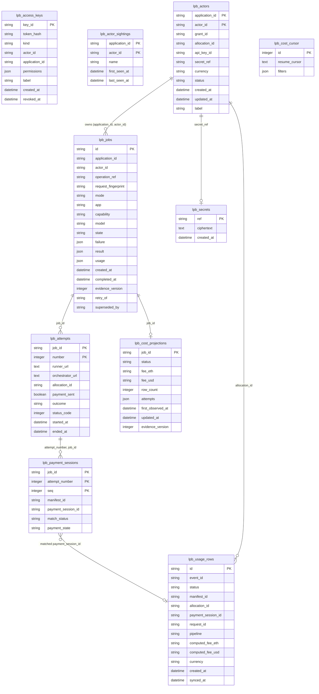

# Database schema (generated)

Generated from `src/livepeer_builder/store/schema.py` by `lpb gen-docs`. Do not edit by hand.
Migrations live in `src/livepeer_builder/store/migrations/versions/`.

## Entity-relationship diagram

Solid lines are foreign keys. `lpb_actors` and `lpb_usage_rows` links are logical joins used by
the cost service (a matched `payment_session_id` joins a session-log entry to usage).

## `lpb_access_keys`

| Column | Type | Null | Key |
| --- | --- | --- | --- |
| `key_id` | VARCHAR(64) | no | PK |
| `token_hash` | VARCHAR(64) | no | unique |
| `kind` | VARCHAR(16) | no |  |
| `actor_id` | VARCHAR(200) | no |  |
| `application_id` | VARCHAR(200) | no |  |
| `permissions` | JSON | no |  |
| `label` | VARCHAR(200) | no |  |
| `created_at` | DATETIME | no |  |
| `revoked_at` | DATETIME | yes |  |

## `lpb_actor_sightings`

| Column | Type | Null | Key |
| --- | --- | --- | --- |
| `application_id` | VARCHAR(200) | no | PK |
| `actor_id` | VARCHAR(200) | no | PK |
| `name` | VARCHAR(200) | no |  |
| `first_seen_at` | DATETIME | no |  |
| `last_seen_at` | DATETIME | no |  |

## `lpb_actors`

| Column | Type | Null | Key |
| --- | --- | --- | --- |
| `application_id` | VARCHAR(200) | no | PK |
| `actor_id` | VARCHAR(200) | no | PK |
| `grant_id` | VARCHAR(200) | no |  |
| `allocation_id` | VARCHAR(200) | no | unique |
| `api_key_id` | VARCHAR(200) | no |  |
| `secret_ref` | VARCHAR(200) | no |  |
| `currency` | VARCHAR(3) | no |  |
| `status` | VARCHAR(16) | no |  |
| `created_at` | DATETIME | no |  |
| `updated_at` | DATETIME | no |  |
| `label` | VARCHAR(200) | no |  |

## `lpb_attempts`

| Column | Type | Null | Key |
| --- | --- | --- | --- |
| `job_id` | VARCHAR(36) | no | PK |
| `number` | INTEGER | no | PK |
| `runner_url` | TEXT | yes |  |
| `orchestrator_url` | TEXT | yes |  |
| `allocation_id` | VARCHAR(200) | yes |  |
| `payment_sent` | BOOLEAN | no |  |
| `outcome` | VARCHAR(16) | no |  |
| `status_code` | INTEGER | yes |  |
| `started_at` | DATETIME | no |  |
| `ended_at` | DATETIME | yes |  |

## `lpb_cost_cursor`

| Column | Type | Null | Key |
| --- | --- | --- | --- |
| `id` | INTEGER | no | PK |
| `resume_cursor` | TEXT | yes |  |
| `filters` | JSON | no |  |

## `lpb_cost_projections`

| Column | Type | Null | Key |
| --- | --- | --- | --- |
| `job_id` | VARCHAR(36) | no | PK |
| `status` | VARCHAR(16) | no |  |
| `fee_eth` | VARCHAR(64) | no |  |
| `fee_usd` | VARCHAR(64) | yes |  |
| `row_count` | INTEGER | no |  |
| `attempts` | JSON | no |  |
| `first_observed_at` | DATETIME | yes |  |
| `updated_at` | DATETIME | no |  |
| `evidence_version` | INTEGER | no |  |

## `lpb_jobs`

| Column | Type | Null | Key |
| --- | --- | --- | --- |
| `id` | VARCHAR(36) | no | PK |
| `application_id` | VARCHAR(200) | no |  |
| `actor_id` | VARCHAR(200) | no |  |
| `operation_ref` | VARCHAR(200) | yes |  |
| `request_fingerprint` | VARCHAR(64) | yes |  |
| `mode` | VARCHAR(16) | no |  |
| `app` | VARCHAR(200) | no |  |
| `capability` | VARCHAR(200) | yes |  |
| `model` | VARCHAR(200) | yes |  |
| `state` | VARCHAR(16) | no |  |
| `failure` | JSON | yes |  |
| `result` | JSON | yes |  |
| `usage` | JSON | yes |  |
| `created_at` | DATETIME | no |  |
| `completed_at` | DATETIME | yes |  |
| `evidence_version` | INTEGER | no |  |
| `retry_of` | VARCHAR(36) | yes |  |
| `superseded_by` | VARCHAR(36) | yes |  |

Indexes:

- `lpb_jobs_operation_ref` (application_id, actor_id, operation_ref) unique
- `lpb_jobs_owner_created` (application_id, actor_id, created_at)
- `lpb_jobs_state` (state)

## `lpb_payment_sessions`

| Column | Type | Null | Key |
| --- | --- | --- | --- |
| `job_id` | VARCHAR(36) | no | PK |
| `attempt_number` | INTEGER | no | PK |
| `seq` | INTEGER | no | PK |
| `manifest_id` | VARCHAR(200) | no |  |
| `payment_session_id` | VARCHAR(200) | yes |  |
| `match_status` | VARCHAR(16) | no |  |
| `payment_state` | VARCHAR(16) | no |  |

Indexes:

- `lpb_payment_sessions_manifest` (manifest_id)
- `lpb_payment_sessions_session` (payment_session_id)

## `lpb_secrets`

| Column | Type | Null | Key |
| --- | --- | --- | --- |
| `ref` | VARCHAR(64) | no | PK |
| `ciphertext` | TEXT | no |  |
| `created_at` | DATETIME | no |  |

## `lpb_usage_rows`

| Column | Type | Null | Key |
| --- | --- | --- | --- |
| `id` | VARCHAR(200) | no | PK |
| `event_id` | VARCHAR(200) | yes |  |
| `status` | VARCHAR(16) | no |  |
| `manifest_id` | VARCHAR(200) | yes |  |
| `allocation_id` | VARCHAR(200) | yes |  |
| `payment_session_id` | VARCHAR(200) | yes |  |
| `request_id` | VARCHAR(200) | yes |  |
| `pipeline` | VARCHAR(200) | yes |  |
| `computed_fee_eth` | VARCHAR(64) | yes |  |
| `computed_fee_usd` | VARCHAR(64) | yes |  |
| `currency` | VARCHAR(8) | yes |  |
| `created_at` | DATETIME | no |  |
| `synced_at` | DATETIME | no |  |

Indexes:

- `lpb_usage_rows_allocation` (allocation_id)
- `lpb_usage_rows_session` (payment_session_id)
