# Extension interfaces (generated)

Generated by `lpb gen-docs` from `src/livepeer_builder/protocols/`. Do not edit by hand. Every
method is `async` unless marked otherwise. The extension guide is
[../design-docs/extending-the-engine.md](../design-docs/extending-the-engine.md).

## Interfaces and their default implementations

```mermaid
classDiagram
    direction LR
    class Authenticator {
        <<interface>>
        +async authenticate(request) ActorContext?
        +challenge() str?
    }
    class AccessPolicy {
        <<interface>>
        +check(actor, operation, resource) None
    }
    class SecretStore {
        <<interface>>
        +async delete(ref) None
        +async get(ref) str
        +async put(name, secret) SecretRef
    }
    class DiscoverySource {
        <<interface>>
        +async fetch() Runner[]
    }
    class SelectionPolicy {
        <<interface>>
        +order(candidates, request) Runner[]
    }
    class RunnerTransport {
        <<interface>>
        +async call(runner, request, credential, on_signed) RunnerReply
    }
    class StreamingRunnerTransport {
        <<interface>>
        +async call(runner, request, credential, on_signed) RunnerReply
        +async open(runner, request, credential, on_signed) RunnerStream
    }
    class RunnerStream {
        <<interface>>
        +content_type str
        +headers tuple~str str~[]
        +manifest_ids str[]
        +payment_sent bool
        +status_code int
        +__aiter__() AsyncIterator
        +async aclose() None
    }
    class CredentialResolver {
        <<interface>>
        +async credential(actor) PaymentCredential
    }
    class AllocationManager {
        <<interface>>
        +async create_grant(name, amount, metadata) GrantRecord
        +async create_key(allocation_id, name, idempotency_key) NewAllocationKey
        +async create_key_for_grant(grant_id, name, amount, idempotency_key) NewAllocationKey
        +async fund_allocation(allocation_id, amount, idempotency_key) None
        +async fund_grant(grant_id, amount, idempotency_key) None
        +async grant_page(cursor) GrantPage
        +async list_grants() GrantRecord[]
        +async read_allocation(allocation_id) Allowance
        +async revoke_allocation(allocation_id) None
        +async revoke_key(api_key_id) None
        +async set_allocation_status(allocation_id, status) None
    }
    class UsageSource {
        <<interface>>
        +async page(cursor, limit) UsagePage
    }
    class AllowanceReader {
        <<interface>>
        +async allocation_for(application_id, actor_id) str?
        +async read_allowance(allocation_id) Allowance
    }
    class EngineStore {
        <<interface>>
        +async ...ActorRepo, KeyRepo, JobRepo, OperationRepo, CostRepo, SecretRepo methods() None
        +maintenance StoreMaintenance?
        +async close() None
    }
    class StoreMaintenance {
        <<interface>>
        +async purge(now, jobs_days, usage_days) PurgeReport
        +async schema_revision() str?
    }
    class CostSnapshot {
        <<interface>>
        +async job_with_projection(job_id) tuple~Job JobCost?~?
        +async projections_and_unprojected(application_id, actor_id, start, end) tuple~tuple~str JobCost~[] Job[]~
        +async recent_with_projections(application_id, actor_id, limit) tuple~Job JobCost?~[]
        +async unattributed_usage(allocation_id) UsageRow[]
        +async usage_for_payment_sessions(payment_session_ids) UsageRow[]
    }
    class Clock {
        <<interface>>
        +now() datetime
    }
    class EventFeed {
        <<interface>>
        +async after(actor, cursor, limit) EventPage
    }
    class SessionManager {
        <<interface>>
        +async close(actor, session_id) Session
        +async open(actor, request) Session
    }
    class ApiKeyAuthenticator
    class AuthenticatorChain
    class BatteriesClient
    class BatteriesUsageSource
    class DefaultPolicy
    class EncryptedDbSecretStore
    class HttpDiscoverySource
    class JwtBearerAuthenticator
    class MostCapacityFirst
    class PaymentsService
    class ReservedEventFeed
    class ReservedSessions
    class RoutingSecretStore
    class SdkRunnerStream
    class SdkRunnerTransport
    class SettingsSecretStore
    class SqlCostSnapshot
    class SqlMaintenance
    class SqlStore
    class StaticDiscoverySource
    class SystemClock
    Authenticator <|.. ApiKeyAuthenticator
    Authenticator <|.. AuthenticatorChain
    Authenticator <|.. JwtBearerAuthenticator
    AccessPolicy <|.. DefaultPolicy
    SecretStore <|.. RoutingSecretStore
    SecretStore <|.. SettingsSecretStore
    SecretStore <|.. EncryptedDbSecretStore
    DiscoverySource <|.. HttpDiscoverySource
    DiscoverySource <|.. StaticDiscoverySource
    SelectionPolicy <|.. MostCapacityFirst
    RunnerTransport <|.. SdkRunnerTransport
    StreamingRunnerTransport <|.. SdkRunnerTransport
    RunnerStream <|.. SdkRunnerStream
    CredentialResolver <|.. PaymentsService
    AllocationManager <|.. BatteriesClient
    UsageSource <|.. BatteriesUsageSource
    AllowanceReader <|.. PaymentsService
    EngineStore <|.. SqlStore
    StoreMaintenance <|.. SqlMaintenance
    CostSnapshot <|.. SqlCostSnapshot
    Clock <|.. SystemClock
    EventFeed <|.. ReservedEventFeed
    SessionManager <|.. ReservedSessions
```

## Default implementations

| Interface | Default | Module |
| --- | --- | --- |
| `Authenticator` | `ApiKeyAuthenticator` | `livepeer_builder.adapters.auth` |
| `Authenticator` | `AuthenticatorChain` | `livepeer_builder.adapters.auth` |
| `Authenticator` | `JwtBearerAuthenticator` | `livepeer_builder.adapters.jwt` |
| `AccessPolicy` | `DefaultPolicy` | `livepeer_builder.services.policy` |
| `SecretStore` | `RoutingSecretStore` | `livepeer_builder.adapters.secrets` |
| `SecretStore` | `SettingsSecretStore` | `livepeer_builder.adapters.secrets` |
| `SecretStore` | `EncryptedDbSecretStore` | `livepeer_builder.adapters.secrets` |
| `DiscoverySource` | `HttpDiscoverySource` | `livepeer_builder.adapters.sdk` |
| `DiscoverySource` | `StaticDiscoverySource` | `livepeer_builder.adapters.static` |
| `SelectionPolicy` | `MostCapacityFirst` | `livepeer_builder.services.discovery` |
| `RunnerTransport` | `SdkRunnerTransport` | `livepeer_builder.adapters.sdk` |
| `StreamingRunnerTransport` | `SdkRunnerTransport` | `livepeer_builder.adapters.sdk` |
| `RunnerStream` | `SdkRunnerStream` | `livepeer_builder.adapters.runner_call` |
| `CredentialResolver` | `PaymentsService` | `livepeer_builder.services.payments` |
| `AllocationManager` | `BatteriesClient` | `livepeer_builder.adapters.batteries` |
| `UsageSource` | `BatteriesUsageSource` | `livepeer_builder.adapters.batteries` |
| `AllowanceReader` | `PaymentsService` | `livepeer_builder.services.payments` |
| `EngineStore` | `SqlStore` | `livepeer_builder.store.sql` |
| `StoreMaintenance` | `SqlMaintenance` | `livepeer_builder.store.maintenance` |
| `CostSnapshot` | `SqlCostSnapshot` | `livepeer_builder.store.cost_reads` |
| `Clock` | `SystemClock` | `livepeer_builder.adapters.clock` |
| `EventFeed` | `ReservedEventFeed` | `livepeer_builder.services.reserved` |
| `SessionManager` | `ReservedSessions` | `livepeer_builder.services.reserved` |

## Persistence sub-interfaces

`EngineStore` combines these. `SqlStore` implements all of them.

| Interface | Methods |
| --- | --- |
| `ActorRepo` | `get_actor`, `save_actor`, `list_actors`, `save_sighting`, `get_sighting`, `list_sightings` |
| `KeyRepo` | `insert_access_key`, `get_operation`, `access_key_by_hash`, `revoke_access_key`, `get_access_key`, `rotate_access_key`, `list_access_keys`, `count_active_admin_keys` |
| `JobRepo` | `create_job`, `job_by_operation_ref`, `get_job`, `list_jobs`, `jobs_between`, `start_attempt`, `record_payment_evidence`, `finish_attempt`, `finish_job`, `set_usage`, `jobs_in_state` |
| `OperationRepo` | `begin_operation`, `resume_operation`, `remember_operation`, `complete_operation`, `abandon_operation`, `get_operation` |
| `CostRepo` | `cost_checkpoint`, `apply_usage`, `match_sessions`, `jobs_for_projection`, `job_for_projection`, `usage_for_payment_sessions`, `unattributed_usage`, `get_projection`, `cost_snapshot`, `save_projection` |
| `SecretRepo` | `put_secret`, `get_secret`, `delete_secret` |
