# Extension interfaces (generated)

Generated by `lpb gen-docs` from `src/livepeer_builder/protocols/`. Do not edit by hand. Every
method is `async` unless marked otherwise. The extension guide is
[../design-docs/extending-the-engine.md](../design-docs/extending-the-engine.md).

## Interfaces and their default implementations

```mermaid
classDiagram
    direction LR
    class Authenticator {
        <<interface>>
        +async authenticate(request) ActorContext?
        +challenge() str?
    }
    class AccessPolicy {
        <<interface>>
        +check(actor, operation, resource) None
    }
    class SecretStore {
        <<interface>>
        +async delete(ref) None
        +async get(ref) str
        +async put(name, secret) SecretRef
    }
    class DiscoverySource {
        <<interface>>
        +async fetch() Runner[]
    }
    class SelectionPolicy {
        <<interface>>
        +order(candidates, request) Runner[]
    }
    class RunnerTransport {
        <<interface>>
        +async call(runner, request, credential) RunnerReply
    }
    class CredentialResolver {
        <<interface>>
        +async credential(actor) str?
    }
    class AllocationManager {
        <<interface>>
        +async create_key(allocation_id, name, idempotency_key) NewAllocationKey
        +async create_key_for_grant(grant_id, name, amount, idempotency_key) NewAllocationKey
        +async fund_allocation(allocation_id, amount, idempotency_key) None
        +async read_allocation(allocation_id) Allowance
        +async revoke_allocation(allocation_id) None
        +async revoke_key(api_key_id) None
        +async set_allocation_status(allocation_id, status) None
    }
    class UsageSource {
        <<interface>>
        +async page(cursor, limit) UsagePage
    }
    class AllowanceReader {
        <<interface>>
        +async allocation_for(application_id, actor_id) str?
        +async read_allowance(allocation_id) Allowance
    }
    class EngineStore {
        <<interface>>
        +async ...ActorRepo, KeyRepo, JobRepo, CostRepo, SecretRepo methods() None
        +async close() None
    }
    class Clock {
        <<interface>>
        +now() datetime
    }
    class EventFeed {
        <<interface>>
        +async after(actor, cursor, limit) EventPage
    }
    class SessionManager {
        <<interface>>
        +async close(actor, session_id) Session
        +async open(actor, request) Session
    }
    class ApiKeyAuthenticator
    class AuthenticatorChain
    class BatteriesClient
    class BatteriesUsageSource
    class DefaultPolicy
    class EncryptedDbSecretStore
    class MostCapacityFirst
    class PaymentsService
    class ReservedEventFeed
    class ReservedSessions
    class RoutingSecretStore
    class SdkRunnerTransport
    class SettingsSecretStore
    class SignerDiscoverySource
    class SqlStore
    class StaticDiscoverySource
    class SystemClock
    Authenticator <|.. ApiKeyAuthenticator
    Authenticator <|.. AuthenticatorChain
    AccessPolicy <|.. DefaultPolicy
    SecretStore <|.. RoutingSecretStore
    SecretStore <|.. SettingsSecretStore
    SecretStore <|.. EncryptedDbSecretStore
    DiscoverySource <|.. SignerDiscoverySource
    DiscoverySource <|.. StaticDiscoverySource
    SelectionPolicy <|.. MostCapacityFirst
    RunnerTransport <|.. SdkRunnerTransport
    CredentialResolver <|.. PaymentsService
    AllocationManager <|.. BatteriesClient
    UsageSource <|.. BatteriesUsageSource
    AllowanceReader <|.. PaymentsService
    EngineStore <|.. SqlStore
    Clock <|.. SystemClock
    EventFeed <|.. ReservedEventFeed
    SessionManager <|.. ReservedSessions
```

## Default implementations

| Interface | Default | Module |
| --- | --- | --- |
| `Authenticator` | `ApiKeyAuthenticator` | `livepeer_builder.adapters.auth` |
| `Authenticator` | `AuthenticatorChain` | `livepeer_builder.adapters.auth` |
| `AccessPolicy` | `DefaultPolicy` | `livepeer_builder.services.policy` |
| `SecretStore` | `RoutingSecretStore` | `livepeer_builder.adapters.secrets` |
| `SecretStore` | `SettingsSecretStore` | `livepeer_builder.adapters.secrets` |
| `SecretStore` | `EncryptedDbSecretStore` | `livepeer_builder.adapters.secrets` |
| `DiscoverySource` | `SignerDiscoverySource` | `livepeer_builder.adapters.sdk` |
| `DiscoverySource` | `StaticDiscoverySource` | `livepeer_builder.adapters.static` |
| `SelectionPolicy` | `MostCapacityFirst` | `livepeer_builder.services.discovery` |
| `RunnerTransport` | `SdkRunnerTransport` | `livepeer_builder.adapters.sdk` |
| `CredentialResolver` | `PaymentsService` | `livepeer_builder.services.payments` |
| `AllocationManager` | `BatteriesClient` | `livepeer_builder.adapters.batteries` |
| `UsageSource` | `BatteriesUsageSource` | `livepeer_builder.adapters.batteries` |
| `AllowanceReader` | `PaymentsService` | `livepeer_builder.services.payments` |
| `EngineStore` | `SqlStore` | `livepeer_builder.store.sql` |
| `Clock` | `SystemClock` | `livepeer_builder.adapters.clock` |
| `EventFeed` | `ReservedEventFeed` | `livepeer_builder.services.reserved` |
| `SessionManager` | `ReservedSessions` | `livepeer_builder.services.reserved` |

## Persistence sub-interfaces

`EngineStore` combines these. `SqlStore` implements all of them.

| Interface | Methods |
| --- | --- |
| `ActorRepo` | `get_actor`, `save_actor`, `list_actors` |
| `KeyRepo` | `insert_access_key`, `access_key_by_hash`, `revoke_access_key`, `list_access_keys`, `count_active_admin_keys` |
| `JobRepo` | `create_job`, `job_by_operation_ref`, `get_job`, `list_jobs`, `jobs_between`, `start_attempt`, `finish_attempt`, `finish_job`, `set_usage`, `jobs_in_state` |
| `CostRepo` | `cost_checkpoint`, `apply_usage`, `jobs_for_auth_ids`, `usage_for_auth_ids`, `unattributed_usage`, `get_projection`, `save_projection` |
| `SecretRepo` | `put_secret`, `get_secret`, `delete_secret` |
