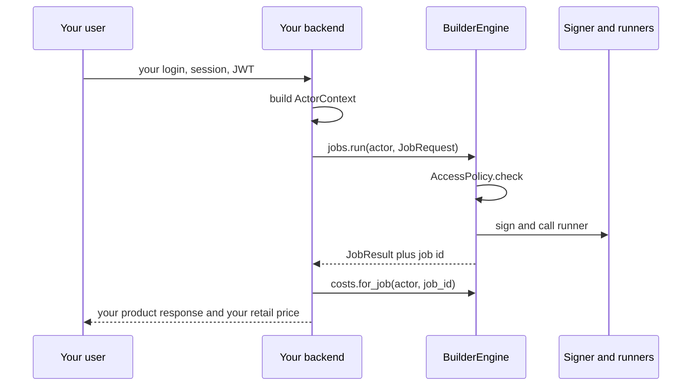

# Embedded mode

Your Python backend owns identity and calls the engine in-process. There is no HTTP hop and no
engine API key (`lpk_`). The REST service (`lpb serve`) is the other mode. Both hit the same
`BuilderEngine`. See [ARCHITECTURE.md](../../ARCHITECTURE.md#integration-modes).

Retail pricing, customer accounts and billing stay in your application. The engine reports wholesale
**network** cost.

## Install

```sh
pip install livepeer-builder
```

The `[server]` extra (FastAPI, uvicorn) is only for `lpb serve`. Embed does not need it. The
`[postgres]` extra is only if `LPB_DATABASE_URL` is PostgreSQL.

You still need the usual `LPB_*` settings: database, signer, Batteries tokens, and a secret key.
See [RELIABILITY.md](../RELIABILITY.md#configuration).

## The loop



Your app authenticates the human. The engine never sees that credential. It only sees an
`ActorContext` you constructed ([access.md](../contracts/access.md#actor-context), D12 in
[m2-decisions.md](../design-docs/m2-decisions.md)).

## 1. Construct and start the engine once

```python
from livepeer_builder import ActorContext, BuilderEngine, EngineSettings, JobRequest

engine = await BuilderEngine.from_settings(EngineSettings.from_env())
await engine.start()
```

`from_settings` wires the defaults: SQLite or PostgreSQL store, `DefaultPolicy`,
`ApiKeyAuthenticator` (present but unused on this path), signer discovery, SDK transport, Batteries,
and the encrypted secret store. Replace any of those at this call (`policy=`, `discovery_source=`,
`secret_store=`, …) as in [extending-the-engine.md](../design-docs/extending-the-engine.md).

`start()` recovers interrupted jobs, takes a discovery snapshot, then runs the background loops
(discovery refresh, cost sync, retention). Call `await engine.stop()` on shutdown. `stop()` is safe to call
twice and closes everything the engine opened; an engine is single-use, so after `stop()` create a new one.
If construction fails part-way, whatever it had already opened is closed before the error reaches you.

Public imports come from the package root: `BuilderEngine`, `EngineSettings`, contracts
(`ActorContext`, `JobRequest`, `Offering`, …), and errors (`NotProvisioned`, `JobFailed`, …).
Everything else is reached through the engine object.

## 2. You build the actor

```python
actor = ActorContext(
    actor_id="customer-42",
    application_id="default",
    permissions=frozenset({"discover", "jobs.run", "jobs.read", "costs.read"}),
)
```

That is the only identity the engine understands.

| Your app | `ActorContext` |
| --- | --- |
| Logged-in customer id | `actor_id` |
| Tenant / org | `application_id` |
| What this user may do | `permissions` (`discover`, `jobs.run`, `jobs.read`, `costs.read`) |
| Operator / admin desk | `credential_kind="admin"` |

You do **not** call `engine.authenticator`. Imported mode needs no authenticator
([access.md](../contracts/access.md#protocols)). `DefaultPolicy` still runs on every service call,
so a missing permission is `AccessDenied` even though you constructed the object.

The authenticator is still on the engine if you want it. You can issue `lpk_` keys via `engine.keys`
and later call `engine.authenticator.authenticate(AuthRequest(...))` yourself. That is optional.
This path skips it.

## 3. Provision before paid work

Jobs that hit the network spend from an allocation. An unprovisioned actor raises `NotProvisioned`
(HTTP 402 in service mode). Provisioning is an admin operation. There is no automatic provisioning
([payments.md](../contracts/payments.md)).

```python
from livepeer_builder import ActorContext, Money, ProvisionRequest

admin = ActorContext(actor_id="operator", credential_kind="admin")

await engine.payments.provision(
    admin,
    ProvisionRequest(
        application_id="default",
        actor_id="customer-42",
        amount=Money(amount="5", currency="USD"),
    ),
)
```

The payment key (`lpg_`) stays in the `SecretStore`. Your app never holds it. On each job the engine
resolves it and sends it to the signer. See [SECURITY.md](../SECURITY.md).

## 4. Call the services

The same methods the REST routes wrap:

```python
offerings = engine.discovery.offerings(actor)
runners = engine.discovery.runners(actor, "livepeer-example/echo")

result = await engine.jobs.run(
    actor,
    JobRequest(app="livepeer-example/echo", path="/echo", payload={"x": 1}),
)
# result.content, result.status_code, result.content_type, result.job.id

cost = await engine.costs.for_job(actor, result.job.id)
allowance = await engine.payments.allowance(actor)
```

`offerings` and `runners` still require the `discover` permission. Retail pricing stays in your app.
`cost` is wholesale network cost, and stays `pending` until Batteries reports the charge.

Failures are Python exceptions, not HTTP statuses:

| Exception | When |
| --- | --- |
| `AccessDenied` | The actor lacks the operation, or the resource belongs to someone else |
| `NotProvisioned` | No allocation for this actor |
| `JobFailed` | The job finished without a runner result (`job.failure` names the kind) |
| `NoCapacity` | No ready runner after selection |
| `OperationExists` / `OperationConflict` | The caller's `operation_ref` collided |

## 5. What you still run as an operator

Your process is the process that holds the engine. There is no separate `lpb serve`. You still:

- Set `LPB_DATABASE_URL`, `LPB_SIGNER_URL`, `LPB_BATTERIES_URL`, `LPB_BATTERIES_TOKEN`,
  `LPB_BATTERIES_OPERATOR_TOKEN`, and `LPB_SECRET_KEY` ([RELIABILITY.md](../RELIABILITY.md#configuration)).
- Run `lpb migrate`, or leave `LPB_AUTO_MIGRATE=true`.
- Run `lpb bootstrap-admin` only if you will use engine-issued admin keys. Embed can pass an
  in-process admin `ActorContext` instead, as above.
- Use `lpb backup`, `lpb verify`, `lpb restore`, and `lpb purge` as in
  [RELIABILITY.md](../RELIABILITY.md#operations).

Health is `engine.health()`, not `GET /readyz`.

## What is not in this path

- No FastAPI, no `/v1/offerings`, no `Authorization: Bearer lpk_...`
- No CORS, no `WWW-Authenticate`
- Your users never see an engine key. They talk to your app; your app talks to `engine.jobs`,
  `engine.costs`, and the other services
- `engine.authenticator` is wired but idle unless you choose to use it

## Design notes

- **D12.** Two small protocols: `Authenticator` and `AccessPolicy`. Imported mode builds
  `ActorContext` itself. The policy still applies.
- **Identity stops at your app.** No request field establishes identity in the engine. You map your
  session or token onto `actor_id` / `application_id` / `permissions`.
- **Payment keys never ride on records.** `lpg_` lives in a `SecretStore`; the database holds a
  `SecretRef`. Your handlers must not log or return it.
- **Replace adapters, not services.** Swap discovery, policy, secrets, or transport through
  `from_settings`. Do not subclass `JobService` or `PaymentsService`
  ([extending-the-engine.md](../design-docs/extending-the-engine.md)).

## Checklist

1. Install `livepeer-builder` (add `[postgres]` only if the store is PostgreSQL).
2. Set `LPB_*` and generate `LPB_SECRET_KEY` with `lpb gen-secret-key`.
3. Run `lpb migrate` (or rely on `auto_migrate`).
4. Construct `BuilderEngine.from_settings`, then `await engine.start()` once per process.
5. Map each authenticated user to an `ActorContext` with the permissions they need.
6. Provision that actor with an admin `ActorContext` before the first paid job.
7. Call `engine.discovery`, `engine.jobs`, `engine.costs`, `engine.payments` in your request
   handlers. Catch `EngineError` subclasses and map them to your own API.
8. Call `await engine.stop()` on shutdown. Back up the database and `LPB_SECRET_KEY` separately.
