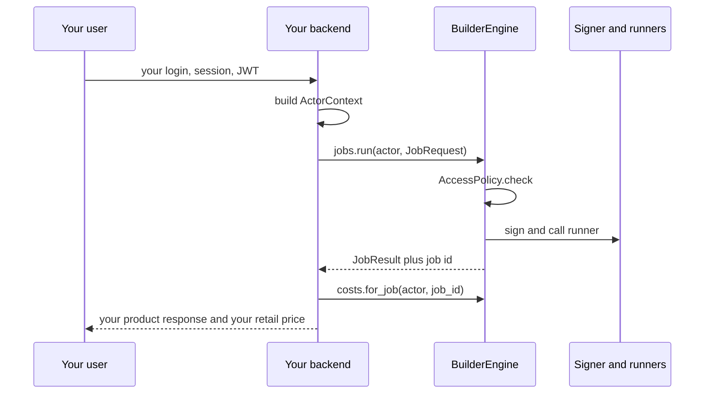

# Embedded mode

Your Python backend owns identity and calls the engine in-process. There is no HTTP hop and no
engine API key (`lpk_`). The REST service (`lpb serve`) is the other mode. Both hit the same
`BuilderEngine`. See [ARCHITECTURE.md](../../ARCHITECTURE.md#integration-modes).

Retail pricing, customer accounts and billing stay in your application. The engine reports wholesale
**network** cost.

## Install

```sh
pip install livepeer-builder
```

The `[server]` extra (FastAPI, uvicorn) is only for `lpb serve`. Embed does not need it. The
`[postgres]` extra is only if `LPB_DATABASE_URL` is PostgreSQL.

You still need the usual `LPB_*` settings: database, discovery URL, signer, Batteries tokens, and a secret key.
See [RELIABILITY.md](../RELIABILITY.md#configuration).

## The loop



Your app authenticates the human. The engine never sees that credential. It only sees an
`ActorContext` you constructed ([access.md](../contracts/access.md#actor-context), D12 in
[m2-decisions.md](../design-docs/m2-decisions.md)).

## 1. Construct and start the engine once

```python
from livepeer_builder import ActorContext, BuilderEngine, EngineSettings, JobRequest

engine = await BuilderEngine.create(EngineSettings.from_env())
await engine.start()
```

`create` wires the defaults: SQLite or PostgreSQL store, `DefaultPolicy`, engine API keys (present
but unused on this path), discovery from `LPB_DISCOVERY_URL`, SDK transport, Batteries, and the encrypted
secret store.
Settings are always passed in: read the environment with `EngineSettings.from_env()` at your edge, or
build `EngineSettings(...)` in code. To change a part, **supply** it (`supply=EngineSupply(store=...)`)
when other parts depend on it, or **decorate** the configured default
(`decorate=lambda parts: dataclasses.replace(parts, policy=MyPolicy(parts.policy))`), as in
[extending-the-engine.md](../design-docs/extending-the-engine.md). Scripts and tests can use
`async with engine:`, which starts on entry and stops on exit.

`start()` recovers interrupted jobs, takes a discovery snapshot, then runs the background loops
(discovery refresh, cost sync, retention). Call `await engine.stop()` on shutdown. `stop()` is safe to call
twice and closes everything the engine opened; an engine is single-use, so after `stop()` create a new one.
A second `start()` on a running engine raises `RuntimeError` and changes nothing: the loops run once
(#113, C27). The REST app's lifespan is such a second start: `create_app(engine)` on an engine you
already started fails at startup and leaves the engine running. To serve an engine you start and stop
yourself, pass `create_app(engine, manage_lifecycle=False)`; the error says so too.
If construction fails part-way, whatever it had already opened is closed before the error reaches you. So
is a failed `start()` (a store error, or a cancellation): the engine stops, which also covers
`async with engine:`, whose exit does not run when entry fails.

Public imports come from the package root: `BuilderEngine`, `EngineSettings`, the construction types
(`EngineSupply`, `EngineParts`, `ApiKeys`, `UNSET`), contracts
(`ActorContext`, `JobRequest`, `Offering`, …), and errors (`NotProvisioned`, `JobFailed`, …).
Everything else is reached through the engine object.

## 2. You build the actor

```python
actor = ActorContext(
    actor_id="customer-42",
    tenant_id="default",
    permissions=frozenset({"discover", "jobs.run", "jobs.read", "costs.read"}),
)
```

That is the only identity the engine understands.

| Your app | `ActorContext` |
| --- | --- |
| Logged-in customer id | `actor_id` |
| Tenant / org | `tenant_id`: your tenant's id, which is the id of its grant ([step 3](#3-allot-before-paid-work)) |
| What this user may do | `permissions` (`discover`, `jobs.run`, `jobs.read`, `costs.read`) |
| Operator / admin desk | `credential_kind="clearinghouse_admin"` |

You do **not** call `engine.authenticator`. Imported mode needs no authenticator
([access.md](../contracts/access.md#protocols)). `DefaultPolicy` still runs on every service call,
so a missing permission is `AccessDenied` even though you constructed the object.

The authenticator is still on the engine if you want it. You can issue `lpk_` keys via `engine.keys`
and later call `engine.authenticator.authenticate(AuthRequest(...))` yourself. That is optional.
This path skips it.

## 3. Allot before paid work

Jobs that hit the network spend from an allocation. A job for an actor with no allocation fails with
`JobFailed` (`job.failure.kind == "not_provisioned"`; HTTP 402 in service mode). Allotment is an admin operation. There is no automatic allotment
([payments.md](../contracts/payments.md)).

An allocation is allotted from its tenant's grant, and a tenant's id is its grant's id
([payments.md](../contracts/payments.md#tenants)). So the `tenant_id` you allot under, and the one in
each `ActorContext`, is that id. Onboard the tenant once (`engine.payments.tenants.onboard(admin, name,
amount, operation_ref=...)`, which needs `LPB_BATTERIES_GRANTS_TOKEN`) and keep the `tenant_id` it
answers with, or use the id of a grant you created at Batteries yourself.

```python
from livepeer_builder import ActorContext, AllotRequest, Money

admin = ActorContext(actor_id="operator", credential_kind="clearinghouse_admin")

await engine.payments.allot(
    admin,
    AllotRequest(
        tenant_id="<your tenant id>",  # the grant's id: the allocation is allotted from that grant
        actor_id="customer-42",
        amount=Money(amount="5", currency="USD"),
        operation_ref="allot-customer-42",  # required: a repeat is answered, never applied twice
    ),
)
```

The payment key (`lpg_`) stays in the `SecretStore`. Your app never holds it. On each job the engine
resolves it and sends it to the signer. See [SECURITY.md](../SECURITY.md).

**With a payment clearinghouse** the code above is the same, and the settings differ (D84, #169). The
engine is in its `work` role: `LPB_ROLE=work`, with `LPB_CLEARINGHOUSE_URL`, `LPB_CLEARINGHOUSE_TOKEN`
and `LPB_CLEARINGHOUSE_TENANT_ID` from what the clearinghouse admin handed over at onboarding, and no
Batteries or signer setting ([RELIABILITY.md](../RELIABILITY.md#roles)). The tenant is onboarded at the
clearinghouse, not here, and its id is the `tenant_id` of every actor. `engine.payments.allot` then
takes the amount from the tenant's grant at the clearinghouse and keeps the payment key the
clearinghouse issues for the actor (`lpp_`) in your `SecretStore`; each job is signed there with it
([payments.md](../contracts/payments.md#the-remote-adapters)). Allot through the engine: an allocation
made at the clearinghouse directly gives your engine no payment key.

## 4. Call the services

The same methods the REST routes wrap:

```python
offerings = engine.discovery.offerings()  # public: no actor
runners = engine.discovery.runners(actor, "livepeer-example/echo")

result = await engine.jobs.run(
    actor,
    JobRequest(app="livepeer-example/echo", path="/echo", payload={"x": 1}),
)
# result.content, result.status_code, result.content_type, result.job.id

cost = await engine.costs.for_job(actor, result.job.id)
allowance = await engine.payments.allowance(actor)
```

`offerings` is public and takes no actor; `runners` still requires the `discover` permission. Retail
pricing stays in your app.
`cost` is wholesale network cost, and stays `pending` until Batteries reports the charge.

Failures are Python exceptions, not HTTP statuses:

| Exception | When |
| --- | --- |
| `AccessDenied` | The actor lacks the operation, or the resource belongs to someone else |
| `JobFailed` | The job finished without a runner result; `job.failure.kind` names why (`not_provisioned`, `no_offering`, `refused`, `timeout`, …) |
| `NoCapacity` | The engine or the app is at its concurrent-job limit (before any payment) |
| `OperationExists` / `OperationConflict` | The caller's `operation_ref` was used before: by a job that ran (read `exc.job`), or with another request. `OperationInProgress`, an `OperationExists`, means that job still runs: ask again shortly. A job that failed before any runner accepted the work is dispatched again instead ([rules](../contracts/engine.md#idempotency)) |

## Type against the role you use, and test without a network

Depend on the narrowest Protocol your code uses, not on `BuilderEngine`
([livepeer_builder.api](../../src/livepeer_builder/api.py)): `ActorApi` to run jobs and read their
results, costs and catalog; `WorkApi` when you also manage the engine's access keys, reconcile or
sync costs; `ClearinghouseApi` for tenants, allotment and top-ups; `EngineApi` for all of it.

```python
from livepeer_builder import ActorApi, ActorContext, JobRequest


async def answer(engine: ActorApi, actor: ActorContext, prompt: dict[str, str]) -> bytes:
    streaming = engine.jobs.streaming  # None when the transport cannot stream
    if streaming is None:
        return (await engine.jobs.run(actor, JobRequest(app="chat/llm", payload=prompt))).content
    async with await streaming.stream(actor, JobRequest(app="chat/llm", payload=prompt)) as stream:
        return b"".join([chunk async for chunk in stream])
```

Optional capabilities are `X | None` members: `jobs.streaming`, `keys` on `WorkApi`, and
`payments.tenants` on `ClearinghouseApi`. Check for `None`; do not probe with `hasattr`.

Two test doubles ship in `livepeer_builder.testing`, and a contract test keeps them in step:

- **`FakeEngine`** for your unit tests: it implements `ActorApi` and records `jobs.requests`. It
  answers per `(app, path)` with `Reply(...)` (a body, its parsed `data`, stream chunks), `Fails(...)`
  (`JobFailed`, paid or not; among stream chunks, a failure part-way that leaves the job `uncertain`) or
  `Raises(error)` (an engine error such as `NoCapacity`; also accepted as a job's cost). Like the
  engine, it records an attempt on the first runner for the app, ends a stream once (read to the end
  or `complete()`: `succeeded`; `aclose()`, `break`, `return` or an error: `abandoned`; a cancellation:
  the runner's settle window, as on the engine), and rejects a repeated
  `operation_ref` and a path with no leading `/`. It does not model admission, failover or payment.
- **`make_engine(...)`** for integration tests: a real engine over in-memory SQLite and the shipped port
  fakes (`async with make_engine(runners=[...]) as engine:`). Its `FakeAllocationManager` holds a grant
  for the tenant `default`, so that tenant's actors can be allotted. For another tenant, supply a manager
  of your own (`manager.add_grant("<tenant id>")`, then `EngineSupply(allocation_manager=manager,
  grants_manager=manager)`), or onboard the tenant. The fake refuses as Batteries does: an unknown grant
  is its 404, and an allocation or a top-up larger than the grant's unallocated balance its 409.
  `payments.allot` stores the actor's payment key in the engine's `SecretStore` and answers the
  allocation (`ActorAllocation`, with `credential_custody: secret_store`). `payments.allot_for_delivery`
  is what a standalone clearinghouse calls: it hands the key to the caller once, in a
  `DeliveredAllocation`, and stores none, so an engine that runs the actor's jobs itself never calls it
  ([payments.md](../contracts/payments.md#payment-keys)).

## 5. What you still run as an operator

Your process is the process that holds the engine. There is no separate `lpb serve`. You still:

- Set `LPB_DATABASE_URL`, `LPB_DISCOVERY_URL` (required: the engine does not start without it),
  `LPB_SIGNER_URL`, `LPB_BATTERIES_URL`, `LPB_BATTERIES_TOKEN` and `LPB_SECRET_KEY` ([RELIABILITY.md](../RELIABILITY.md#configuration)), or pass the same values as an
  `EngineSettings`. `LPB_BATTERIES_GRANTS_TOKEN` only turns on the tenant desk
  (`engine.payments.tenants`); an application that never onboards or lists tenants leaves it unset.
- Run `lpb migrate`, or leave `LPB_AUTO_MIGRATE=true`.
- Run `lpb bootstrap-admin` only if you will use engine-issued admin keys. Embed can pass an
  in-process admin `ActorContext` instead, as above.
- Use `lpb backup`, `lpb verify`, `lpb restore`, and `lpb purge` as in
  [RELIABILITY.md](../RELIABILITY.md#operations).

Health is `engine.health()`, not `GET /readyz`.

## What is not in this path

- No FastAPI, no `/v1/offerings`, no `Authorization: Bearer lpk_...`
- No CORS, no `WWW-Authenticate`
- Your users never see an engine key. They talk to your app; your app talks to `engine.jobs`,
  `engine.costs`, and the other services
- `engine.authenticator` is wired but idle unless you choose to use it

## Design notes

- **D12.** Two small protocols: `Authenticator` and `AccessPolicy`. Imported mode builds
  `ActorContext` itself. The policy still applies.
- **Identity stops at your app.** No request field establishes identity in the engine. You map your
  session or token onto `actor_id` / `tenant_id` / `permissions`.
- **Payment keys never ride on records.** `lpg_` lives in a `SecretStore`; the database holds a
  `SecretRef`. Your handlers must not log or return it.
- **Replace adapters, not services.** Supply or decorate discovery, policy, secrets, or transport
  through `BuilderEngine.create`. Do not subclass `JobService` or `PaymentsService`
  ([extending-the-engine.md](../design-docs/extending-the-engine.md)).

## Checklist

1. Install `livepeer-builder` (add `[postgres]` only if the store is PostgreSQL).
2. Set `LPB_*` and generate `LPB_SECRET_KEY` with `lpb gen-secret-key`.
3. Run `lpb migrate` (or rely on `auto_migrate`).
4. Construct `BuilderEngine.create(settings)`, then `await engine.start()` once per process.
5. Map each authenticated user to an `ActorContext` with the permissions they need.
6. Allot an allocation to that actor with an admin `ActorContext` before the first paid job.
7. Call `engine.discovery`, `engine.jobs`, `engine.costs`, `engine.payments` in your request
   handlers. Catch `EngineError` subclasses and map them to your own API.
8. Call `await engine.stop()` on shutdown. Back up the database and `LPB_SECRET_KEY` separately.
